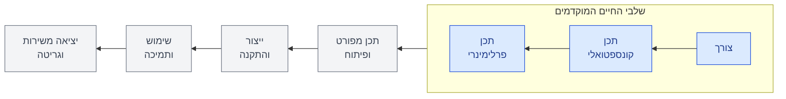
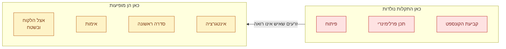
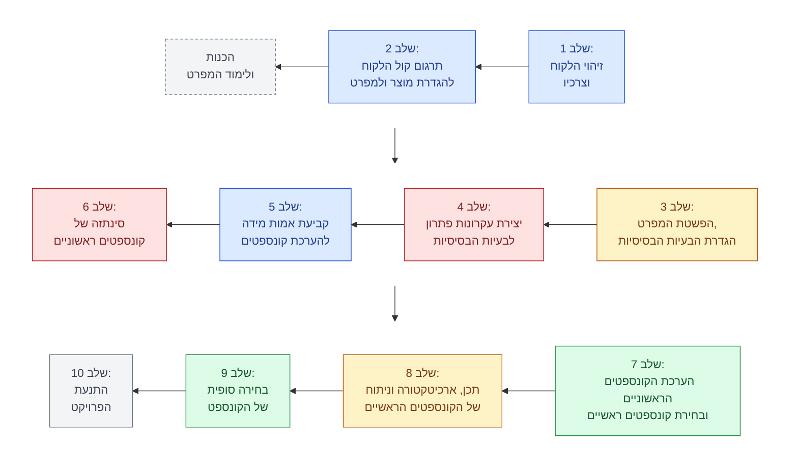
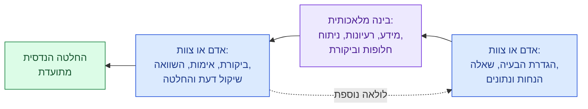

# פרק 1: מבוא, השיטה וצורכי הלקוח (חלק א)

> מפגש 1, יום ג', 3 בנובמבר 2026
>
> כל הזכויות על תוכן הקורס שמורות לד"ר עמיהוד הרי. התוכן מתפרסם כאן באישורו ואינו חלק מרישיון MIT של המאגר.
>
> לפרטים על הספר ועל אופן כתיבתו: [על הספר](../README.md)
>
> בפרק הזה: איך לומדים בקורס, מחזור החיים של מערכת, למה ההחלטות המוקדמות קובעות, שלושה סוגי תכן, עשרת השלבים של שיטת ICDM, אדם ובינה מלאכותית בתכן, ותחילת השלב הראשון: מי הלקוח ומה הוא צריך.
>
> המצגת: [שקפי המפגש](slides.md)

## על מה דיברנו

שמי עמי הרי, ואני המרצה שלכם בקורס תכן הנדסי מערכתי מתקדם 1 ו-2. אלה בעצם קורס אחד: אנחנו הולכים לבלות שנה ביחד, ובאיזשהו מקום נעצור ונעבור לסמסטר הבא.

הקורס הזה עומד כבר כעשרים שנה, והתורה שהוא מלמד ותיקה. אבל בשנה-שנתיים האחרונות עובר עליה מהפך. הבינה המלאכותית משנה לפחות את ה"איך", אם לא את ה"מה". אני מניח שה"מה" יישמר, והוא מהות הקורס: תכן הנדסי. ה-AI הוא לא מהות הקורס. לא ננסה לכפות עליכם שיטות שעברו מהעולם, ואנחנו מצפים שתיעזרו גם ב-AI. הקורס ידוע ככבד השקעה; יש תקווה שהשנה הוא יהיה לכם קל יותר, אבל כנראה יהיו בעיות אחרות.

לכן הזמנתי למפגש הראשון אורח מהתעשייה, שהתנסה במעבר ממה לאיך. הוא אמר לנו משפט שכדאי לזכור: כל התיאוריות שתלמדו כאן נשארות בתוקף, שום דבר לא יישבר; פשוט אפשר לעשות את זה באמצעים חזקים יותר.

במפגש הראשון עברנו על מבנה הקורס ועל הדרך שבה לומדים בו. הצגתי את מחזור החיים של מערכת, את הסיבה שההחלטות המוקדמות קובעות כמעט הכול, ואת השיטה שתלווה אותנו כל השנה. אחרי ההפסקה התחלנו את השלב הראשון שלה, זיהוי הלקוח וצרכיו, והגענו עד סוגי התרחישים. השעה השלישית הוקדשה להקמת הצוותים.

> **הערת עורך:** הפרק נכתב מהקלטת שתי השעות הראשונות ומשקפי המפגש. השעה השלישית, הקמת הצוותים, לא הוקלטה.

## הקורס ואיך לומדים בו

### תכן לומדים על ידי תכן

עקרון ההוראה בקורס הוא למידה פעילה (Action Learning): מתרגלים את המתודולוגיות על פרויקט תכן מקורי. שחייה והנדסה, וגם ריקוד, אפשר ללמוד רק בעשייה. ואם אתם גם מלמדים אחרים, הכי טוב. לכן השעה השלישית בכל מפגש היא שלכם, ובה אתם מלמדים.

| סוג הלמידה | דרכי הלמידה, לפי הסדר בשקף |
|---|---|
| למידה סבילה | הרצאה, קריאה, אמצעים אור-קוליים, הדגמה |
| למידה פעילה | קבוצת דיון, תרגול בעשייה, ללמד אחרים או שימוש מיידי |

לצד הקונוס בשקף יש חץ, ועליו כתוב: ההשקעה הנדרשת מהתלמיד. זה החץ העגום. ככל שהלמידה טובה יותר, גם ההשקעה הנדרשת גדולה יותר.

ובשקף שתי שאלות שאין לי עליהן עדיין תשובה מלאה: איך משפיעה הלמידה מרחוק, ואיך משפיע השימוש ב-AI? מה זה לתרגל כשאתה בזום? אנחנו רואים מה קורה לילדים שלומדים בזום. ומה זה לתרגל כשה-AI עושה את זה בשבילך?

האורח שלנו מהתעשייה הוסיף כאן נקודה חשובה. ה-AI יחסוך לכם עבודה, אבל כנראה יעשה אותה לא טוב אם אתם לא מומחים במה שהוא עושה. צריך להיות מומחה כדי לכוון אותו, וכדי לבדוק את מה שהוא מחזיר. אז איך עושים אתכם מומחים כשה-AI עושה את העבודה? זה האתגר שאנחנו מביאים לקורס הזה.

> **הערת עורך:** בשקף המקורי הופיעו גם אחוזים לכל דרך למידה. האחוזים האלה מגיעים מ"פירמידת הלמידה" הנפוצה, ואין להם מקור מחקרי ידוע. ב"קונוס הניסיון" המקורי של אדגר דייל, משנת 1946, לא היו מספרים כלל. לכן הטבלה כאן מציגה רק את הסדר, בלי אחוזים. המקור שבשקף: Janoska, 2017.

### מבנה הקורס

- שלושה-עשר מפגשים, שלוש שעות כל אחד. התוכן: מתודולוגיות לשלבי התכן המוקדמים.
- בערך שעתיים בכל מפגש אני מרצה, מדגים ומנחה. השעה השלישית שלכם: התקדמות בפרויקט והערכה אישית, ובכל שבוע צוות אחר מציג בה.
- בשבוע הראשון מקימים צוותים ובוחרים פרויקט תרגול. זה פרויקט מתגלגל: אותו פרויקט כל השנה.
- בשבוע האחרון כל צוות מציג את עבודתו לכיתה ולאורחים, ומגיש אותה.

המפגש האחרון בנוי כמו הצגה למשקיעים: האם אתם יודעים הנדסת מערכות, האם הפרויקט טוב, האם הוא מוגדר נכון. אפשר להזמין אורחים: חברים מהעבודה, בני משפחה, וגם ילדים מעל גיל 12, בגיל שבו מתחיל לעניין אותם לייצר ולהמציא.

תוכנית, כמו שתמיד אמרו בצבא, היא בסיס לשינויים. הקצב משתנה ממחזור למחזור, ומה שלא ייכנס כאן ימשיך בקורס ההמשך. הקובע הוא קובץ ההנחיות של הקורס, לא השקפים.

## מחזור החיים של מערכת

תהליך תכן מתחיל בזה שמזהים שמישהו צריך משהו. מחזור החיים של מערכת נמשך מהצורך ועד הגריטה, כפי שמתארים אותו בלנשרד ופבריצקי (Blanchard & Fabrycky). שלושת השלבים הראשונים הם שלבי החיים המוקדמים, והם הלב של הקורס. בערך השליש הראשון של הקורס עוסק בצורך.

| שלב מוקדם | מה עושים בו | מילת המפתח |
|---|---|---|
| צורך והגדרה | מתרגמים את צורכי הלקוח למפרט כמותי ברמה גבוהה: אוסף דרישות שיוצר מענה לצורך | מזהים |
| תכן קונספטואלי | יוצרים חלופות, מעריכים אותן ובוחרים את המתאימה ביותר | יוצרים |
| תכן פרלימינרי | מגדירים ארכיטקטורה, רכיבים וממשקים; מנתחים ביצועים, לוח זמנים ועלות; בוחרים את החלופה שתלך לתכן המפורט | משקיעים |

בשלב הקונספטואלי המילה החשובה ביותר היא "יוצרים". עם AI אין כמעט גבול לכמה חלופות אפשר לייצר. להגדיר חלופות זה צ'יק צ'אק; לבנות מהן תמונה קונספטואלית ולשאול אם היא טובה, ועד כמה, כבר דורש קצת יותר.

בשלב הפרלימינרי משקיעים קצת יותר במועמדים המבטיחים: ארכיטקטורה, ממשקים, מרכיבים, כמה זה עולה, כמה זה מתקלקל. ובדרך כלל מגלים בדרך שיש עוד חלופה אחת, שלוקחת את הטוב מכולן.

## ההחלטות המוקדמות קובעות

השקף הזה ותיק מאוד. הוא לא נולד ב-2004, רק צוטט במאמר שלנו מאותה שנה; הרעיון מסתובב בעולם עוד מאז מלחמת העולם השנייה. שימו לב שציר הזמן בו אינו ליניארי. הגדרת המוצר לוקחת ימים עד שבועות. התכן הקונספטואלי והפרלימינרי לוקחים שבועות עד חודשים. והפיתוח המלא? כשהייתי צעיר, חמש-עשרה שנים. היום, תלוי.

מחויבות פירושה עד כמה קשרתם לעצמכם את הידיים: בעלות, בתקלות ובביצועים.

| בסוף השלב | חלק העלות שכבר נקבע | משך אופייני |
|---|---|---|
| הגדרת המוצר | כמחצית | ימים עד שבועות |
| תכן קונספטואלי ופרלימינרי | כשלושה רבעים | שבועות עד חודשים |
| פיתוח מלא | כ-90% | שנים |

בשלבים האלה נוצרים הביצועים, ננעלת עלות מחזור החיים (LCC) ונוצרים אופני הכשל. התקלות עצמן מופיעות רק מאוחר יותר: בפיתוח המלא, בייצור ובתפעול.

המספרים לא קדושים. אבל אחרי הקונספט והפרלימינרי, כשלושה רבעים מהעלות כבר תקועים, ונשאר לכם לשחק ברבע הנותר, אלא אם כן תחזרו אל הדרישות. לכן פרויקטים להורדת עלות באים אחרי הפיתוח, ותמיד עם אותה בקשה: אל תיגע לי בקונספט, כי אז צריך לעשות את כל הפיתוח מחדש.

ומה עם התקלות? הן נולדות בקביעת הקונספט, או לכל היותר בפרלימינרי, או לכל היותר-היותר בפיתוח. אבל הן לא מופיעות שם. זרענו את התקלות, ואנחנו לא יודעים. ולא יכולים לדעת.

מתי בפעם הראשונה אתם אומרים "לעזאזל, עשיתי תכנון לא טוב"? באינטגרציה, בשלהי הפיתוח. מתחילים להרכיב, ואומרים: הייתי צריך לעשות אחרת. ויש עוד מוקש בדרך, בתחילת הייצור. הקמתם קו ייצור, הרצתם את הסדרה הראשונה, ומישהו שואל: מי האידיוט שתכנן את זה?

ומכאן האתגר למי שבא להציע מתודולוגיה לתכן מוקדם: תביא לי משהו שיעזור לי לזהות את התקלות כשאני עושה אותן, ולא שאצטרך לחזור אחר כך ולשנות את כל התכן כדי להתגבר עליהן, או לייקר אותו.

## מה מאפיין את השלבים המוקדמים

זה שלב שנראה מאוד סקסי. הכי כיף להמציא פתרונות, ולכל אחד יש את הרגע שבו היצירתיות מתפרצת: במקלחת, בלילה, במשחק עם הילדים. אבל השקף מונה שלושה קשיים:

1. החיפוש אחר פתרון: האם יש פתרון בכלל? יש כיוונים רבים, אבל האם הם יעבדו? מאיפה להתחיל?
2. עבודה בתנאי לחץ ואי ודאות, של זמן ושל כסף.
3. קבלת החלטות חשובות על סמך מידע עמום.

הלחץ מגיע גם מאי האמון של ההנהלה. המספר שמסתובב בעולם, ולא בדקתי אם הוא נכון, הוא בערך אחד לעשרה: מתוך עשרה פרויקטים שמתחילים פיתוח, אחד נגמר ותשעה הולכים לפח. ההנהלה יודעת את זה ומחשבנת את זה, ולכן היא קצת קמצנית. והיא גם ממהרת: הפיתוח תמיד תחת לחץ של זמן לשוק, בואו נהיה ראשונים, המתחרים כבר הופיעו.

> **הערת עורך:** המספר "אחד לעשרה" מובא כפי שנאמר, וכמו שהמרצה עצמו ציין, הוא לא נבדק. שיעורי ההצלחה שמדווחים בספרות משתנים מאוד לפי הענף ולפי ההגדרה של "הצלחה".

ובשלב הקונספטואלי, מה יש לכם ביד? כמה סקיצות. אין פרטי תכן, לא עשיתם אף אנליזה, ואתם צריכים לקבל את ההחלטות הכי חשובות: על הקונספט, על איך זה יעבוד. אתם עושים את זה כשאתם יודעים מעט מאוד. המון אינטואיציה, וגם פוליטיקה: אם המומחה לתחום חזק במנהיגותו, הוא יצעק וידפוק על השולחן, ובסוף יקבל מה שהוא רוצה. מה לזה ולתכן מקצועי?

## שלושה סוגי תכן

פאל ובייץ (Pahl & Beitz), ששמם יחזור שוב ושוב, הם אבות התורה של התכן ההנדסי. הם הוציאו את המהדורה הראשונה של תורת התכן, והספרים שלהם עדיין מתורגמים ומתעדכנים. הם אמרו שיש שלושה סוגי תכן:

| סוג התכן | מה משתנה | דוגמה |
|---|---|---|
| תכן וריאנטי | שינויים קטנים במוצר קיים; הקונספט לא משתנה | השינויים ההדרגתיים שכל חברה עושה במוצר שלה |
| תכן התאמה (שדרוג) | התאמת מוצר קיים לצורך חדש: משנים, לפעמים לגמרי, את עקרון הפתרון של אחת הפונקציות | מעבר ממכונית עם מנוע בנזין למכונית חשמלית |
| תכן מקורי | מוצר חדש לצורך חדש, או לצורך ישן בטכנולוגיה חדשה | הפרויקט שלכם בקורס |

בשקף הגופן גדל מלמעלה למטה, ולא במקרה: ככל שהגופן גדול יותר, יש יותר מתודולוגיה ויותר מרכיבים בתהליך התכן. במכונית החשמלית השינוי הוא אפילו קונספטואלי, אבל בפונקציה אחת; המכונית נראית אותו דבר ונוהגים בה אותו דבר. בתכן וריאנטי יש דברים שאפשר לדלג עליהם או לעשות מהר, כי הם טריוויאליים: הקונספט לא השתנה.

כדי ללמוד תכן, נתרגל תכן מקורי. אני מבקש שהפרויקטים שלכם יהיו מקוריים: שאין כזה. מי שיודע לעשות טוב תכן מקורי, יודע לקצר ולצמצם כשהוא עושה שדרוג או וריאנט; הוא לא חייב להשתמש בכל המתודולוגיה.

ומניסיוני, שהוא כבר די רב, לא כל אחד זוכה לעשות תכן מקורי בחיים. אשרי מי שזכה. זה הכי קשה, אבל הסיפוק והלמידה הם גולת הכותרת של חיינו כמתכננים. בדרך כלל לוקחים את זה אלה שיושבים ליד המנכ"ל ובאים עם הרעיון, ולא נותנים את זה למהנדסים זוטרים שלא יודעים לצעוק חזק.

## שיטת ICDM: עשרה שלבים לתכן מקורי

תכן מקורי בשיטה שלנו נראה כך. נקרא לו ICDM, קיצור של Integrated Methodology for the Conceptual Design of New Systems. עשרת השלבים שלו הם גם תוכנית הקורס.

- שלב 1, זיהוי הלקוח וצרכיו: מי הלקוח ומה הוא צריך. בו עוסק החלק השני של הפרק.
- שלב 2: מתרגמים את קול הלקוח הטהור להגדרת מוצר ולמפרט. כאן עוברים מדיבור של צרכים לדיבור של מאפיינים.
- הכנות ולימוד המפרט, ואחריהן שלב 3: מתחילים לשאול מה המערכת צריכה לדעת לעשות, ומחפשים את הבעיות הבסיסיות. הן היסוד של כל התהליך היצירתי. אפשר לסכם את כל מה שהמערכת צריכה לעשות בכעשר שאלות: איך מספקים אנרגיה, איך מספקים כוח, איך מייצרים תאוצה, וכך הלאה. יש מי שקורא לזה ניתוח פונקציונלי, אבל זו רק אחת השיטות לעשות את זה.
- שלב 4, השלב היצירתי הראשון: יצירתיות ברמת הבעיה הבסיסית. אם שאלתי איך לספק אנרגיה, תביאו לי רעיונות לספק אנרגיה. וזו רק פונקציה אחת.
- שלב 5: לפני שממציאים קונספטים, קובעים לפי אילו אמות מידה נעריך אותם. הן באות מהצרכים ומהמפרט, ולכן הן בצבע שלהם. הסדר הזה חשוב, כי יש כאן בעיה אנושית: אם אראה את הקונספטים לפני העיניים, לא אעשה טוב את אמות המידה.
- שלב 6: סינתזה, או בעברית טובה, מיזוג. קונספט נולד כשממזגים עקרונות פתרון לכל הבעיות הבסיסיות: איך אספק אנרגיה, איך אבלום, איך אמצא כיוון, איך אתאים לנהג. ארבע בעיות בסיסיות, לכל אחת מבחר פתרונות, ומכל צירוף נולד קונספט. למזג קונספטים קל מאוד, ואפשר לייצר המון גם בלי AI. מי שיש לו AI יכול לייצר המון-המון.
- שלב 7: מעריכים את הקונספטים הראשוניים, כולל השאלה מי מהם שטויות, ובוחרים את הקונספטים הראשיים: המעטים שכדאי להתאמץ בשבילם קצת יותר. את כל היתר זורקים. לכן המעבר משלב 6 לשלב 7 קריטי מאוד.
- שלב 8, השלב הפרלימינרי: לוקחים את המעטים המבטיחים, עושים להם ארכיטקטורה, ניתוחים ועלויות, שואלים איך נייצר ואיך נבדוק, עד שמצטבר מספיק מידע.
- שלב 9: בוחרים מבין המעטים את האחד שילך לתכן המפורט.
- שלב 10, התנעת הפרויקט: מקימים צוות ומייצרים פרויקט. רוב האנשים מגויסים לפרויקט רק בשלב הזה. עד שלב 10 עובדת קבוצה קטנה יחסית, מעט אנשים מכל דיסציפלינה, ובדרך כלל רוצים שהכול יקרה מהר מאוד.

### שלושה אופני חשיבה בבת אחת

ולמה צבעים? כי יש כאן שלושה אופני חשיבה. בשלבים המתקדמים של פרויקט אפשר לחלק את העבודה: יש את החכם של הפרויקט שיושב ליד ראש הפרויקט, ויש מי שיודע לעשות אנליזות. בשלבים הקונספטואליים אין את זה. שלושת אופני העבודה נדרשים בו-זמנית, ואלה הצבעים בשקף.

| צבע בשקף | אופן החשיבה | שלבים |
|---|---|---|
| כחול | שיטתי וכמותי: כשכותבים דרישות, חייבים לכתוב את כולן, לכתוב נכון ולא לשכוח | שלבים 1, 2 ו-5 |
| אדום | יצירתי | שלבים 4 ו-6 |
| ירוק | אנליטי: כל פעם צריך לשבת ולחשב | שלבים 7 ו-9 |
| משולב | כמה אופני חשיבה יחד | שלבים 3 ו-8 |

אומרים שאנליטיות ויצירתיות מקלקלות אחת את השנייה. ככל שאתה יותר אנליטי, אתה פחות יצירתי, וככל שאתה יותר יצירתי, אתה בורח מאנליזה. בשלב הקונספטואלי צריך להיות שניהם באותו זמן. זה האתגר.

## אדם, בינה, אדם

השקף הזה הוא יציאה ידי חובה ראשונית בפגישה שלנו עם ה-AI. את המושג למדתי מהאורח שלנו; אני לא בטוח שכך הוא קרא לו, ואנחנו נקרא לו פשוט "אדם, בינה, אדם". זה מודל העבודה של אדם עם AI בתכן, ואפשר לומר שזה האטום של מודל העבודה: לולאה.

האדם פותח. הוא מגדיר את הבעיה ואת הדרישות, אומר לאן ללכת לחפש חומר, מלמד את ה-AI ושואל אותו את השאלות. ה-AI מעבד את החומר, ובעיקר מייצר הרבה רעיונות והרבה אנליזות; גם ביקורת הוא יודע לעשות. ואז הוא מחזיר לאדם, כדי שישפוט ויחליט. זו יכולה להיות לולאה אחת, אבל אפשר הרבה לולאות. במעט שהתנסיתי, זה אף פעם לא נגמר לי בלולאה אחת.

מה ה-AI תורם? מהירות, בסדר גודל; כמות; אימות של איכות ודיוק; ועקיבות.

האורח שלנו הוסיף שלזה קוראים Human in the Loop. חשוב מאוד שהאדם הוא זה שמכניס את הקלט ל-AI, אבל הוא גם חותם על הפלט. ולא משנה כמה לולאות עושים, הסכנה הגדולה ביותר היא שהאדם יתמכר, והתוצר יהפוך להיות של ה-AI ולא של האדם.

ומכאן השורה האדומה בתחתית השקף: האחריות לתכן ולהחלטה בידי צוות התכן. כלל הזהב: ה-AI לא מקבל החלטות הנדסיות במקום הצוות. אין "AI ואז החלטה"; תמיד AI, ביקורת אנושית, ורק אז החלטה.

תפנימו את זה גם לחיים וגם לקורס. אמירה כמו "ה-AI אמר" או "קיבלתי מה-AI" לא אומרת כלום. אולי הוא צדק, אולי טעה, ואולי מה שאמרתם לו זה לא מה שהתכוונתם שיוציא. צריך להעביר ביקורת, והאחריות עליכם, על הצוות. כמו שהיה פעם; רק שפעם לא היה AI שעושה את כל העבודה השחורה באמצע.

פעם, ההבדל בין שלוש חלופות לחמש היה כ-40% בעלות הפיתוח, כי כל חלופה נוספת עולה. היום זה השתנה, ואפשר לבקש הרבה חלופות, בזול ומהר. הרבה. טוב או לא? אולי.

## מדען או אמן?

לפני המפגש שלחתי לכם לקריאה את Systems Engineering in 45 Minutes של מרטן בונמה (Maarten Bonnema). הוא מעלה דילמה שתלווה אתכם כל החיים: האם אתם מדענים או אמנים? זה מבוא מצוין לשלב הקונספטואלי, שבו היצירתיות היא די אמנות. יש על זה ויכוח בלי סוף, גם בשאלה אם ללמד הנדסת מערכות, או חשיבה מערכתית, כבר בתואר הראשון. רציתי שתבואו לקורס עם ההתלבטות, כי אין שם תשובה. אבל יש חומר למחשבה.

בכיתה העירו שעם הניסיון היצירתיות מתייבשת, והפתרונות נשארים במסגרת שאתה כבר מכיר. אולי. זכיתי לעבוד חלק ניכר מחיי ברפאל, ופגשתי שם כמה אנשים שגם כשהיו מבוגרים, נשארו יצירתיים מאוד. בודדים. בדרך כלל אלה אנשים שונים: יש מי שמייצרים רעיונות, ויש מי שיודעים לבנות מערכת. אבל אתם מהנדסים, ואתם צריכים להיות שניהם.

## השלב הראשון: זיהוי הלקוח וצרכיו

אחרי ההפסקה התחלנו את השלב הראשון של ICDM. מכאן ועד סוף הפרק, כל מה שנאמר שייך לשלב הזה.

### הצרכים לא באים מעצמם

הצרכים לא באים. צריך ללכת להביא אותם. אתם לא מקבלים אותם; אתם הולכים למערה וחופרים. זו עבודה אקטיבית, לא פסיבית, וזו המשימה הראשונה שלכם.

בכיתה שאלו אם אני מבחין בין צרכים לבין דרישות. את המילה "דרישה" עוד לא הגדרתי. נגיע אליה בשלב 2.

קחו לדוגמה אריזה לתרופה אנטיביוטית. השאלה הראשונה היא לא מה הצרכים, אלא את מי לשאול. את קולו של מי צריך לשמוע לקראת הגדרת המוצר החדש?

| בעל העניין | מה הוא צריך מהאריזה | כמה יש לו להגיד |
|---|---|---|
| המטופל | שיהיה קל להוציא כדור, שלא ייפלו כולם יחד, שיוכל לקרוא מה כתוב | מעט |
| הרופא | שהכמויות יתאימו למינון | מעט |
| הרוקח | שהאריזה תתאים למידות הקטנות של בית המרקחת, למבנה שלו ולמגירות, גם לאלה שלמעלה; כמה שיותר קטנה | בינוני |
| הלוגיסטיקה | משאית חוצה את היבשת מחוף לחוף בארבעה ימים, בלי מיזוג, מאריזונה ביום החם ועד מונטנה ביום הקר; האריזה לא נפתחת בתאונה; האריזות בתחתית נמעכות; הפריקה לוקחת חצי יום, ולכן הוא רוצה אריזות גדולות שנפרקות מהר | הרבה |
| חברת התרופות | מפרט שלם: המכונות שלה, התנאים, התרופות, הלחצים | הרבה מאוד, והיא מרכזית |
| הרגולטור | אל תבוא אליי. יש תקן, לך תקרא. יש בו שלושת אלפים דרישות | הרבה מאוד |

שימו לב: אינטואיטיבית שואלים קודם את המשתמש, ודווקא לו יש מעט להגיד. לכל אחד יש מה להגיד, וצריך לשמוע את כולם. אם אתם לא יודעים שהרוקח צריך אריזה קטנה, זה כבר לא טוב. אם אתם יודעים, מותר לכם להחליט במודע: אני מצפצף על הרוקח, בבקשה. אבל זו החלטה, לא שכחה.

בכיתה הציעו לפשט: להגיד ללקוח מה אפשרי. לא בשלב הזה. אתם לא צריכים להגיד לו כלום. אתם צריכים ללכת לחפש את בעלי הצרכים ולראיין אותם.

השקף מציע מאיפה להתחיל לחפש:

- מגזרי הלקוחות.
- שרשרת הערך בכל מגזר: הספק, המרכיב, המשווק.
- בעלי העניין, שיש להתייחס אליהם כמו ללקוחות. כולם מחזיקים במחסנים שלהם צרכים.

### צורך, לא פתרון

סמארטפון הוא לא צורך. הוא אמצעי לתקשר. הצורך הוא לתקשר.

כך גם בתחום הביטחוני. כשמערכת יירוט קיימת פוגשת איום חדש, למשל צרור פצצות שמגיעות יחד ובכמויות, אל תנסחו את זה כפתרון. נסחו את זה כצורך, בלי פתרון: צורך במענה לבעיית צרור פצצות שבאות יחד בכמויות.

### למה מזהים צרכים

השקף מונה חמש מטרות:

1. להבטיח שהמוצר יתרכז בצורכי הלקוח וייגזר מהם.
2. לזהות צרכים גלויים, וגם צרכים חבויים: יש צרכים שאף אחד לא אומר.
3. לספק בסיס להצדקת המפרט של המוצר או של המערכת.
4. להבטיח ששום צורך קריטי לא יישכח.
5. לפתח הבנה אחידה ושפה משותפת של צורכי הלקוח בתוך צוות הפיתוח.

המטרה האחרונה נשמעת רכה, אבל היא קשה. בלי שפה משותפת, הטייס מנופף בידיים, והמהנדס שעומד מולו שואל: מה אתה רוצה? אני יודע לעשות מנועים.

### מי מחזיק בצרכים

זהו את הלקוחות ואת בעלי העניין: מה מאפיין אותם, מהו תהליך הרכישה, מי מחליט בתהליך הרכישה, ומהם הגורמים העיקריים בהחלטת הרכישה (KBFs, Key Buying Factors). ואז שאלו: במי מהם כדאי להשקיע מאמץ באיסוף צרכים, וכיצד?

שלחתי לכם קובצי אקסל לעבודה. תשתמשו בהם, או תסבו אותם לצורככם. אפילו ה-AI הסב לי אחד מהם, והוסיף עמודה שלא ביקשתי.

הטבלה הזו עוזרת לדרג למי ללכת. אם אתם מוגבלים בזמן, לכו לזה; לזה תשלחו מכתב. ולא לכל אחד מתאימה אותה שיטת איסוף: את מי שמתכתב איתכם רק במכתבים, אי אפשר לראיין.

הרבה דוגמאות בקורס ידברו על הפנס לקשישים. כך נראית הטבלה שלו:

| בעל העניין | מאפיינים | תהליך קבלת ההחלטות | מי מחליט | גורמי רכישה (KBFs) | חשיבות | שיטת איסוף |
|---|---|---|---|---|---|---|
| מפעיל | קשיש, משתמש | סקר חנויות ובחירה במקום | המפעיל עצמו | משקל ונפח, קלות הפעלה, מחיר | גבוהה | ראיון, תצפית על תרחיש תפעולי |
| בעל חנות ציוד או יבואן | סוחר | תחרות והצעות מחיר בין ספקים | היבואן | מחיר, עיצוב האריזה, רווח | גבוהה | ראיון, שאלון |
| מכון התקנים | רגולטור | בחינת דגמים וסקירת דפי נתונים | הבוחן | אמינות, בטיחות | גבוהה | בחינה |
| שירות לקוחות | טכנאי תיקונים; מקבל מוצרים פסולים ותלונות | איסוף נתונים ובחינת דפי נתונים | הנהלת היבואן, הרכש | אמינות, תחזוקתיות, אחריות | בינונית | ראיון |
| קניין של דיור מוגן | איש רכש | מכרז | הקניין | מחיר, אחריות | בינונית | שאלון |

ולגבי המפעיל: אל תסתפקו בראיון. שבו ותסתכלו עליו בפעולה.

הרשימה לא נגמרת בחמש שורות; השקף נגמר. ביד יהיו לכם אולי עשרה בעלי עניין. ה-AI ייתן לכם שלושים. מה אכפת? עד שנולד ה-AI, המספר המקובל היה שבע, פלוס מינוס שתיים, אותו מספר זהב שמסתובב גם לגבי מספר הכפופים למנהל. ה-AI קלקל את כל התורה הזו: עכשיו כמה שיותר.

בתרגיל 1 אבקש מכם לכל צורך: מאיפה הוא בא, ובאיזו שיטה נאסף. צרכים שאתם סתם מפנטזים לא יועילו לכם. לא תדעו להמשיך מהם.

### כללים לניסוח צורך

השקף מונה את הכללים:

- צורך מובע כמענה לתרחיש, כתועלת או כפתרון לבעיה. בדרך כלל אין בו מספרים.
- בשפת הלקוח.
- ברור לכל אחד בארגון.
- הצהרה חיובית, ככל האפשר.
- בהגדרות שכל אחד יבין.

הכי טוב לבטא צורך כמענה לתרחיש: יש לי סרט, ואני מתאר אותו. אם לא, אז כתועלת או כפתרון לבעיה: אני צריך להיות בריא.

במכונית, הצורך הוא להגיע ממקום למקום. תאוצה מאפס למאה היא לא צורך. בכיתה שאלו: ומה עם להשוויץ? ועוד איך: סטטוס חברתי הוא צורך. ולא אמרתם MTBF; אמרתם להגיע בשלום. שיהיה לי נוח. הצרכים הם תועלות, מענה לבעיה, תרחיש.

| לא כך: פתרון או מספר | אלא כך: צורך |
|---|---|
| תאוצה מאפס למאה | להגיע ממקום למקום |
| זמן ממוצע בין תקלות (MTBF) | להגיע בשלום |
| רמת רעש בדציבלים | שיהיה לי שקט |
| שלא יתקלקל | שיעבוד כשצריך |
| מכונית במאה אלף, או במיליון | שיתאים לתקציב שלי |
| סמארטפון | לתקשר |
| מערכת יירוט חדשה | מענה לצרור פצצות שמגיעות יחד ובכמויות |

ותיזהרו גם עם "כמה שיותר". גנרל ירצה לנצל את כל התקציב: כמה שיותר באותו תקציב. אבל לא סתם כמה שיותר; אין לו מקום לאחסן את כולם. הצורך הוא שזה יתאים לתרחיש המבצעי. ותשאלו את קול הלקוח: אם שבע זה מספיק טוב, כמה יחידות אתה צריך?

זה נראה טריוויאלי, אבל זה שינוי במחשבה ובסגנון העבודה.

### מודל קאנו: שלוש משפחות של צרכים

בשקף שני צירים. הציר האופקי הוא מידת השגת הביצועים, מלא הושג כלל ועד הושג במלואו. הציר האנכי הוא שביעות רצון הלקוח, ממאוד לא שבע רצון ועד מאוד מרוצה. על הגרף שלוש עקומות, ואלה שלוש משפחות של צרכים.

| משפחת הצורך | אם הוא חסר | אם הוא קיים | האם הלקוח יגיד אותו | דוגמה מהמפגש |
|---|---|---|---|---|
| חד-ממדי | ככל שפחות, פחות מרוצה | ככל שיותר, יותר מרוצה | כן, וזה מה ששואלים בסקרים | מחיר הכרטיס, זמני הטיסה, טיסה ישירה, אוכל, מקום לרגליים, קונקשנים |
| מובן מאליו | אוי ואבוי | לא יותר שמח | לא; לא עולה על דעתו להגיד | לנחות בשלום |
| מלהיב | לא קורה כלום, והוא לא כועס | וואו | לא; צריך ללכת לחפש | מקום לכוס בטויוטה, פלסטרים בארגז הטיל |

בסקר של חברת תעופה שואלים על המחיר, על הזמנים, על טיסה ישירה, על אוכל, על מקום לרגליים ועל קונקשנים. כל אלה חד-ממדיים: יותר טוב, יותר מרוצה.

לנחות בשלום הוא צורך מובן מאליו. אם אין, לא חשוב לי כמה עולה הכרטיס. אם יש, אני לא יותר שמח. על צרכים כאלה הלקוח לא שואל, כי לא עלה על דעתו להגיד. המקור שלהם הוא קודם כול הרגולטור, והם כתובים בתקן. ואוי ואבוי אם תשכחו אותם.

טויוטה ערכה סקר בארצות הברית. אנשים נסעו לעבודה שעתיים לכל כיוון, קנו קפה בחלון של מקדונלדס, והקפה נשפך בסיבובים. אחרים הציעו פתרונות כמו מתלה למכנסיים, או "תביא ספריי מהבית". טויוטה עשתה חור בלוח המחוונים, מקום לכוס. אף לקוח לא אומר את זה.

וזה כבר צורך מלהיב: וואו. אם לא נותנים אותו, לא קורה כלום, והלקוח לא כועס. ואני אקנה טויוטה לא בגלל המנוע, אלא בגלל שיש בה מקום לכוס. בשוליים של השוליים.

אז שלוש משפחות: את האחת הלקוח יגיד לכם, את השתיים האחרות לא. לכו תחפשו.

הנחיתי הרבה סדנאות QFD, והמטרה בהן הייתה לחלוב את הצרכים שהלקוח לא אומר. את המובנים מאליהם מוצאים בתקן, ולכן בתחילת הסדנה הייתי אומר: עכשיו תגידו לי צרכים מלהיבים.

באחת הסדנאות סיפרו שבכל פעם שמוציאים את הטיל מהארגז, הוא כבד, המרווח צר, והוא מוחץ את האצבע. ראש האגף אמר: אנחנו מייצרים ומספקים טילים עשרות שנים, ואף אחד לא אמר לי. וזה בדיוק העניין. מבחינת הלקוח: אתה תעשה לי טיל שישמיד את הטנק; מה, אני צריך לספר לך שאני צריך פלסטרים? על צרכים כאלה קל לענות, רק צריך לדעת עליהם. הם קורים בשוליים, ובדרך כלל לא עולים הרבה כסף. ובסדנה, כשהסיעור מתחמם, זה הופך לדמיון פרוע: קפה, טלפון הביתה.

והגרף לא עומד במקום. צורך מלהיב הופך עם הזמן לחד-ממדי (להוא יש מקום לכוס, למה לי אין?), ואחר כך למובן מאליו. כל הגרף כל הזמן צולל למטה. חלונות חשמליים במכונית היו פעם וואו. היום יש מי שעוד עושה תנועת סיבוב של ידית כשהוא מבקש לפתוח חלון, ותינוקות לא מבינים מה זה. וזה עובד גם הפוך: מסך טאבלט במכונית נראה וואו, אבל הוא מסיח את הדעת ולא בטוח.

מילת המפתח היא תרחיש. אם אתם יודעים לבטא צורך כתרחיש, תדעו לגלות אותו, וגם מה לבקש. איסוף הצרכים הוא המשימה שלכם בשבוע הקרוב.

> **הערת עורך:** המודל נקרא על שם נוריאקי קאנו, שפרסם אותו עם עמיתיו ב-1984 (ראו לקריאה נוספת). בשקף, חץ הזמן מסמן את הסחף של הצרכים כלפי מטה.

### שיטות לאיסוף צרכים

השקף מונה את השיטות העיקריות. כשאתם ממלאים בטבלת בעלי העניין את עמודת שיטת האיסוף, תעברו עליהן כמו על צ'קליסט. ויש עוד הרבה.

| שיטה | מה חשוב לדעת עליה |
|---|---|
| ראיונות עם משתמשים ולקוחות | הכלי המרכזי, ועליו בסעיף הבא |
| שאלונים, סגורים ופתוחים | בשלב הזה רובם צריכים להיות פתוחים |
| ביקורים | ביקור אצל לקוחות פוטנציאליים: מתרשמים מהפעילות ומשוחחים עם האנשים במקום |
| בניית תרחישים, כולל מקרי שימוש (Use Cases) וטכניקות UML אחרות | אחד הכלים הקלאסיים, ונלמד לעשות אותו |
| חקירת לקוח (Contextual Inquiry) | שילוב של תצפית וראיון פנים אל פנים |
| קבוצת מיקוד (Focus Group) | תקשורת ישירה, ממוקדת, מרוכזת ומובנית בין הלקוחות הקובעים לבין נציגי הארגון שמפתח ומייצר |

שאלון סגור כבר מכוון את הנשאל לתשובה; אתם סוגרים לו את הגבולות: סמן מאחת עד חמש, כמה פעמים ביום. לפעמים אתם אפילו מכתיבים את התשובה בגוף השאלה ולא שמים לב, ומאבדים צורך. שאלון פתוח מתחיל בדרך כלל במילים תאר, ספר, הצג: ספר לי איך נראים החיים שלך, מה אתה אוהב בזה ומה לא.

החיסרון של שאלון פתוח הוא ההתפזרות. שאלון סגור נורא קל לסכם: מחברים, עושים ממוצע, מקבלים מספרים. שאלון פתוח מספר לכם מעשיות, ואיך מסכמים עשרה כאלה יחד? ובכל זאת, בשלב הזה רוב השאלונים צריכים להיות פתוחים, כי אתם בדרך לחפש צרכים שלא ידעתם עליהם. כדי לשאול שאלה סגורה צריך כבר לדעת. שאלה סגורה שואלים רק על מה שכבר יודעים, רק לא יודעים כמה.

חקירת לקוח משלבת תצפית וראיון. אני אבוא אליך, אשב איתך יום שלם, אשאל שאלות, ואסכם את מה שאני רואה, את מה שאתה אומר ואת מה שאתה לא אומר. אתה אומר: איזה יופי של דשבורד יש לי. ואני רואה שהוא מפריע לך. דברים כאלה תמצאו רק בחקירת לקוח.

גם בניית תרחישים ומקרי שימוש ברמת המשתמש היא שיטה טובה לאיסוף צרכים. מי שהולך, חוקר, מסתכל, אוסף, מצייר ומציג, כבר יש לו משהו ביד.

קבוצת מיקוד היא שיטה למי שאין לו זמן ואין לו כסף. היא מקובלת יותר על אנשי שיווק מאשר על מהנדסים, כי היא מהירה: מספיק חצי יום. יושבים שישה מול שישה, שישה נציגים של קול הלקוח ושישה מתכננים, עם סדר יום של שאלות, בעיקר תרחישים: איך נראה הקרב שלכם, איך נראה השימוש שלכם, איך נראים החיים שלכם עם המוצר. היא ישירה, ממוקדת, ונגמרת מהר.

אני למדתי להצמיד אותה לתערוכות, וזה גם תמיד נתן לי את האישור לנסוע. מזמינים את הלקוחות לארוחת צהריים, שישה כאלה ושישה כאלה, עושים חצי יום של קבוצת מיקוד, ותמיד היינו חוזרים עם "וואלה, לא ידעתי ש...". ברפאל, אנשי השיווק היו כולם גנרלים לשעבר, שהיו באותם שדות קרב. ובכל זאת, כשישבו עם לקוח בחו"ל, הוא אמר להם דברים שלא חשבו עליהם. מתפתחת שיחה: תספר לי, תסביר לי למה ככה. ומתברר שיש לו חורף של עשרה חודשים, כשאצלנו אין אפילו חודש אחד כזה. לאט לאט מגלים דברים שלא חשבו עליהם.

### הראיון

השקף של הראיון הוא בעצם ראשי הפרקים של המידע שצריך לחלוב בראיון.

מתחילים מהבעיה. בדרך כלל אני בא בשם הבעיה. במשחק שעשינו לאחרונה עם AI, הגדרנו את הבעיה כך: יש קשישים מתקשי הליכה, או אנשים עם מגבלות הליכה, שצריך לחלץ בשלום מבית מסוכן, למשל בשריפה. זה הצורך. אין בו רמז לפתרון. את הבעיה שלכם תגדירו כבר השבוע.

אחר כך מנסים לדבר עם הלקוח בתרחישים. ננסה. לא כל הלקוחות כאלה: יש לקוח שיתחיל להגיד לכם בדיוק איזה מנוע הוא רוצה, ויכתיב לכם גם פתרון. בכיתה העירו שלפעמים פשוט שולחים לכם מפרט. גם במפרט כזה יש פתרון, אבל זה לא תכן נכון. זה לא מבטיח שהתכן טוב; אולי כן, אולי לא.

אלה השאלות שבשקף:

1. מה הבעיה שהמוצר נועד לפתור?
2. תאר כיצד אתה רואה בדמיונך תרחישים אופייניים או רצויים, לא בהכרח קיימים, של חיים עם המוצר. היעזרו ברשימת סוגי התרחישים שבהמשך: זה לא רק השימוש הרגיל.
3. כיצד אתה מבצע את התרחישים הנדרשים היום, בהיעדר המוצר?
4. מה אתה אוהב ומה אתה לא אוהב במוצר הקיים (Likes and Dislikes)? אילו פעולות קשה לך לבצע היום?
5. האם אתה מכיר מוצר אחר שעונה על הצורך, כולו או חלקו? מה אתה אוהב בו, מה לא, ומה היית משפר? מוצר שעונה טוב על חלק מהצורך יכול לתת רמז לצורך כולו.
6. מה השיקולים שלך בקנייה? אילו תכונות הכי חשובות לך (KBFs)?
7. כמה שווה לך המוצר הבסיסי? עבור אילו יכולות היית מוסיף כסף, וכמה?

שאלת השיקולים היא בעצם שאלה על גורמי הרכישה. זה כבר קרוב לשפת הדרישות, שעוד לא הגדרנו, אבל לקוח יודע לענות עליה. כשאני קונה פנס, אני מסתכל על האורך ועל המשקל. כשאני קונה מכונית, יש קטלוג עם יותר ממאה פרמטרים, באותיות קטנות ועם כוכביות. על כמה מהם אני באמת מסתכל? אולי ארבעה, אולי חמישה. לפי מה ישראלי קונה מכונית משומשת? מחיר, כמה יקבל עליה כשירצה למכור אותה, ושכמעט אין בה תקלות. וזהו.

השאלה האחרונה, כמה שווה לך המוצר, היא שאלה שקשה לשאול. חשוב לי מאוד לדעת, וקשה לי מאוד לקבל תשובה. אם תשאלו כמה הוא מוכן לשלם על מכונית, הוא יגיד כמה שפחות. ברור: במשא ומתן הוא ירצה ללחוץ עליכם להוריד את המחיר. בכיתה הציעו לשאול על התקציב. את התקציב הוא לא יגיד לכם; הוא יגיד שזה צריך להתאים לתקציב.

אחת הדרכים היא לקחת יכולת מסוימת ולשאול: כמה היית מוסיף כדי שתהיה לך היכולת הזו? כאן אין לו סיבה לשקר. אם יגיד מעט, לא יקבל את היכולת; אם יגיד הרבה, זה יעלה לו ביוקר. יש לו אינטרסים מאזנים, פחות או יותר, לעזור לכם להבין. וכמובן, הסתכלו על מוצרי הייחוס וכמה הם עולים. זה נותן לכם מושג איפה אתם צריכים להיות.

השקף מסתיים בשתי עצות. הראשונה: שאלות פתוחות, בסגנון תאר לי, ספר לי, הצג לי, הדגם לי, מתאימות בדרך כלל לאיסוף צרכים ותרחישים. השנייה, שהייתי צריך להגיד כבר קודם: תשאלו הרבה "למה". זוכרים את הפרסומת של קופת החולים, עם הילד ששואל כל הזמן למה, למה, למה?

לקוחות נסחפים למספרים וליכולות טכניות, ו"למה" נותן לכם מידע שמעבר למידע הטכני. הלקוח רוצה משהו. למה? כי הרעש מפריע לי. למה הרעש מפריע לך? כי יש לי בעיות באוזניים. למה יש לך בעיות באוזניים? כי כבר עשרים שנה אני... אומרים שצריך לשאול למה חמש פעמים, ולפעמים חמש פעמים "למה" יביאו אתכם לשורש ההבנה. הרבה "למה" מעביר אתכם מאמירות כמותיות או פתרוניות אל הצורך. ואז אתם אומרים: עכשיו אני מבין.

### סוגי תרחישים

"תרחישים הם תמונות דמיוניות של עתיד פוטנציאלי." תרחיש הוא סדרה של מצבים ופעולות של אדם ומוצר, הממחישים התנהגות מסוימת; כך מגדיר אותו המילון של UML. השקף מביא דוגמאות לסוגי תרחישים, בשני טורים.

| סוג התרחיש | מה הוא בודק |
|---|---|
| תפעולי (נומינלי), מבצעי | השימוש הרגיל שלשמו המוצר נבנה |
| קיצון תפעולי | הכול בבת אחת, כדי לראות עד כמה רוצים לסחוב כל יכולת |
| שגרה ללא תפעול | מה המערכת עושה לסביבה שלה כשהיא לא פועלת |
| שינוע | כל מה שעובר על המערכת בדרך מהמפעל אל המקום שלה |
| אחסון | התנאים שבהם המערכת ממתינה עד השימוש |
| התקנה | מה צריך כדי שהמערכת תיכנס למקומה ותעבוד |
| לוגיסטי: תקלה ותחזוקה | מה קורה כשמשהו מתקלקל, ואיך מטפלים בו |
| ייצור, הכללה ובדיקה | מה הייצור, ההכללה (האינטגרציה) והבדיקה דורשים מהתכן |
| אימון ותרגול | תרגול על המערכת עצמה, בלי שתירה, תתפוצץ או תיתקע |
| שדרוג ותרחישי עתיד | מה יידרש בעתיד, כדי שלא נצטרך לבנות מחדש |
| סוף החיים וגריטה | איך המערכת יוצאת משירות |

תרחיש הקיצון הוא סינתזה. אני בניו יורק, מינוס 32 מעלות, רוח חזקה, לילה, והכול יחד. לא הגיוני? אפשר לייצר עשרים תרחישי קיצון, כל אחד על פרמטר אחר, אבל אני לא צריך. הספיק לי אחד כזה. כרגע הוא סיפור; בהמשך הוא יעזור לי לשאול עד כמה אני רוצה שהמכונית תהיה אוטונומית.

שגרה ללא תפעול היא תרחיש חשוב מאוד, ותמיד שוכחים אותו: התרחיש שבו המערכת לא פועלת. טוסטר בבית רוב הזמן לא עושה טוסטים. הוא מונח על השיש, תופס מקום, נרטב, מפריע לדברים אחרים, ואולי גם מרעיש וצורך חשמל. או טיל שיושב על כנף של מטוס: המטוס ממריא ונוחת, ממריא ונוחת, ואת הטיל אף פעם לא יורים. התרחיש התפעולי לא יבקש שהטיל יעמוד אלף פעמים בחייו בזעזועים של המראה ונחיתה, ואולי שכחתם לבקש את זה. וגם מערכת החילוץ שדיברנו עליה: הבעיה הכי גדולה שלה אולי היא איפה לשים אותה בבית, כמה מקום היא תופסת, ומה היא עושה לבית כשהיא לא פועלת.

בשינוע אפשר לבנות תרחיש סינתטי אחד. בתקן 810 מדברים על מגוון של שינועים, ואפשר להלביש את כולם על תרחיש אחד: מהמפעל למחסן, למשאית, לאונייה, למטוס, ובמנוף אל המקום. ופתאום מגלים צורך, למשל שצריך מקום פנוי מלמעלה.

ואל תשכחו את תרחיש ההתקנה. אנחנו מכירים את זה: הכול נפלא, רק כשבאים להתקין מתברר שהבית לא מתאים.

תרחיש האימון מעניין בעיקר כשהלקוח רוצה לאמן ולתרגל את המשתמשים על המערכת עצמה, ולא על מאמן. ואז פתאום צריך לתת לה מצב עבודה שבו היא לא תירה, לא תתפוצץ ולא תיתקע. ותרחישי השדרוג שואלים מה יידרש מהמערכת בעתיד, כדי שלא נצטרך לבנות אותה מחדש.

ובטור השני של השקף, כתובים בשחור, יש תרחישים שאסור לשכוח, כי הם שחורים משחור: כשל או תאונה, שילוב של כמה תקלות, תפעול שגוי, ונדליזם, הפרעות ותנאים בלתי צפויים. תרחיש תאונה הוא, למשל: נסעתי, התהפכתי, נכנסתי בעץ, האוטו עלה באש, פתחתי את הדלת ויצאתי. תפעול שגוי הוא, למשל, מי שמשחק בידית ההילוכים של מכונית אוטומטית; אתם רוצים שהוא לא ישבור אותה.

> **הערת עורך:** התקן שהוזכר הוא כנראה התקן הצבאי האמריקאי לבחינות סביבה, MIL-STD-810. בזה הסתיים החלק המוקלט של המפגש.

## טעויות נפוצות

> **הערת עורך:** מהמפגש השני הצוותים מציגים בכיתה, ובפרקים הבאים ייאספו כאן גם טעויות אמיתיות מההצגות, בלי שמות. במפגש הראשון עוד לא היו הצגות, ולכן הרשימה מסכמת את האזהרות שעלו בהרצאה עצמה.

- **פתרון במקום צורך.** סמארטפון ומערכת יירוט חדשה הם כבר פתרונות. הצורך הוא לתקשר, ומענה לצרור פצצות שמגיעות יחד ובכמויות.
- **שפת המהנדס במקום שפת הלקוח.** תאוצה מאפס למאה, MTBF ודציבלים הם השפה של המהנדס. הלקוח רוצה להגיע ממקום למקום, להגיע בשלום, ושיהיה לו שקט.
- **ניסוח בשלילה.** "שלא יתקלקל" הופך ל"שיעבוד כשצריך": הצהרה חיובית, ככל האפשר.
- **לשאול רק את המשתמש.** גם לרגולטור, לשירות הלקוחות, לקניין וליבואן יש צרכים משלהם, ולכל אחד מתאימה שיטת איסוף אחרת.
- **להסתפק במה שהלקוח אומר.** את הצרכים החד-ממדיים הוא יגיד לכם; את המובנים מאליהם ואת המלהיבים לא. לכו לחפש אותם, ושאלו הרבה "למה".
- **לשכוח תרחישים.** השימוש הרגיל הוא רק תרחיש אחד. שגרה ללא תפעול, התקנה והתרחישים השחורים נשכחים כמעט תמיד.
- **צורך בלי מקור.** לכל צורך רושמים מאיפה הוא בא ובאיזו שיטה נאסף. מצורך שסתם פנטזתם לא תדעו להמשיך.
- **בינה מלאכותית בלי בקרה.** "ה-AI אמר" הוא לא מקור. כל עובדה נבדקת מול מקור עצמאי, ותמיד יש אדם בתחילת הלולאה ובסופה.

## דוגמה מלאה: ניקוי חלונות בבניין רב-קומות

> **הערת עורך:** הסעיף הזה הוא תוספת של המדריך, ואינו חלק מהמפגש. לאורך הספר נבנה פרויקט דוגמה אחד, שלב אחרי שלב, והוא יישמר במאגר בתיקייה `examples/window_cleaning`. הטבלאות כאן הן טיוטה ראשונה, לפני ראיונות. בהמשך כותב המדריך ישחק את הלקוח, והטיוטה תיבדק ותתוקן מול הראיונות.
>
> **שימו לב:** ניקיון חלונות בגורד שחקים מופיע במצגת הצרכים ברשימת הצרכים ששימשו פרויקטים בעבר. לכן הוא מתאים לדוגמה, ולא מתאים לפרויקט שלכם: לפי הנחיות התרגיל, אין להציע צרכים ששימשו בעבר לפרויקטים בקורס.

### הצורך

| ניסוח | דוגמה | הערה |
|---|---|---|
| פתרון: לא כך | רובוט שמטפס על החזית ומנקה את החלונות | זה כבר קונספט, והוא סוגר את הדלת בפני כל פתרון אחר |
| צורך כתועלת | חלונות נקיים בכל הקומות, בלי שאיש יסכן את חייו בגובה | בשפת הלקוח, בלי פתרון ובלי מספרים |
| צורך כבעיה | ניקוי חלונות בבניין גבוה מחייב היום עבודה בחוץ, בגובה רב, והוא מסוכן ויקר | בעיה שנדרש עבורה פתרון, כמו בטופס של תרגיל 1 |

את גבולות הפרויקט עוד לא קבענו: רק החלונות או כל החזית, בניינים קיימים או גם חדשים. נקבע אותם אחרי הראיונות.

### בעלי העניין

כמו בטבלת הפנס, שורה לכל בעל עניין:

| בעל העניין | מאפיינים | תהליך קבלת ההחלטות | מי מחליט | גורמי רכישה (KBFs) | חשיבות | שיטת איסוף |
|---|---|---|---|---|---|---|
| דייר | גר בבניין ומשלם דמי ניהול | הצבעה באסיפת הדיירים | אסיפת הדיירים | חלון נקי, פרטיות, שקט, עלות חודשית | גבוהה | ראיון, שאלון פתוח |
| ועד הבית או חברת ניהול | מנהלים את התקציב ואת הספקים | הצעות מחיר והשוואה בין ספקים | הוועד או מנהל הנכס | עלות שנתית, אמינות, ביטוח, מעט תלונות | גבוהה | ראיון, חקירת לקוח |
| מנקה מקצועי או קבלן חזיתות | עובד בגובה, מכיר את הציוד ואת הסכנות | בחירת ציוד לפי ניסיון | הקבלן | בטיחות, מהירות, משקל הציוד, זמן הקמה | גבוהה | תצפית על תרחיש תפעולי, ראיון |
| חברת התחזוקה של הבניין | אחראית על המערכות ועל החזית | בדיקת התאמה לבניין | מהנדס הבניין | התאמה למבנה, תחזוקתיות, שמירה על החזית | בינונית | ראיון |
| רגולטור בטיחות בעבודה בגובה | מפקח ומאשר | בדיקה מול תקנות ותקנים | המפקח | בטיחות העובדים ובטיחות העוברים ושבים | גבוהה | קריאת התקנות, ראיון |
| יצרן או משווק ציוד | מוכר היום ציוד לניקוי חזיתות | תחרות על לקוחות ועל מכרזים | הנהלת החברה | רווח, נתח שוק, שירות | בינונית | ביקור בתערוכה, קבוצת מיקוד |

והרשימה לא נגמרת כאן: גם העוברים ושבים למטה, השכנים ממול וחברת הביטוח הם בעלי עניין.

### שלוש משפחות של צרכים

| משפחת הצורך | צרכים בדוגמה | איך נגלה אותם |
|---|---|---|
| מובן מאליו | הזכוכית נשארת שלמה; השכנים והעוברים ושבים נשארים יבשים; כולם בטוחים; הפרטיות של הדיירים נשמרת | בתקנות ובתקנים, ובהרבה שאלות "למה" |
| חד-ממדי | חלונות נקיים יותר, ניקוי מהיר יותר, עלות שנתית נמוכה יותר, ניקוי לעיתים קרובות יותר | הלקוח יגיד אותם, בראיון ובשאלון |
| מלהיב | החלונות נקיים תמיד, בלי שמישהו יזכור להזמין ניקוי; מגלים בזמן נזק בחזית | הלקוח לא יגיד אותם; מחפשים בתצפית ובקבוצת מיקוד |

שימו לב: הניסוח חיובי, בשפת הלקוח ובלי מספרים. ואת השורה הראשונה אף דייר לא יגיד לכם, כי לא עולה על דעתו.

### תרחישים

| סוג התרחיש | התרחיש בדוגמה |
|---|---|
| תפעולי (נומינלי) | ניקוי כל החלונות בבניין, פעמיים בשנה, ביום רגיל |
| קיצון תפעולי | מגדל של 40 קומות, בחורף, ברוח חזקה, יום אחרי סופת אבק, והכול בבת אחת |
| שגרה ללא תפעול | בין ניקוי לניקוי: איפה הציוד נמצא, כמה מקום הוא תופס, ומה הוא עושה לגג ולחזית |
| שינוע | הציוד מגיע לבניין ועולה לגג: במעלית? במנוף? |
| התקנה | התקנה ראשונה על בניין קיים, שלא תוכנן לזה |
| אימון ותרגול | צוות חדש מפעיל את המערכת בפעם הראשונה, בבטחה |
| תפעול שגוי (שחור) | דייר פותח את החלון באמצע הניקוי |
| הפרעות ותנאים בלתי צפויים (שחור) | כביסה תלויה, עציץ על אדן החלון, פיגום של שיפוץ בקומה אחרת |

כל שורה כאן היא עדיין סיפור. במפגשים הבאים נלמד להפוך את הסיפורים לרשימת צרכים מסודרת, ולתעדף אותה.

## בפרויקט שלך

> **הערת עורך:** הסעיף הזה הוא תוספת של המדריך, ואינו חלק מהמפגש. המנטור שבמאגר עדיין נבנה, והסקילים שבטבלה יגיעו בשבועות הקרובים. עד אז, הפרק הזה הוא המפה שלכם.

במסע של המדריך, המפגש הזה פותח את שלב 2: פרויקט, צוות וצורך. בסוף השלב יהיו לכם מאגר לפרויקט, צוות, הצורך מנוסח כתועלת או כבעיה ובלי פתרון, טבלת תרגיל 1 ודשבורד ראשון. ובמקביל כבר מתכוננים לשלב 3, לקוחות וצרכים: מפת בעלי עניין, ראיונות ותרחישים.

| משימה | הסקיל | מה לבקש בצ'אט |
|---|---|---|
| להבין איפה אני ומה הצעד הבא | הסקיל `se-guide` | "מה אני עושה פה?" |
| לפתוח פרויקט, לרשום את הצוות ולנסח את הצורך | הסקיל `se-project` | "בוא נפתח פרויקט חדש ונכין את תרגיל 1" |
| לבנות מפת בעלי עניין ולהכין ראיון | הסקיל `se-interview` | "תכין לי מדריך ראיון לפי שבע השאלות" |
| לסקור מוצרים קיימים, עם מקור לכל טענה | הסקיל `se-research` | "מה כבר קיים בשוק לצורך שלנו? עם מקורות" |
| לבנות תרחישים ולמיין צרכים לפי קאנו | הסקיל `se-needs` | "בוא נבנה רשימת תרחישים, כולל השחורים" |

### תרגיל 1

זה תקציר; הקובע הוא קובץ ההנחיות של הקורס. התרגיל נקרא "הקמת הצוותים והגדרת צרכים", ומטרתו: להקים צוות רב-תחומי, להכיר את היכולות של חבריו, לאתר צרכים משמעותיים בתחום הנושא המרכזי, לתעדף אותם, לבחון פתרונות ייחוס ולזהות לקוחות פוטנציאליים.

- **הפורמט.** קובץ XLS עם שני גיליונות, בעברית ומימין לשמאל. שם הקובץ באנגלית, עם שם המשפחה של הראשון ברשימת חברי הצוות, למשל `Team Reuveni.xls`.
- **גיליון 1, חברי הצוות.** שם, דוא"ל, כתובת, טלפון, תואר ראשון (מוסד ושנה), וניסיון מקצועי: מקום עבודה, ותק, תחומי מומחיות והתרומה האפשרית לצוות.
- **גיליון 2, הצרכים.** כל חבר מציע לפחות צורך אחד בתחום הנושא המרכזי, שאין עבורו מוצר, או שהמוצר הקיים לא פותר אותו באופן משביע רצון. שורה אחת לכל צורך, לפי סדר העדיפות של הצוות: הצורך ושם המציע בסוגריים, הסבר תמציתי עם ארבע עד חמש דרישות ביצועים עיקריות (כולל יעד מחיר או עלות, כשזה רלוונטי), פתרונות אחרים שעונים על הצורך, ומרואיינים פוטנציאליים.
- **סקר מוצרים.** מוצרים ומערכות שעונים, ולו חלקית, על הצורך, והתוצאות הגולמיות בנספח. מותר להיעזר ב-AI כדי למצוא שמות של פתרונות, יצרנים או כיווני חיפוש, אבל כל טענה על מוצר קיים נבדקת מול מקור עצמאי ומתועד. מבחינים בין פתרון שהצוות מצא לבין הצעה של AI שעוד לא אומתה, ומציינים כשמשהו לא אומת.
- **סבב ביקורת.** לפחות סבב אחד, כדי להרחיב את מרחב הצרכים ולוודא שהם צרכים אמיתיים, לא פתרונות מחופשים, ומתאימים למגבלות התרגיל.
- **שעות ותיעוד AI.** כמו בכל תרגיל בקורס: בסיכום רושמים כמה שעות השקיע כל הצוות, ובמידת הצורך גם את הזמן שהושקע בעבודה עם כלי AI. בסוף התרגיל מצרפים נספח חובה שמתעד את השימושים המהותיים ב-AI: הכלי, מטרת השימוש, מה התבקש, מה אומץ, מה נדחה או תוקן, ואיך אומת. אסור להזין לכלי AI מידע חסוי, מידע אישי שאינו נחוץ או חומר מסווג.

ומה נחשב נושא טוב? צורך מערכתי שמכסה תרחיש מלא באופן אוטונומי, בתחום שחברי הצוות מכירים. לא צורך שהפתרון שלו יכול להיות תוכנה או הכללה בלבד, לא צורך שמחייב פריצת דרך טכנולוגית או עבודת מעבדה, לא צורך מסובך מדי, ולא צורך ששימש כבר פרויקט בקורס או בתוכנית.

| מועד | מה קורה |
|---|---|
| יום א', 8 בנובמבר 2026 | שולחים את תרגיל 1 למרצה בדוא"ל |
| יום ג', 10 בנובמבר 2026 | מגישים עותק בכיתה, וכל צוות מציג בעשר דקות את הצוות, הצורך, הלקוחות הפוטנציאליים והפתרונות הקיימים בשוק |
| יום ו', 13 בנובמבר 2026 | המרצה קובע לכל צוות את נושא הפרויקט ושולח אותו בדוא"ל, אם לא נקבע כבר בכיתה |

> **הערת עורך:** בטופס של הקורס יש גם עמודה למספר תעודת זהות. המדריך לעולם לא שומר מספר תעודת זהות, ולא ימלא אותו בשבילכם: את העמודה הזו תמלאו בעצמכם, ידנית, בקובץ שאתם מגישים.

## לקריאה נוספת

ספרי הלימוד העיקריים של הקורס:

- תכן הנדסי שיטתי: Pahl & Beitz, Engineering Design, Springer, 3rd edition, 2007.
- תכן ופיתוח מוצר: Ulrich, Eppinger & Yang, Product Design and Development, 8th edition, McGraw Hill, 2026. מצגת הצרכים מפנה גם למהדורה השישית (2015), פרק 6, עמודים 92 עד 111, על השוואה תחרותית; נחזור לזה בפרק 2.
- תכן מוצר: Otto & Wood, Product Design, Prentice Hall, 2001.
- הנדסת מערכות ומחזור החיים: Blanchard B. S., Fabrycky W. J., Systems Engineering and Analysis, 5th edition, Prentice Hall, 2010.

מאמרים ומקורות לפרק הזה:

- הרחבת השיטה של פאל ובייץ לתכן הקונספט: Weiss M. P., Hari A., "Extension of the Pahl & Beitz Systematic Method for Conceptual Design of a New Product", Procedia CIRP, Vol. 36, 2015, pp. 254-260.
- שיטת ICDM: Hari A., Weiss M. P., Zonnenshain A., "ICDM: An Integrated Methodology for the Conceptual Design of New Systems", Proceedings of the System Engineering / Test and Evaluation Conference, SETE 2004, Adelaide, Australia, November 8-10, 2004.
- מקרה בוחן של ICDM: Herscovitz J., Hari A., "Systems Engineering with ICDM: A Case Study", Proceedings of the 12th Annual International Symposium of INCOSE, Las Vegas, Nevada, USA, July 2002.
- דרישות איכות למערכות מורכבות, ומה למדנו מ-QFD: Hari A., Kasser J. E., Weiss M. P., "How Lessons Learned from Using QFD Led to the Evolution of a Process for Creating Quality Requirements for Complex Systems", Systems Engineering, Vol. 10, No. 1, 2007, pp. 45-63, DOI 10.1002/sys.20065.
- קול הלקוח: Griffin A., Hauser J. R., "The Voice of the Customer", Marketing Science, Vol. 12, No. 1, Winter 1993, pp. 1-27.
- פריסת פונקציית האיכות (QFD): Cohen L., Quality Function Deployment: How to Make QFD Work for You, Addison-Wesley, 1995, pp. 36-42.
- המאמר המקורי של מודל קאנו (תוספת עורך): Kano N., Seraku N., Takahashi F., Tsuji S., "Attractive Quality and Must-Be Quality", Hinshitsu, Vol. 14, No. 2, 1984.
- קונוס הניסיון: Janoska L., What Really Is The Cone Of Experience, 2017.
- הקונוס המקורי, בלי אחוזים (תוספת עורך): Dale E., Audio-Visual Methods in Teaching, Dryden Press, 1946.
- חקירת לקוח: Usability Body of Knowledge, Contextual Inquiry, https://www.usabilitybok.org/contextual-inquiry
- קבוצת מיקוד, וגם הנחיות לניהול הדיון: Wikipedia, Focus group, https://en.wikipedia.org/wiki/Focus_group

חומרי הכנה למפגש:

- קריאה מקדימה: Bonnema G. M., Systems Engineering in 45 Minutes, 2017.
- צפייה מקדימה, ד"ר א. שנהר על אמנות ומדע בניהול פרויקט: Shenhar A., "Is Project Management an Art or Science", YouTube, https://www.youtube.com/watch?v=xKrV2ceneDg

## המצגת

שקפי המפגש, בעיצוב חדש ובמילים שלנו, נמצאים בקובץ [slides.md](slides.md). גרסת HTML וקובץ PowerPoint ייווצרו מאותו מקור, כשמנוע ההפקה של המדריך יהיה מוכן.

---

כל הזכויות על תוכן הקורס שמורות לד"ר עמיהוד הרי. התוכן מתפרסם כאן באישורו, ואינו חלק מרישיון MIT של המאגר. הפרק נכתב בקולו, מהקלטת המפגש ומהשקפים, ותוספות של המדריך מסומנות "הערת עורך".
