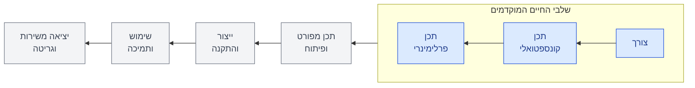
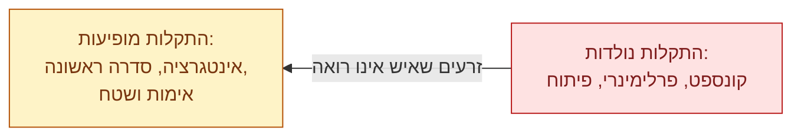
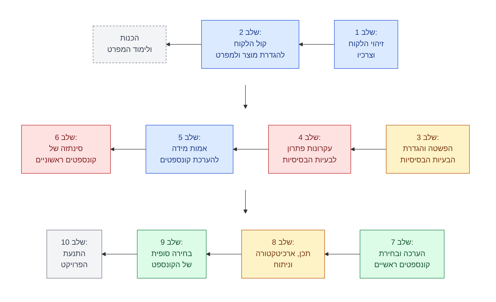
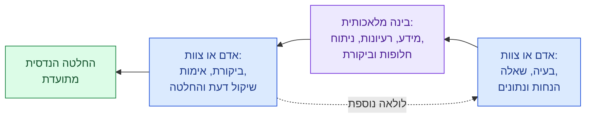

<!--
Deck source format (SystemEngineeringBKM course book).
`python -m sebkm render course` turns this file into slides.html, the deck on the guide's site.
A PowerPoint export comes later.

- The text before the first slide is the deck header: an H1 title and one blockquote.
- Each slide starts with a level-2 heading: "## שקף N: <title>", numbered from 1.
- The first line of a slide is "**המסר:** ...", the single takeaway of the slide.
- Then the slide content: a few short lines, a list, a table, or one Mermaid diagram.
  A "> **הערת עורך:** ..." line inside the content is an editor's addition and renders as a callout.
- Then the speaker notes, one blockquote line: "> **הערת דובר:** ...".
- Each slide ends with an HTML comment that names its source, for example "מקור: INTRO S6".
  INTRO and Needs are the lecturer's two decks for this meeting, and S is the slide number.
- Slides are separated by a line of three dashes. The text after the last separator is the footer.
- Writing rules are the same as in the chapter: every block starts with a Hebrew letter,
  no en or em dashes, Mermaid labels in Hebrew only, and no slide images are copied.
-->

# מצגת מפגש 1: מבוא, השיטה וצורכי הלקוח

> מפגש 1, יום ג', 3 בנובמבר 2026. עשרים שקפים בעיצוב חדש ובמילים שלנו, על בסיס שקפי המפגש וההקלטה.
>
> הפרק המלא, עם כל ההסברים והמקורות: [פרק 1](README.md)
>
> כל הזכויות על תוכן הקורס שמורות לד"ר עמיהוד הרי. התוכן מתפרסם כאן באישורו, ואינו חלק מרישיון MIT של המאגר.

---

## שקף 1: תכן הנדסי מערכתי מתקדם 1

**המסר:** שנה אחת, צוות אחד, פרויקט אחד ושיטה אחת לשלבי התכן המוקדמים.

- מפגש 1: מבוא לקורס ולשיטה, ותחילת השלב הראשון: מי הלקוח ומה הוא צריך.
- המרצה: ד"ר עמיהוד (עמי) הרי.
- הקורס עומד כעשרים שנה. הבינה המלאכותית משנה את ה"איך", לא את ה"מה".

> **הערת דובר:** תכן הנדסי מערכתי מתקדם 1 ו-2 הם בעצם קורס אחד, שנה ביחד. מהות הקורס היא תכן הנדסי, לא AI, ובכל זאת אנחנו מצפים שתיעזרו גם ב-AI. כמו שאמר האורח שלנו מהתעשייה: אף תיאוריה לא נשברת, פשוט אפשר לעשות אותה באמצעים חזקים יותר.

<!-- מקור: INTRO S1-S2; פתיחת ההרצאה -->

---

## שקף 2: תכן לומדים על ידי תכן

**המסר:** תכן, כמו שחייה, לומדים רק בעשייה: מתרגלים כל שיטה על פרויקט מקורי.

| סוג הלמידה | דרכי הלמידה |
|---|---|
| למידה סבילה | הרצאה, קריאה, אמצעים אור-קוליים, הדגמה |
| למידה פעילה | קבוצת דיון, תרגול בעשייה, ללמד אחרים או שימוש מיידי |

- ככל שהלמידה פעילה יותר, גדלה גם ההשקעה הנדרשת מכם.
- שתי שאלות פתוחות: מה משנה הלמידה מרחוק, ומה משנה ה-AI?

> **הערת דובר:** לכן השעה השלישית בכל מפגש היא שלכם, ובה אתם מלמדים. ה-AI יחסוך לכם עבודה, אבל בלי מומחיות לא תדעו לכוון אותו ולא לבדוק את מה שהוא מחזיר. איך נעשים מומחים כשה-AI עושה את העבודה? זה האתגר של הקורס.

<!-- מקור: INTRO S4 (Janoska 2017) -->

---

## שקף 3: מבנה הקורס

**המסר:** שלושה-עשר מפגשים ופרויקט מתגלגל אחד, שמסתיים בהצגה כמו מול משקיעים.

- שלושה-עשר מפגשים, שלוש שעות כל אחד, על מתודולוגיות לשלבי התכן המוקדמים.
- שעתיים של הרצאה, דוגמאות והנחיות. השעה השלישית שלכם: התקדמות בפרויקט והערכה אישית, ובכל שבוע מציג צוות אחר.
- בשבוע הראשון: צוותים ופרויקט תרגול. אותו פרויקט מלווה אתכם כל השנה.
- בשבוע האחרון: הצגה לכיתה ולאורחים, והגשת העבודות.
- הקובע הוא קובץ ההנחיות של הקורס, לא השקפים.

> **הערת דובר:** למפגש האחרון אפשר להזמין חברים מהעבודה, בני משפחה, וגם ילדים מעל גיל 12. ותוכנית, כמו שאמרו בצבא, היא בסיס לשינויים: מה שלא ייכנס כאן ימשיך בקורס ההמשך.

<!-- מקור: INTRO S3, S5 -->

---

## שקף 4: מחזור החיים של מערכת

**המסר:** הקורס עוסק בשלושת השלבים הראשונים של מחזור החיים, ושם נקבע כמעט הכול.

- **צורך והגדרה, מזהים:** מתרגמים את צורכי הלקוח למפרט כמותי ברמה גבוהה.
- **תכן קונספטואלי, יוצרים:** מייצרים חלופות, מעריכים אותן ובוחרים.
- **תכן פרלימינרי, משקיעים:** ארכיטקטורה, ממשקים, ביצועים ועלות לחלופות המבטיחות.

> **הערת דובר:** זה מחזור החיים לפי בלנשרד ופבריצקי. בשלב הקונספטואלי המילה החשובה היא "יוצרים". עם AI, להגדיר חלופות זה צ'יק צ'אק; לשאול אם הן טובות, ועד כמה, דורש יותר. ובשלב הפרלימינרי מגלים בדרך כלל עוד חלופה אחת, שלוקחת את הטוב מכולן.

<!-- מקור: INTRO S6 (Blanchard & Fabrycky) -->

---

## שקף 5: ההחלטות המוקדמות קובעות

**המסר:** בסוף התכן הפרלימינרי כשלושה רבעים מהעלות כבר נעולים, והתקלות כבר נזרעו.

| בסוף השלב | חלק העלות שכבר נקבע |
|---|---|
| הגדרת המוצר | כמחצית |
| תכן קונספטואלי ופרלימינרי | כשלושה רבעים |
| פיתוח מלא | כ-90% |

> **הערת דובר:** ציר הזמן אינו ליניארי: הגדרה בימים עד שבועות, קונספט ופרלימינרי בשבועות עד חודשים, פיתוח מלא בשנים. לכן כל פרויקט להורדת עלות מגיע עם אותה בקשה: אל תיגע לי בקונספט. והאתגר לכל שיטה לתכן מוקדם: לעזור לזהות את התקלות כשעושים אותן, ולא באינטגרציה.

<!-- מקור: INTRO S7 (Hari, Weiss, Zonnenshain 2004) -->

---

## שקף 6: מה קשה בשלבים המוקדמים

**המסר:** את ההחלטות החשובות ביותר מקבלים כשיודעים הכי מעט.

1. החיפוש אחר פתרון: האם יש פתרון בכלל? יש כיוונים רבים, אבל האם הם יעבדו? מאיפה מתחילים?
2. עבודה בלחץ ובאי ודאות, של זמן ושל כסף.
3. החלטות חשובות על סמך מידע עמום: כמה סקיצות, בלי פרטי תכן ובלי אנליזה.

> **הערת דובר:** ההנהלה ממהרת לשוק, וגם קצת קמצנית. המספר שמסתובב, ולא בדקתי אותו, הוא שרק פרויקט אחד מכל עשרה שמתחילים פיתוח מגיע לסוף. ובחוסר ידע נכנסות גם אינטואיציה ופוליטיקה: מי שצועק חזק מקבל מה שהוא רוצה. מה לזה ולתכן מקצועי?

<!-- מקור: INTRO S8 -->

---

## שקף 7: שלושה סוגי תכן

**המסר:** בקורס מתרגלים תכן מקורי. מי שיודע אותו, יודע גם לקצר כשהוא משדרג.

| סוג התכן | מה משתנה | דוגמה |
|---|---|---|
| תכן וריאנטי | שינוי קטן במוצר קיים; הקונספט לא משתנה | השיפורים ההדרגתיים שכל חברה עושה במוצר שלה |
| תכן התאמה (שדרוג) | עקרון הפתרון של אחת הפונקציות, לפעמים לגמרי | מעבר ממכונית עם מנוע בנזין למכונית חשמלית |
| תכן מקורי | מוצר חדש לצורך חדש, או לצורך ישן בטכנולוגיה חדשה | הפרויקט שלכם בקורס |

> **הערת דובר:** זו החלוקה של פאל ובייץ, אבות התורה של התכן ההנדסי. ככל שיורדים בטבלה, יש יותר מתודולוגיה. לא כל אחד זוכה לעשות תכן מקורי בחיים. אשרי מי שזכה: זה הכי קשה, אבל גם הסיפוק והלמידה הכי גדולים.

<!-- מקור: INTRO S9 (Pahl & Beitz 2007) -->

---

## שקף 8: עשרת השלבים של ICDM

**המסר:** עשרה שלבים מהצורך ועד התנעת הפרויקט, והם גם תוכנית הקורס.

> **הערת דובר:** שלבים 1 ו-2 עוסקים בצרכים ובמפרט. בשלב 3 מחפשים את הבעיות הבסיסיות, בערך עשר שאלות שמסכמות מה המערכת צריכה לעשות. את אמות המידה של שלב 5 קובעים לפני שרואים קונספטים, כדי שהקונספטים לא ישפיעו עליהן. המעבר משלב 6 לשלב 7 קריטי: שם זורקים את רוב הקונספטים. ורוב האנשים מגויסים לפרויקט רק בשלב 10.

<!-- מקור: INTRO S10; Needs S3 (Hari, Weiss, Zonnenshain 2004) -->

---

## שקף 9: שלושה אופני חשיבה בבת אחת

**המסר:** בשלבים המוקדמים אותו צוות צריך להיות שיטתי, יצירתי ואנליטי, באותו זמן.

| אופן החשיבה | צבע בתרשים | שלבים |
|---|---|---|
| שיטתי וכמותי: לכתוב את כל הדרישות, לכתוב נכון ולא לשכוח | כחול | שלבים 1, 2 ו-5 |
| יצירתי | אדום | שלבים 4 ו-6 |
| אנליטי: לשבת ולחשב | ירוק | שלבים 7 ו-9 |
| משולב | צהוב | שלבים 3 ו-8 |

> **הערת דובר:** בשלבים המתקדמים אפשר לחלק את העבודה בין החכם של הפרויקט לבין מי שעושה את האנליזות. בשלב הקונספטואלי אין את זה. ואומרים שאנליטיות ויצירתיות מקלקלות אחת את השנייה. זה האתגר.

<!-- מקור: INTRO S10 (הצבעים בשקף); הרצאה -->

---

## שקף 10: אדם, בינה, אדם

**המסר:** ה-AI מייצר ומבקר; האדם מגדיר, בודק, מחליט וחותם.

- תרומת ה-AI: מהירות בסדר גודל, כמות, אימות של איכות ודיוק, ועקיבות.
- אין "AI ואז החלטה". תמיד: AI, ביקורת אנושית, ורק אז החלטה.
- כלל הזהב: ה-AI לא מקבל החלטות הנדסיות במקום הצוות. האחריות לתכן נשארת אצלכם.

> **הערת דובר:** האורח שלנו קרא לזה Human in the Loop: האדם מכניס את הקלט, והאדם חותם על הפלט. הסכנה הגדולה היא שהאדם יתמכר, והתוצר יהיה של ה-AI. לכן "ה-AI אמר" לא אומר כלום. פעם כל חלופה נוספת עלתה ביוקר; היום אפשר לבקש הרבה חלופות, בזול ומהר. טוב או לא? אולי.

<!-- מקור: INTRO S11 -->

---

## שקף 11: מדען או אמן?

**המסר:** בשלב הקונספטואלי המהנדס צריך להיות גם וגם: אמן שממציא ומדען שבודק.

- היצירתיות של שלב הקונספט היא די אמנות.
- ההערכה, הניתוח וההחלטה הם מדע.
- בדרך כלל אלה אנשים שונים. אתם מהנדסים, ואתם צריכים להיות שניהם.

> **הערת דובר:** זו הדילמה שמעלה מרטן בונמה בקריאה המקדימה. אין לה תשובה, רק חומר למחשבה. בכיתה העירו שעם הניסיון היצירתיות מתייבשת. אולי. ברפאל פגשתי כמה אנשים שנשארו יצירתיים מאוד גם כשהיו מבוגרים. בודדים.

<!-- מקור: הרצאה; קריאה מקדימה: Bonnema 2017; צפייה מקדימה: Shenhar -->

---

## שקף 12: הצרכים לא באים מעצמם

**המסר:** הולכים לחפש את הצרכים, ומתחילים בשאלה: את מי לשאול?

| בעל העניין | מה הוא צריך מאריזה של אנטיביוטיקה |
|---|---|
| המטופל | להוציא כדור בקלות, ולקרוא מה כתוב |
| הרופא | כמויות שמתאימות למינון |
| הרוקח | אריזה קטנה, שנכנסת למגירות של בית המרקחת |
| הלוגיסטיקה | אריזות גדולות שנפרקות מהר, ושורדות ארבעה ימים במשאית בלי מיזוג |
| חברת התרופות | מפרט שלם: המכונות, התנאים, התרופות |
| הרגולטור | תקן עם שלושת אלפים דרישות |

- מאיפה מתחילים לחפש: מגזרי הלקוחות, שרשרת הערך בכל מגזר, וכל בעלי העניין, כאילו היו לקוחות.

> **הערת דובר:** אינטואיטיבית שואלים קודם את המשתמש, ודווקא לו יש הכי מעט להגיד. צריך לשמוע את כולם. מותר להחליט במודע להתעלם מהרוקח, אבל זו החלטה, לא שכחה.

<!-- מקור: Needs S4 -->

---

## שקף 13: למה מזהים צרכים

**המסר:** הצרכים הם הבסיס שממנו נגזר המפרט, ושעליו הוא מוצדק.

1. שהמוצר יתרכז בצורכי הלקוח וייגזר מהם.
2. לזהות צרכים גלויים, וגם חבויים.
3. בסיס להצדקת המפרט של המוצר או של המערכת.
4. ששום צורך קריטי לא יישכח.
5. הבנה אחידה ושפה משותפת של צורכי הלקוח בתוך צוות הפיתוח.

> **הערת דובר:** המטרה האחרונה נשמעת רכה, אבל היא קשה. בלי שפה משותפת, הטייס מנופף בידיים, והמהנדס מולו שואל: מה אתה רוצה? אני יודע לעשות מנועים.

<!-- מקור: Needs S5 -->

---

## שקף 14: מי מחזיק בצרכים

**המסר:** לכל בעל עניין יש תהליך רכישה, מי שמחליט וגורמי רכישה, ולפיהם מחליטים למי ללכת ואיך.

| בעל העניין | מי מחליט | גורמי רכישה (KBFs) | שיטת איסוף |
|---|---|---|---|
| מפעיל (קשיש) | המפעיל עצמו | משקל ונפח, קלות הפעלה, מחיר | ראיון, ותצפית על תרחיש תפעולי |
| בעל חנות או יבואן | היבואן | מחיר, עיצוב האריזה, רווח | ראיון, שאלון |
| מכון התקנים | הבוחן | אמינות, בטיחות | בחינה |
| שירות לקוחות | הנהלת היבואן, הרכש | אמינות, תחזוקתיות, אחריות | ראיון |
| קניין של דיור מוגן | הקניין | מחיר, אחריות | שאלון |

- גורמי רכישה (Key Buying Factors): התכונות שלפיהן הלקוח באמת מחליט לקנות.

> **הערת דובר:** זו הטבלה של הפנס לקשישים, דוגמה שתחזור בקורס. ביד יהיו לכם אולי עשרה בעלי עניין, וה-AI ייתן שלושים. פעם המספר המקובל היה שבע, פלוס מינוס שתיים; עכשיו כמה שיותר. ולכל צורך רושמים מאיפה הוא בא ובאיזו שיטה נאסף.

<!-- מקור: Needs S6 -->

---

## שקף 15: כללים לניסוח צורך

**המסר:** צורך הוא תרחיש, תועלת או בעיה, בשפת הלקוח, בלי פתרון ובדרך כלל בלי מספרים.

| לא כך: פתרון או מספר | אלא כך: צורך |
|---|---|
| תאוצה מאפס למאה | להגיע ממקום למקום |
| זמן ממוצע בין תקלות (MTBF) | להגיע בשלום |
| רמת רעש בדציבלים | שיהיה לי שקט |
| שלא יתקלקל | שיעבוד כשצריך |
| סמארטפון | לתקשר |

- ברור לכל אחד בארגון, ובהגדרות שכל אחד יבין.
- הצהרה חיובית, ככל האפשר.

> **הערת דובר:** הכי טוב לבטא צורך כמענה לתרחיש: יש לי סרט, ואני מתאר אותו. וסטטוס חברתי? ועוד איך צורך. זה נראה טריוויאלי, אבל זה שינוי במחשבה ובסגנון העבודה.

<!-- מקור: Needs S7 -->

---

## שקף 16: מודל קאנו

**המסר:** את הצרכים החד-ממדיים הלקוח יגיד לכם. את המובנים מאליהם ואת המלהיבים תצטרכו לחפש.

| משפחת הצורך | אם הוא חסר | אם הוא קיים | הלקוח יגיד אותו? | דוגמה |
|---|---|---|---|---|
| חד-ממדי | ככל שפחות, פחות מרוצה | ככל שיותר, יותר מרוצה | כן, וזה מה ששואלים בסקרים | מחיר הכרטיס, טיסה ישירה, מקום לרגליים |
| מובן מאליו | אוי ואבוי | לא יותר שמח | לא; לא עולה על דעתו | לנחות בשלום |
| מלהיב | לא קורה כלום | וואו | לא; צריך לחפש | מקום לכוס בטויוטה, פלסטרים בארגז הטיל |

- עם הזמן הכול צולל: המלהיב הופך לחד-ממדי, ואחר כך למובן מאליו.

> **הערת דובר:** טויוטה עשתה חור בלוח המחוונים, מקום לכוס הקפה, ואף לקוח לא ביקש. ובסדנה סיפרו שהטיל מוחץ את האצבע כשמוציאים אותו מהארגז: עשרות שנים, ואף אחד לא אמר. את המובנים מאליהם מוצאים בתקן. ומילת המפתח היא תרחיש: מי שיודע לבטא צורך כתרחיש, ידע גם לגלות אותו.

<!-- מקור: Needs S8 (Cohen 1995, pp. 36-42) -->

---

## שקף 17: שיטות לאיסוף צרכים

**המסר:** לכל בעל עניין מתאימה שיטה אחרת. עברו על הרשימה כמו על צ'קליסט.

| שיטה | מה חשוב לדעת עליה |
|---|---|
| ראיון | הכלי המרכזי, ועליו בשקף הבא |
| שאלון | בשלב הזה רוב השאלות פתוחות: שאלה סגורה שואלים רק על מה שכבר יודעים |
| ביקור | מתרשמים מהפעילות אצל הלקוח ומשוחחים עם האנשים במקום |
| בניית תרחישים ומקרי שימוש | מי שמצייר ומציג תרחיש, כבר יש לו משהו ביד |
| חקירת לקוח | תצפית וראיון יחד: רואים גם את מה שהלקוח לא אומר |
| קבוצת מיקוד | חצי יום, שישה מול שישה, וחוזרים עם "לא ידעתי ש..." |

> **הערת דובר:** קבוצת מיקוד היא שיטה למי שאין לו זמן ואין לו כסף. למדתי להצמיד אותה לתערוכות: ארוחת צהריים, שישה לקוחות מול שישה מתכננים. פעם לקוח בחו"ל סיפר לנו שיש לו חורף של עשרה חודשים, ואף אחד מאיתנו לא חשב על זה.

<!-- מקור: Needs S9 -->

---

## שקף 18: הראיון

**המסר:** באים בשם הבעיה, מדברים בתרחישים, ושואלים הרבה "למה".

1. מה הבעיה שהמוצר נועד לפתור?
2. איך אתה רואה בדמיונך תרחישים אופייניים או רצויים של חיים עם המוצר?
3. איך אתה מבצע אותם היום, בלי המוצר?
4. מה אתה אוהב ומה אתה לא אוהב במוצר הקיים? מה קשה לך לעשות היום?
5. האם אתה מכיר מוצר אחר שעונה על הצורך, כולו או חלקו? מה היית משפר בו?
6. מה השיקולים שלך בקנייה? אילו תכונות הכי חשובות לך?
7. כמה שווה לך המוצר הבסיסי? על אילו יכולות היית מוסיף כסף, וכמה?

- שאלות פתוחות: תאר לי, ספר לי, הצג לי, הדגם לי.

> **הערת דובר:** על המחיר הלקוח לא יגיד את האמת, ואת התקציב שלו הוא לא יגלה. אבל אם תשאלו כמה היה מוסיף על יכולת מסוימת, אין לו סיבה לשקר. ו"למה" חמש פעמים מעביר אתכם מאמירות כמותיות ופתרוניות אל הצורך: למה הרעש מפריע? כי יש לי בעיות באוזניים.

<!-- מקור: Needs S10 -->

---

## שקף 19: סוגי תרחישים

**המסר:** השימוש הרגיל הוא רק תרחיש אחד. את השאר צריך לבנות במכוון, אחרת הם נשכחים.

- **לאורך מחזור החיים:** תפעולי, קיצון תפעולי, שגרה ללא תפעול, שינוע, אחסון, התקנה, תקלה ותחזוקה, ייצור והכללה ובדיקה, אימון ותרגול, שדרוג ותרחישי עתיד, סוף החיים וגריטה.
- **התרחישים השחורים:** כשל או תאונה, שילוב של כמה תקלות, תפעול שגוי, ונדליזם, הפרעות ותנאים בלתי צפויים.
- תרחיש הוא סדרה של מצבים ופעולות של אדם ומוצר: תמונה דמיונית של עתיד אפשרי.

> **הערת דובר:** שגרה ללא תפעול תמיד נשכחת: טוסטר שרוב הזמן תופס מקום על השיש, טיל על כנף שממריא ונוחת אלף פעמים ואף פעם לא נורה. תרחיש קיצון אחד, סינתטי, עם הכול בבת אחת, מספיק. ובהתקנה מגלים שהבית לא מתאים.

<!-- מקור: Needs S15 (מילון UML) -->

---

## שקף 20: מה עושים השבוע: תרגיל 1

**המסר:** מקימים צוות רב-תחומי, מוצאים צורך אמיתי בלי פתרון, ומגישים את תרגיל 1.

- קובץ XLS עם שני גיליונות, בעברית: חברי הצוות, והצרכים לפי סדר עדיפות.
- כל חבר מציע לפחות צורך אחד, עם ארבע עד חמש דרישות ביצועים, פתרונות קיימים ומרואיינים פוטנציאליים.
- כל טענה על מוצר קיים נבדקת מול מקור עצמאי.
- בסיכום רושמים את שעות העבודה של הצוות, ובסוף מצרפים נספח חובה על השימוש ב-AI.

| מועד | מה קורה |
|---|---|
| יום א', 8 בנובמבר 2026 | שולחים את התרגיל למרצה בדוא"ל |
| יום ג', 10 בנובמבר 2026 | מגישים עותק בכיתה, וכל צוות מציג בעשר דקות |
| יום ו', 13 בנובמבר 2026 | המרצה קובע לכל צוות את נושא הפרויקט |

> **הערת עורך:** המדריך שבמאגר יעזור לכם להכין את התרגיל: בקשו בצ'אט "בוא נפתח פרויקט חדש ונכין את תרגיל 1". מספר תעודת זהות המדריך לא שומר; את העמודה הזו ממלאים ידנית.

> **הערת דובר:** נושא טוב הוא צורך מערכתי שמכסה תרחיש מלא באופן אוטונומי, בתחום שאתם מכירים. לא תוכנה בלבד, לא פריצת דרך, לא מסובך מדי, ולא נושא ששימש כבר פרויקט בקורס. הקובע הוא קובץ ההנחיות.

<!-- מקור: Needs S11-S14; קובץ ההנחיות, תרגיל 1 -->

---

כל הזכויות על תוכן הקורס שמורות לד"ר עמיהוד הרי. התוכן מתפרסם כאן באישורו, ואינו חלק מרישיון MIT של המאגר. זו מצגת חדשה, בעיצוב חדש ובמילים שלנו; השקפים המקוריים אינם מועתקים לכאן.
