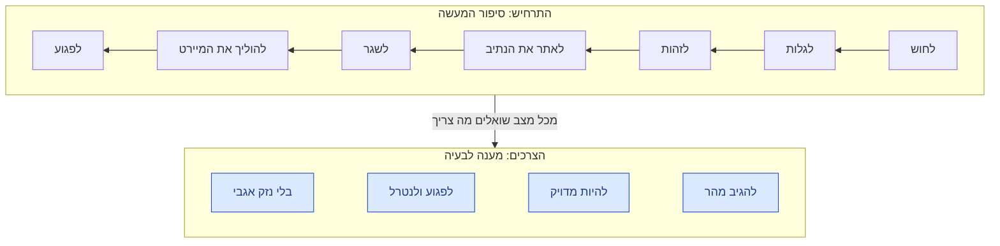
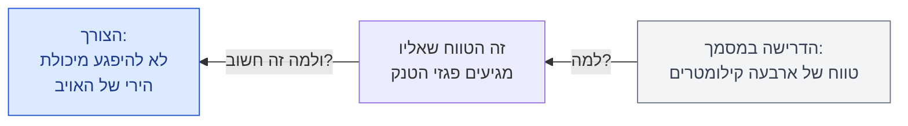
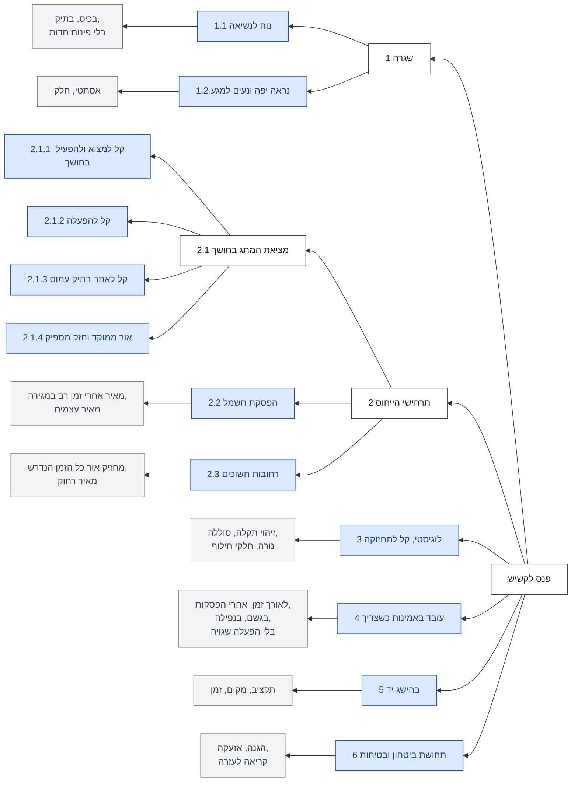
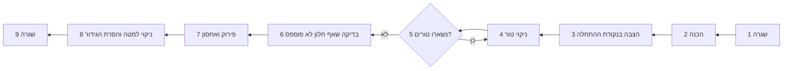
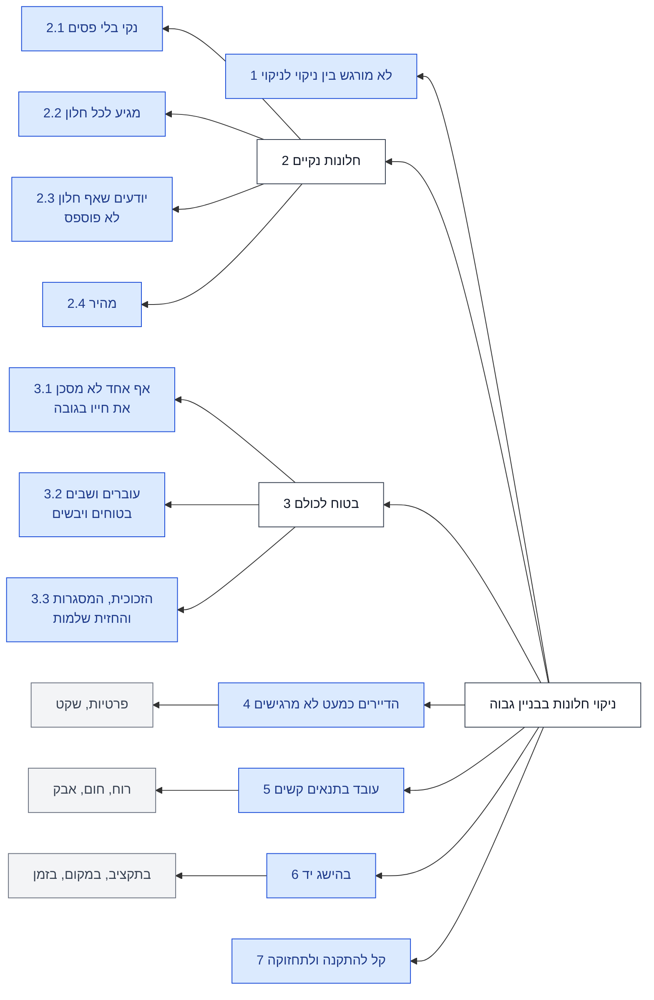

# פרק 2: איסוף וניתוח צורכי הלקוח (חלק ב)

> מפגש 2, יום ג', 10 בנובמבר 2026
>
> כל הזכויות על תוכן הקורס שמורות לד"ר עמיהוד הרי. התוכן מתפרסם כאן באישורו ואינו חלק מרישיון MIT של המאגר.
>
> לפרטים על הספר ועל אופן כתיבתו: [על הספר](../README.md)
>
> בפרק הזה: איך בונים תרחיש מצב אחרי מצב, מה ההבדל בין תרחיש לצורך, מה עושים עם מסמך דרישות שמגיע במעטפה, עץ הצרכים וקו הגיזום, תיעדוף בשיטת NGT והשוואת שוק.
>
> המצגת: [שקפי המפגש](slides.md)

## על מה דיברנו

במפגש הקודם התחלנו את השלב הראשון של השיטה: מי הלקוח ומה הוא צריך. אמרנו שצורך הוא תועלת שהלקוח רוצה, או בעיה שדורשת פתרון, ולא הפתרון עצמו. הכרנו את בעלי העניין, את מודל קאנו, את שיטות האיסוף ואת הראיון, והגענו עד סוגי התרחישים: האדומים, שנגזרים ממחזור החיים של המערכת, והשחורים, שעושים לנו את החיים שחורים.

היום ממשיכים מאותה נקודה. נבנה תרחיש אחד עד הסוף, מצב אחרי מצב, ונראה איך יוצאים ממנו הצרכים. נדבר על מה עושים כשהלקוח לא מספר לכם סיפור, אלא שולח מעטפה עבה עם מפרט. נסדר את כל הצרכים בעץ ונגזום אותו, ואחר כך נתעדף את הצרכים ונשווה אותם למה שכבר קיים בשוק.

> **הערת עורך:** הפרק נכתב מהקלטת החלק הראשון של המפגש, עד ההפסקה, משקפי המפגש, מקובץ ההנחיות של תרגיל 2 ומקובץ הדוגמה של הקורס. ההקלטה מתחילה באמצע ההסבר על פורמט התרחיש. ההקלטה של החלק השני עוד לא בידינו, ולכן הסעיפים על תיעדוף בשיטת NGT ועל השוואת שוק נכתבו מהשקפים ומקובץ הדוגמה. נעדכן אותם כשההקלטה תגיע.

## תרחיש הייחוס, מצב אחרי מצב

בפעם הקודמת הצגתי את רשימת התרחישים הפוטנציאליים. הרשימה הזו היא צ'קליסט: כשאתם מחפשים לאילו תרחישים לתכנן את המערכת שלכם, תסתכלו קודם כול ברשימה, ואחר כך תוסיפו. תתייעצו גם עם ה-AI, או עם מי שאפשר; אולי יש תרחישים שלא חשבתם עליהם. ועכשיו, כל תרחיש שבחרתם מקבל מין אקסל כזה: טבלה אחת, שמספרת את התרחיש מההתחלה ועד הסוף.

נעבוד עם הדוגמה שמלווה את הקורס, פנס לקשיש. המשימה שלו, כמו שנוסחה בדוגמה: "להאיר עצם בעזרת אמצעי נייד, קל ונוח לנשיאה, עבור קשישים". והתרחיש הראשון שלו: מציאת מתג התאורה בחדר מדרגות לא מוכר, בחושך. ועוד דבר שכתוב על השקף של הדוגמה: הדרך הטובה ביותר להציג תרחיש היא בתמונה. הטבלה היא השלד, ותמונה, ציור או סרטון עוזרים לכולם לראות את אותו הסרט.

### כותרת התרחיש

הכותרת האמיתית של הפורמט היא העמודה הימנית, עם הרקע הירקרק. היא לא קשורה לכל היתר; היא מספרת מה זה התרחיש הזה. אני חושב על התרחיש כמו על סרט וידאו, ושואל ארבע שאלות:

| שדה | מה כותבים | בדוגמה |
| --- | --- | --- |
| שם התרחיש | שם של לא יותר מעשר מילים, כך שכשנדבר עליו, כולם יבינו על איזה תרחיש מדובר | מציאת מתג התאורה בחדר מדרגות לא מוכר, בחושך |
| השחקנים | את מי רואים בסרט | קשיש או קשישה, שלא רואים טוב, הידיים קצת רועדות וקשה להם לתפוס |
| הזירה | איפה זה מתרחש ומה רואים שם: ביום או בלילה, בתוך מבנה או בחוץ | חדר מדרגות חשוך ולא מוכר |
| צד שכנגד | שחקן שמנסה לקלקל את התרחיש, אם יש כזה. זה שדה רשות | אין |

הצד שכנגד הוא לא עוד שחקן ברשימת השחקנים. הוא שחקן שמנסה לקלקל את התרחיש, להפריע לו. אם התרחיש שלי הוא משחק שח, או שש-בש, מולי יושב מישהו. אני חשבתי חמישה צעדים קדימה, אבל הוא עשה משהו בצד השני, קלקל לי את התרחיש, והכריח אותי לשנות את הסדר, את הפעולות, או להוסיף פעולה. כל הסייבר הוא כזה, וגם לוחמה אלקטרונית: רציתי להעביר אות, קוד או מידע, והצד השני אומר, זה לא יעבור. או שיעבור לא ברור, או שהוא ישבש אותו ויכניס משהו אחר במקומו. והתרחיש השתנה.

לפעמים יש צד שכנגד, ולרוב אין. כשיש, ציינו אותו, וכשתבנו את הצעדים של התרחיש, תכניסו גם את הפעולות שלו לסדרת הצעדים: יהיו צעדים שבהם אתם צופים שהתרחיש ישתנה ממה שציפיתם, ואז אתם פועלים נגדו, וכך הלאה. בפנס לקשיש אין צד שכנגד.

### המצבים, מהשגרה ועד הסוף

העמודה הראשונה שאני ממלא היא רשימת המצבים, עם המספור שלהם. את התרחיש מציגים מצב אחרי מצב, ואם אתם חושבים וידאו, חושבים סרט, הכי נוח למלא את העמודה מלמעלה למטה.

בדרך כלל תרחיש מתחיל במצב שגרה: יש פנס, ולא משתמשים בו. זה לא אומר שלמצב הזה אין דרישות. אמרנו את זה בשבוע שעבר: מצב השגרה מלא בדרישות, ובדרך כלל בדרישות שהתרחיש התפעולי בכלל שוכח לבקש. אז כרגע הפנס בכיס או בתיק, ולא צריכים אותו. וזה התרחיש כולו:

| מצב | מה קורה | אירוע המעבר | המצב הבא | צרכים משתמעים |
| --- | --- | --- | --- | --- |
| 1.1 | שגרה: הפנס בכיס או בתיק | הקשיש נכנס לחדר מדרגות חשוך, ולא מוצא את המתג | 1.2 | נוח לנשיאה |
| 1.2 | מחפש את הפנס ומאתר אותו | הפנס אחוז ביד, באחיזה יציבה | 1.3 | קל לאיתור; נוח לתפיסה בידיים רועדות |
| 1.3 | שולף את הפנס | הפנס יציב ביד | 1.4 | נוח לשליפה |
| 1.4 | מדליק את הפנס | האור דולק | 1.5 | קל להפעלה, גם למי שמוגבל בתנועה |
| 1.5 | מאיר סביבו ומחפש את המתג | המתג נמצא | 1.6 | תאורה שמתאימה למשימה |
| 1.6 | מאיר את הדרך אל המתג ולוחץ עליו | האור בחדר המדרגות דולק | 1.7 | הארה ממוקדת |
| 1.7 | מכבה את הפנס | הפנס כבוי | 1.8 | קל לכבות, גם למי שמוגבל בתנועה |
| 1.8 | מחזיר את הפנס למקומו ומשחרר את האחיזה | הפנס בכיס או בתיק | 1.9 | קל להכניס |
| 1.9 | חזרה לשגרה | אין | אין | אין |

בטבלה המלאה יש עוד שתי עמודות: המאפיינים המשתמעים והפונקציות המשתמעות. היום לא ממלאים אותן; רק צריך להבין שנחזור אליהן. כדי שתראו לאן זה הולך, כך הן נראות בדוגמה:

| מצב | מאפיינים משתמעים | פונקציות משתמעות |
| --- | --- | --- |
| 1.1 | מידות, צורה | לספק נוחות נשיאה |
| 1.2 | זמן לאיתור ולהפעלה | לספק נוחות איתור |
| 1.3 | משקל | לספק נוחות שליפה |
| 1.4 | כוח וזמן להפעלה | להפעיל אור, לספק אנרגיה |
| 1.5 | עוצמה, טווח | ליצור אור |
| 1.6 | רמת מיקוד | להאיר עצם, למקד את האור |
| 1.7 | כוח לכיבוי, רמת אוטומציה | לכבות את הפנס |
| 1.8 | קוטר מרבי | לספק נוחות הכנסה |

### אירוע המעבר והמצב הבא

כרגע אולי לא ברור בשביל מה צריך את העמודה של אירוע המעבר, אבל בהמשך צריך אותה מאוד. תחשבו שאתם רוצים שמכונה תעשה את המצבים בשבילכם, או תלווה אתכם בהם. ברור שהיא צריכה לדעת לא רק מתי להפעיל משהו, אלא גם מתי להפסיק. אז השאלה שאני שואל, כשאני מסתכל על הסרט, היא: איך אני יודע שהמצב נגמר, ושאפשר לעבור למצב הבא? מה צריך לקרות? אם המצב הוא "מדליק את הפנס", איך אני יודע שהוא נגמר? כי לפנס יש אור. אם האור דולק, כנראה גמרתי, ועוברים הלאה.

העמודה הבאה שואלת לאן ללכת. בפנס זה פשוט: הכול בטור, בלי הסתעפויות ובלי "אם". וגם כשיש כמה הסתעפויות, כל עוד הן מעטות, הפורמט הזה מספיק טוב. אבל אם נתקלתם בתרחיש שכולו "אם", עם הרבה אפשרויות, הצורה הזו פחות נוחה. אז כדאי לצרף לטבלה תרשים זרימה, עם מעוינים, שאומר: אם ככה, לכו לפה, ואם אחרת, לכו לשם. אני מדבר על התרחיש, לא על פקודות לאיך לעשות את זה.

התרשים לא מחליף את הטבלה, הוא מתלווה אליה. האקסל נוח מאוד: מילאתם, ופתאום אתם רוצים להוסיף שורה בין 1.5 ל-1.6, או לשנות את הסדר, וזה קל. בתרשימי זרימה החיים מסובכים יותר, ולשנות קשה יותר. והטבלה הזו היא נקודת המוצא לצרכים, למאפיינים ולפונקציות, ובהמשך נחזור אליה עוד הרבה פעמים. בסוף התהליך, כשנתכנן את המערכת, נשאל מול כל מצב: איזה מרכיב במערכת, בחומרה או בתוכנה, אחראי למצב הזה? האם הבאתי לו פתרון? לכן הפורמט הזה נוח מאוד, ומומלץ.

ומישהו שאל: למה 1.2 מופיע בטבלה פעמיים? אחד זה מאיפה יוצאים, והשני זה לאן הולכים. מצב 1.1 נגמר באירוע המעבר שלו, ובעמודת המצב הבא כתוב 1.2: לכו לשורה של 1.2, שבה מחפשים ומאתרים את הפנס. וכשיש פיצולים, המצב הבא יכול להיות 1.3 או 1.4.

### כמה לפרט

ואם תשאלו אותי כמה לפרט: היום, בימי ה-AI, השאלה הזו פחות היסטרית. כשעשינו את זה ידנית, היא הייתה קריטית. מצד אחד, שיהיה מספיק מפורט כדי שיהיה לנו תרחיש. מצד שני, שלא ניסחף לפרטי פרטים, לתרחיש של מאות מצבים. כשאנשים עושים את זה, הייתי אומר ששבע פלוס מינוס שתיים הוא מספר טוב, תשובה טובה לשאלה "כמה" בהרבה דברים. ומכיוון שאת רוב התרחישים כנראה יעשה לכם ה-AI, גם שתים-עשרה זה בסדר. אבל אל תיסחפו.

ומהצד השני: תרחיש של ארבעה מצבים הוא כנראה לא תרחיש. אולי זו תמונה, אולי קטע מתרחיש. אם גמרתם את כל התרחיש בארבע שורות, תחשבו עוד פעם. תתייעצו עם ה-AI, תתייעצו עם החברים, תחלמו קצת. כי אם לא פירטתם מספיק, גם לא תגלו את כל הצרכים: יש מצבים שלא הגעתם אליהם ולא דמיינתם אותם, וכשתשאלו איזה צורך נובע מכל מצב, את השאלה הזו פשוט לא תשאלו.

### תרחיש ראשון ביד, ואחר כך AI

אפשר ללמד את ה-AI לעשות את זה, ומניסיוני הוא יודע לעשות את זה. אבל אתם תצטרכו ללמד אותו ולהשגיח עליו, שהוא עושה את זה נכון ושהוא מבין אתכם. ואני מאוד מציע, וזה כתוב גם בהנחיות, שתרחיש אחד תעשו ידני. תתנסו בעצמכם, ואל תתנו לו להתחיל: אם הוא לא הבין את המהות, הוא ייקח אתכם למקומות שזה ממש לא זה.

אז קודם עושים אחד, ואז גם הוא יראה מה עשיתם. ואחר כך, אם תרצו להשתמש בו לתרחישים האחרים, ברור. אבל כל אחד, גם ברמה האישית: עד שלא עשית תרחיש כזה, לא הבנת, וגם לא תדע לבדוק מה הוא עושה. אני אומר לעשות יותר מאחד, אבל נגיד שאנחנו יעילים: לפחות אחד, מנקודת המוצא ועד נקודת הסיום, עד שהתרחיש נגמר. כל אחד עושה אחד ביד, ואחרי שיש לכם שבעה, שמונה תרחישים שעשיתם ביד והבנתם אותם, תנו ל-AI.

בשביל זה כל כך ביקשתי, ממש התפללתי, שתבחרו נושאים שיש בהם אקטואציה: שאחרי שהמערכת חשה, מבינה ומנתחת, היא גם עושה משהו. מחליפה את הגלגל, נותנת את התרופה. מערכת שרק נותנת אינפורמציה לא מתאימה לנו. זה לא אומר שאין מערכות כאלה, אבל לקורס, כדי לתרגל את מה שלומדים ולראות את כל התמונה, היא לא מתאימה.

### לא רק התרחיש הנומינלי

שאלו אותי אם צריך גם תרחישי קיצון, שבהם דברים לא עובדים. לא רק שהם צריכים להיות: רוב התרחישים שלכם לא יהיו נומינליים. את התרחיש הנומינלי, הראשון ברשימה, אין ספק שלא תשכחו. אבל אחריו יש תרחישים תפעוליים בתנאי קיצון. האם זה בדיוק אותו תרחיש? אם יש שיטפון בחדר המדרגות, זה אותו תרחיש? ואחר כך תעברו על כל הרשימה, אחד אחד. אנחנו רוצים להיות מוכנים גם לתרחישי תקלה.

ויש ברשימה גם את תרחיש השגרה, שאמרתי לא לשכוח, כי בדרך כלל הוא חשוב: הוא מגלה צרכים שהתרחיש התפעולי לא ידע לבקש. אם אתם מתכננים, נגיד, טיל שתלוי על מטוס, המטוס ממריא ונוחת, ממריא ונוחת, ולא משגרים את הטיל. רוב חייו הוא מבלה בשגרה, ולא עושה כלום. אז לתרחיש הזה אין דרישות? ועוד איך יש. כל חייו, שעות, ימים ושנים, הוא סופג חבטות בהמראה ובנחיתה, ויש דרישות שאתם דורשים ממנו בגלל התרחיש הזה, ולא בגלל שלוש או עשר השניות שבהן הוא טס.

וגם תאונות. אני צריך לתכנן את המערכת שלי גם לתאונה. תרחיש התאונה החלומי שלי הוא שנסעתי, התהפכתי, נתקעתי בעץ, התגלגלתי, פתחתי את הדלת ויצאתי בשלום. בשביל התרחיש הנומינלי אפשר לבנות מכונית מפלסטיק דק. התרחיש הזה אומר: תעשו אותה בריונית מאוד, עמידה במכות, בשריפות ובכל מה שיכול לקרות, כדי שהאדם ייצא בשלום.

ולמה חלק מהתרחישים בשקף באדום וחלק בשחור? האדומים נגזרים מניתוח מחזור החיים: גם הפעלה, גם תקלה, ואפילו גריטה. השחורים הם אלה שעושים לנו את החיים שחורים, כמו תאונות, הפרעות וונדליזם. שחור יכול גם לא לקרות, אבל אי אפשר להתעלם ממנו.

ומישהו שאל: איך אדע שכיסיתי את כל התרחישים? לא תדעו. אף פעם לא כיסיתם את כולם. נשמח מאוד אם יהיה לכם, בפירוט, את העיקר. אנחנו רק בתכן קונספטואלי, ומחפשים פתרונות; זה עוד לא תכן מפורט, וזה עוד לא ניתוח תקלות.

## תרחיש וצורך

את הצרכים מחפשים בשתי רמות. יש צרכים שנובעים מהתרחיש כולו, כשמסתכלים על כל המשבצת הימנית העליונה: התרחיש הוא חיפוש המתג, ומהם הצרכים שנובעים ממנו? ויש צרכים שנובעים מכל מצב ומצב. בהתחלה לכו לאינטואיציה, כי היא בדרך כלל תוביל אתכם אל הצרכים ברמת התרחיש, ברמה הגבוהה: הצורך שלי הוא למצוא את דרכי. הצורך שלי הוא לראות את המתג. זהו. אחרי שעניתי ברמת האבא, אני הולך מצב אחרי מצב, ושואל אם הוא מביא לי עוד צרכים. אין פה חיוב.

אז מה ההבדל בין תרחיש לצורך? צורך הוא מענה לבעיה: אתה בחושך, ואתה צריך שיהיה אור, כדי לדעת את דרכך. התרחיש הוא סיפור המעשה: הלכתי לחדר המדרגות, היה חושך, לא ידעתי איפה המתג, הוצאתי את הפנס מהכיס, הארתי, מצאתי את המתג ולחצתי עליו. זה סיפור המעשה, וממנו אגזור את הצרכים. אלה שני דברים שונים, ובדרך כלל הסדר הוא שהתרחיש מוביל אל הצרכים.

נגיד שבאים ממשרד הביטחון ואומרים: אנחנו רוצים ליירט טיל מסוים. אז הצורך הוא יירוט, והתרחיש הוא איך מיירטים? לא. התרחיש שלכם הוא שירו עליכם טיל. ירו טיל בצפון, הוא בדרכו למרכז הארץ, ואתם רוצים ליירט אותו בשלום, בלי נפגעים, מהר. זהו. עכשיו עוברים מצב אחרי מצב: צריך לחוש בו, לגלות אותו, לזהות אותו, לאתר את הנתיב, לשגר, להוליך אליו את המיירט ולפגוע בו. אלה המצבים, ומהם מתחילים לשאול על הצרכים: שיגיב מהר, שיהיה מדויק, שיפגע וינטרל, שלא יגרום נזק אגבי. אלה צרכים.

והמבנה האקסלי לא צריך להטעות אתכם, כאילו חייבים צורך אחד מול כל מצב. יש צרכים שעומדים מול התרחיש כולו, ולא מול מצב מסוים, ויש מצב שמעורר שניים, שלושה, ארבעה צרכים. זו רשימה עצמאית. ההסתכלות על המצבים מעוררת אתכם לשאול ולחפש, אבל רשימת הצרכים יכולה להיות הרבה יותר ארוכה מרשימת המצבים.

ובהמשך נשאל לא רק מהם הצרכים. צורך הוא משהו נטול מספרים: מענה לבעיה, שמבוטא בדרך כלל בלי מספר. נחפש גם את המדדים הכמותיים שבעזרתם נבחן עד כמה המענה טוב, ואלה המאפיינים. כשנגיע אליהם, בעוד שיעור או שניים, נחזור לכאן ונמלא את העמודה שלהם. אחר כך נשאל מה המערכת צריכה לדעת לעשות, ואלה הפונקציות. ובקונספט התפעול, בערך בשני שלישים של הסמסטר, נשאל איך המפעיל, או האוטומציה, עושים את זה. אבל כרגע, נכון להיום, האתגר הוא להגיע עד עמודת הצרכים המשתמעים.

### הכשל מחכה

שאלו אותי אם התרחיש מוביל לצרכים, או לנקודות שבהן המערכת תיכשל. למה לדבר על כשל? עוד אין לנו פתרון. אנחנו רוצים לדעת מה המערכת צריכה, בדרך להגדרת המפרט. את הכשל שימו בצד, כמעט עד סוף הסמסטר. ההבדל הוא העיתוי: כדי לשאול איך משהו ייכשל, קודם תגידו לי על איזה פתרון אתם חושבים. כשנגיע לניתוח הכשלים, נחזור לטבלה הזו ונשאל איך הפתרון שבחרנו ייכשל בכל מצב. אבל עכשיו, תהיו אופטימיים. מחפשים לא איך זה ייכשל, אלא איך זה בכלל יעבוד.

ואם הפנס נופל על הרצפה באמצע? זה לא חלק מהתרחיש הזה. זה תרחיש אחר, תרחיש תקלה, מהתרחישים השחורים ברשימה. יש כאלה שקראנו להם סינתטיים: תרחישים מלאכותיים, שאוספים כל מיני צרות. הפנס נפל, ואני רוצה ששום דבר לא יישבר, ושכשאנסה להפעיל אותו, הוא יעבוד. או שהוא נרטב: אני הולך איתו בחוץ, ויורד גשם, או שמישהו התיז מים. מהתרחיש הזה יוצא הצורך: עמיד להתזת מים.

## ניתוח מסמך דרישות

בשבוע שעבר מישהו אמר לי: אצלי לא מספרים סיפורים, שולחים לי את הדרישות בדוח. נכון, זה קורה. אבל משרד הביטחון לא היה בקורס. מגיעה אליכם מעטפה עבה, ובתוכה הכול מעורבב: צרכים, מאפיינים, תרחישים, וגם פתרונות, למשל שהמצלמה תהיה של חברה מסוימת. מי שכתב את המסמך מתערב לכם בשיקולי התכן, ולא תמיד בצורה ממושמעת. ככה זה החיים. וזו גם השאלה שבראש השקף: מה עושים כשהלקוח מגיש מפרט מוכן, כמו במכרז?

אני קורא לזה אוטוסטרדה ודרכי עפר. האוטוסטרדה היא לעבוד בשיטות שאני מלמד כאן. אבל לפעמים אתם בדרכי עפר, ומדרכי העפר צריך קודם לעלות על האוטוסטרדה. הטופס הזה עוזר לעלות.

הדבר הראשון: תזמינו את מי שכתב את המסמך. כנראה הוא לא משתמש. הוא קצין פרויקט, איש טכני, בוגר טכניון, אולי סרן. הוא אף פעם לא נלחם עם המוצר; הוא אסף דרישות מהרבה אנשים וחיבר אותן למסמך אחד. ועל כל דרישה שואלים אותו:

- מי ביקש אותה?
- האם מנוסח כאן תרחיש, או צורך?
- האם מנוסחת כאן פונקציה?
- האם זה עקרון תכן, תשובה לשאלה "איך"?
- האם זה מתייחס לכל המערכת, או לחלק מסוים שלה?
- האם בכלל מדובר כאן בשיטת בדיקה?

ואז מגיעים לעמודה הצהובה, הרציונל, ואומרים לו: בוא נתחיל בלמה. כתוב אצלך טווח של ארבעה קילומטרים. למה ארבעה קילומטרים? מה, חמישה לא טוב? והוא מסביר: כי זה הטווח שאליו מגיעים הפגזים של הטנק. אז הצורך שלך הוא לא ארבעה. הצורך שלך הוא לא להיפגע מיכולת הירי של האויב.

ותראו מה קרה: המספר נעלם. זה כבר לא ארבעה, זה כבר למה. ואם למה אחד לא מספיק, שואלים עוד למה. לפעמים צריך ארבעה או חמישה למה, כל אחד עם הלמות שלו. בקורס לא חייבים לתרגל את זה, כי אנחנו נוסעים באוטוסטרדה. אבל בחיים תפגשו את זה. לי זה קרה הרבה, בעיקר בהתחלה. בהמשך החליפה את זה פריסת פונקציית האיכות, QFD: יושבים ביחד, והלקוח מתאר.

כך נראה הטופס בדוגמה של הפנס. בשקף, סוג הדרישה מסומן בכמה עמודות נפרדות; כאן הוא מרוכז בעמודה אחת:

| מס' | הדרישה במסמך | מי ביקש | מה היא באמת | מרכיב מערכת | הרציונל |
| --- | --- | --- | --- | --- | --- |
| 1 | נפח כולל של עד 40 סמ"ק | דמ"צ | מאפיין | מבנה | נוחות נשיאה בכיס או בתיק |
| 2 | קל לאיתור בכיס או בתיק | ראיונות עם לקוחות | צורך | אין | קל לאיתור בכיס או בתיק |
| 3 | הפנס ישתמש בסוללות תקניות מסוג AAA | איכות | עקרון תכן | אספקת אנרגיה | פיתוח זול יותר, זמן קצר יותר לשוק ואמינות טובה יותר |
| 4 | יעזור לקשיש להזעיק עזרה במצוקה | שיווק | צורך, וגם פונקציה | קריאה לעזרה | הזעקת עזרה; ובהערות: אבל בלי תוספת מחיר |
| 5 | התאמת העיצוב לקשישים תיבדק בסקר לקוחות על הדפסות תלת-ממד | הנדסת אנוש, איכות | שיטת בחינה | עיצוב | אימות מוקדם שהעיצוב מתאים לקהל היעד |

רק בשורה 2 יש צורך נקי. בשורה 4 מעורבבים צורך ופונקציה, ושלוש השורות האחרות הן מאפיין, עקרון תכן ושיטת בחינה. את הניתוח הזה עושים יחד עם נציג של הלקוח, ובטופס יש עוד שתי שאלות לכל דרישה: למה נדרשת הדרישה? וכיצד אתה מתכוון לאמת שהדרישה נתמלאה?

## עץ הצרכים

עכשיו יש לי בלגן של צרכים. אספתי אותם מכל התרחישים, מהראיונות ומהמסמכים, ויש ביניהם קשרים: יש בנים, יש נכדים, ואולי יש להם גם סבתא. למשל, לבצע היטב את תרחיש השגרה הוא צורך ברמה של סבתא. יש לו שני בנים: נוח לנשיאה, ונראה יפה ונעים למגע, חלק ולא פוצע. ולנוח לנשיאה יש שלושה בנים משלו: נוח בכיס, נוח בתיק של סבתא, ובלי פינות חדות שמשרטות.

מסדרים את כל הצרכים על העץ, ומחפשים את המקומות הריקים. למשל, "עובד באמינות כשצריך, ולא פועל כשלא צריך" מתפצל לגשם ולנפילה, שבאו מהתרחישים הסינתטיים. וכשהכול על העץ, רואים פתאום בנים בלי אבא, ואבות בלי בנים. ויותר גרוע מזה: אולי יש צרכים שלא נגזרים מתרחישים. זה משפט מאוד חשוב.

קחו את העלות. עלות היא לא צורך. אבל היא גוררת אותנו למקום הנכון: ללקוח יש צורך שהמוצר יתאים לתקציב שלו, והצורך הזה לא הופיע באף תרחיש. ואולי הוא הכי חשוב. אז מוסיפים לעץ צורך חדש, בהישג יד, עם שלושה בנים: בתקציב שלי; במקום שבו אני צריך אותו, כי אם אי אפשר להשיג אותו שם, הוא לא בהישג יד; ובזמן הנכון.

אוספים את כל הצרכים מכל התרחישים לעץ אחד, וזו רשימה ארוכה. ככה נראה העץ של הפנס:

הגזע בלבן, שנים עשר הצרכים שנשארו בתוך קו הגיזום בכחול, ומה שנגזם באפור. ההערה בשקף מזכירה שהרמות רק מראות את חופש הבחירה, ואינן מחייבות.

## גיזום העץ

את העץ גוזמים. אני רוצה לעבוד עם 20 עד 30 צרכים, כי זה נוח לי, לפחות בתור בן אדם. היום, כשחלק מהצעדים ממוכנים, גם 100 צרכים מפחידים פחות; ל-AI אין בעיה עם 100. אבל לבן האדם, שצריך לבדוק שכל צורך קיבל מענה, זו בעיה. עד 20 או 30 צרכים בתוך קו הגיזום זה סביר, זה אנושי. בטח בשלב הקונספטואלי, שבו אין הרבה זמן, ויש הרבה ניחושים.

איך בוחרים איפה לגזום? מסתכלים שלושה צעדים קדימה: באילו צרכים אטפל אחד אחד, אמדוד ואפתור, ואילו מאפיינים, מה שכתוב במפרט, ארצה לבדוק מוקדם. ועוד קצת אינטואיציה.

תחשבו על עץ אמיתי. הגזע הוא הצרכים הראשוניים, הענפים העבים הם המשניים, והעלים הם השלישוניים. כשגוזמים עץ, מורידים עלים וענפים דקים. וזה לא גורף, זה לפי בחירה. בענף 2.1 של הפנס השארנו את כל ארבעת הבנים, ולכן שם הקו עובר רחוק יותר מהגזע.

ומה שנגזם לא נמחק. לא יקרה שום אסון. אני נותן עדיפות למה שבתוך הקו, אבל תמיד מסתכל גם על מה שהתכוונתי אליו. כך לא אעשה טעות איומה, ואהיה מעשי.

### שלמות קו הגיזום

ויש כלל אחד שאסור לשבור: הקו לא יכול לעבור באמצע ענף. אני לא יכול להגיד: אני משאיר את 2.1, וגם את 2.1.3 ואת 2.1.4. זה אסור. או שהקו עובר על 2.1, או שלוקחים את כל ארבעת הבנים שלו. תמיד את כולם: או שלקחת הכול, או שגזמת הכול. אחרת אותו צורך מופיע פעמיים, וכשתתעדף, מה תתעדף?

ארבע דרכים להעביר את הקו בענף 2.1:

| איפה עובר הקו בענף 2.1 | מותר? | למה |
| --- | --- | --- |
| על 2.1 בלבד | מותר | הצורך נספר פעם אחת, והבנים שלו מזכירים מה הוא כולל |
| על כל ארבעת הבנים של 2.1 | מותר | כך בדוגמה של הפנס: כל אחד מהבנים נספר פעם אחת |
| על 2.1, וגם על 2.1.3 ו-2.1.4 | אסור | הבנים 2.1.3 ו-2.1.4 נספרים פעמיים: לבד, וגם בתוך 2.1 |
| על 2.1.3 ו-2.1.4 בלבד | אסור | 2.1.1 ו-2.1.2 נשארים בחוץ; לוקחים תמיד את כל הבנים |

> **הערת עורך:** כאן יצאנו להפסקה, וכאן נגמר החלק המוקלט שבידינו. שני הסעיפים הבאים נכתבו מהשקפים ומקובץ הדוגמה של הקורס.

## תיעדוף בשיטת NGT

> **הערת עורך:** הסעיף הזה כתוב בקול ניטרלי, מהשקפים, מקובץ ההנחיות ומקובץ הדוגמה. כשתגיע ההקלטה של החלק השני, נכתוב אותו מחדש בקולו של המרצה.

אחרי הגיזום נשארים 20 עד 30 צרכים, ועכשיו צריך לדעת מה חשוב יותר. השיטה היא NGT, Nominal Group Technique, שיטת הקבוצה הנומינלית: כל משתתף מחלק לבד 100 נקודות בין הצרכים, ואחר כך הקבוצה מחשבת, דנה, ומחלקת שוב.

- **המשתתפים והמשקלים.** בדוגמה של הפנס יש שמונה משתתפים, וסכום המשקלים שלהם הוא 14. שלושה מהם, במשקלים 3, 3 ו-2, הם קול הלקוח, ובשקף הם מסומנים באדום. מחמשת האחרים, לארבעה משקל 1 ולאחד משקל 2.
- **החלוקה.** כל משתתף מחלק לבד 100 נקודות בין הצרכים שבתוך קו הגיזום.
- **הדירוג.** לכל צורך מחשבים ממוצע משוקלל: הנקודות של כל משתתף כפול המשקל שלו, חלקי סכום המשקלים. לפי הממוצע הזה מדרגים.
- **הפיזור.** את סטיית התקן מחשבים בלי משקלים. היא לא מדרגת; היא מראה איפה אין הסכמה.
- **לפחות שני סבבים.** בין הסבבים דנים בצרכים שסטיית התקן שלהם גבוהה. המטרה איננה אחידות מלאכותית, אלא הסכמה שניתן לקבל. פער של נקודה או שתיים לא משנה, ואם סטיית התקן נשארת גבוהה, עושים עוד סבב.
- **חלוקה מלמעלה, אם רוצים.** אפשר גם שההנהלה תחלק קודם את 100 הנקודות בין הענפים הראשיים, והצוות יחלק בתוך כל ענף.

כך יצא הדירוג בדוגמה של הפנס:

| דירוג | הצורך | ממוצע משוקלל | סטיית תקן |
| --- | --- | --- | --- |
| 1 | 1.1 נוח לנשיאה | 23.8 | 3.5 |
| 2 | 4 עובד באמינות כשצריך, ולא פועל כשלא צריך | 20.1 | 3.9 |
| 3 | 5 בהישג יד | 13.1 | 1.9 |
| 4 | 2.2 התמצאות ראשונית בבית, בהפסקת חשמל | 9.3 | 1.7 |
| 5 | 1.2 נראה יפה ונעים למגע | 8.0 | 1.8 |
| 6 | 2.1.4 אור ממוקד וחזק מספיק | 7.4 | 2.5 |
| 7 | 2.3 מציאת הדרך ברחובות חשוכים | 5.9 | 0.7 |
| 8 | 3 לוגיסטי: קל לתחזוקה, או בלי תחזוקה | 4.0 | 0.8 |
| 9 | 2.1.1 קל למצוא ולהפעיל בחושך | 2.9 | 1.2 |
| 10 | 2.1.2 קל להפעלה | 2.6 | 1.2 |
| 11 | 2.1.3 קל לאתר בתיק עמוס | 2.1 | 0.8 |
| 12 | 6 תחושת ביטחון ובטיחות | 0.8 | 1.0 |

שלושת הצרכים הראשונים מקבלים יחד 57 מתוך 100 הנקודות.

> **הערת עורך:** בדוגמה של הקורס, הדרישה של השיווק להזעיק עזרה, שורה 4 בטופס ניתוח הדרישות, שייכת לענף 6, תחושת ביטחון ובטיחות. והענף הזה במקום האחרון, עם 0.8 נקודות.

תרגיל 2 מבקש גם שתי דוגמאות לשינוי בין הסבבים. בקובץ הדוגמה יש לכך טבלה עם העמודות מזהה, צורך, סבב 1, סבב 2, שינוי והסבר. העמודה החשובה היא ההסבר: למה מישהו שינה את דעתו.

## השוואת שוק

> **הערת עורך:** גם הסעיף הזה נכתב מהשקפים ומקובץ הדוגמה, ונעדכן אותו כשתגיע ההקלטה.

השוואה תחרותית, Competitive Benchmarking, היא לימוד ומדידה של מוצרי ייחוס, כדי לשפר את המוצרים של הארגון או את איכות התהליכים שלו. בשלב הזה עושים אותה בשתי טבלאות:

- **טבלת BM1, מול הצרכים.** לכל צורך ולכל תרחיש: מי עונה עליו הכי טוב.
- **טבלת BM2, מול המאפיינים.** הערכים של כל מוצר בכל מאפיין שמשפיע על ההחלטה, והטוב ביותר מסומן.
- **מהראשונה לשנייה.** הטבלה הראשונה מובילה לשנייה: מהצרכים שבהם מוצר מסוים מוביל, מגיעים למאפיינים שבזכותם הוא מוביל.

בשקף, המוצרים נקראים Now, X ו-Y. כאן הם הפתרון הקיים, מוצר א ומוצר ב.

| הצורך | מי עונה עליו הכי טוב |
| --- | --- |
| 1.1 נוח לנשיאה | הפתרון הקיים |
| 1.2 נראה יפה ונעים למגע | הפתרון הקיים |
| 2.1.1 קל למצוא ולהפעיל בחושך | מוצר א |
| 2.1.2 קל להפעלה | הפתרון הקיים |
| 2.1.3 קל לאתר בתיק עמוס | מוצר ב |
| 2.1.4 אור ממוקד וחזק מספיק | מוצר ב |
| 2.2 התמצאות ראשונית בבית, בהפסקת חשמל | מוצר א |
| 2.3 מציאת הדרך ברחובות חשוכים | מוצר ב |
| 3 לוגיסטי: קל לתחזוקה, או בלי תחזוקה | אף אחד מהשלושה |
| 4 עובד באמינות כשצריך, ולא פועל כשלא צריך | הפתרון הקיים |
| 5 בהישג יד | מוצר א ומוצר ב |
| 6 תחושת ביטחון ובטיחות | אף אחד מהשלושה |

בצרכים 3 ו-6 אף מוצר לא עונה טוב, וזו הזדמנות. ובטבלה השנייה, הערך הטוב ביותר בכל שורה מודגש:

| מאפיין | יחידה | הפתרון הקיים | מוצר א | מוצר ב |
| --- | --- | --- | --- | --- |
| נפח | סמ"ק | 220 | 80 | **75** |
| משקל | גרם | 220 | 75 | **70** |
| פעולה רציפה | דקות | **40** | 20 | 20 |
| זמן לאיתור ולהפעלה | שניות | **10** | 14 | 12 |
| עלות ייצור | דולר | 3 | 2 | **1.6** |
| רמת עיצוב | 1 עד 5 | **3** | **3** | 2 |
| הפעלות עד כשל | מספר | **500** | 400 | **500** |
| עוצמת הארה | לוקס | 300 | 300 | **400** |
| רמת אוטומציה | רמה | **2** | **2** | **2** |
| החלפת סוללה | שניות | **25** | 30 | 60 |

אף מוצר לא מנצח בכול. הפתרון הקיים מוביל בפעולה רציפה, בזמן לאיתור ולהפעלה ובהחלפת סוללה; מוצר ב מוביל בנפח, במשקל, בעלות הייצור ובעוצמת ההארה.

ולכל ערך בטבלה צריך מקור. תרגיל 2 מבקש לציין לכל ערך חיצוני משמעותי את המקור שלו ואת רמת האמינות שלו:

| רמת האמינות | מה היא אומרת |
| --- | --- |
| גבוהה | מפרט רשמי ועדכני של היצרן |
| בינונית-גבוהה | מקור של היצרן, או חישוב ישיר, עם הסתייגות |
| בינונית | מחיר אצל משווק, מספר שיווקי או הערכה הנדסית |
| נמוכה | צד שלישי שלא אומת; לא משתמשים בה לנתונים מרכזיים |
| לא פורסם | פער מידע: רושמים אותו כפער, ולא ממציאים ערך |

על ההשוואה התחרותית ועל הקשר שלה למפרט המוצר אפשר לקרוא אצל Ulrich ו-Eppinger, ברשימת הקריאה שבסוף הפרק.

## טעויות נפוצות

> **הערת עורך:** הרשימה מסכמת את האזהרות מהחלק המוקלט של המפגש ומהשקפים. טעויות מהצגות הצוותים יתווספו בהמשך.

- **בלי תרחיש שגרה.** הטיל שתלוי על כנף המטוס מבלה בשגרה את רוב חייו, וסופג חבטות בכל המראה ונחיתה. מצב השגרה מלא בצרכים שהתרחיש התפעולי שוכח.
- **תרחיש של ארבעה מצבים.** זה כנראה לא תרחיש, אלא תמונה או קטע מתרחיש. מצב שלא דמיינתם הוא צורך שלא תגלו.
- **מאות מצבים.** שבע פלוס מינוס שתיים היא תשובה טובה, ועם ה-AI גם שתים-עשרה בסדר. מעבר לזה נסחפים לפרטים.
- **מצב בלי אירוע מעבר.** בלי אירוע מעבר אי אפשר לדעת מתי המצב נגמר, ומכונה לא תדע מתי להפסיק.
- **טבלה שכולה "אם".** כשיש הרבה הסתעפויות, מצרפים תרשים זרימה. התרשים מתלווה לטבלה, ולא מחליף אותה.
- **לתת ל-AI להתחיל.** קודם תרחיש אחד ביד, מההתחלה ועד הסוף. בלי זה לא תדעו לבדוק מה ה-AI עשה.
- **מספרים בצורך.** "טווח של ארבעה קילומטרים" הוא לא צורך. שואלים למה, עד שהמספר נעלם. המספרים חוזרים אחר כך, עם המאפיינים.
- **צורך אחד לכל מצב.** רשימת הצרכים עצמאית: יש צרכים של התרחיש כולו, ויש מצב שמעלה כמה צרכים.
- **ניתוח כשל לפני שיש פתרון.** כשל בודקים על פתרון. עכשיו מחפשים איך זה בכלל יעבוד, ואת הכשל דוחים כמעט עד סוף הסמסטר.
- **רק צרכים שבאו מתרחיש.** יש צרכים שלא נגזרים מאף תרחיש, כמו בהישג יד. מחפשים אותם בעץ, במקומות הריקים.
- **קו גיזום באמצע ענף.** או שהקו עובר על האבא, או שלוקחים את כל הבנים. אחרת אותו צורך נספר פעמיים.
- **למחוק את מה שנגזם.** מה שנגזם נשאר בעץ, ומזכיר למה התכוונו.
- **עלות כצורך.** עלות היא לא צורך. הצורך הוא בהישג יד: בתקציב, במקום ובזמן.
- **סבב תיעדוף אחד.** עושים לפחות שני סבבים, ודנים בצרכים שסטיית התקן שלהם גבוהה.
- **ערך בלי מקור.** לכל ערך בהשוואת השוק צריך מקור ורמת אמינות. פער מידע רושמים כפער.
- **מערכת שרק מוסרת מידע.** לקורס בוחרים מערכת עם אקטואציה, מערכת שגם עושה משהו.

## דוגמה מלאה: ניקוי חלונות בבניין רב-קומות

> **הערת עורך:** הסעיף הזה הוא תוספת של המדריך, וממשיך את הדוגמה מפרק 1. הוא יישמר במאגר בתיקייה `examples/window_cleaning`. זו טיוטה לפני ראיונות, והמספרים בה מומצאים: כותב המדריך שיחק את תפקידי בעלי העניין.

### תרחיש הייחוס: ניקוי שגרתי

התרחיש הנומינלי, בפורמט של המפגש:

| שדה | בדוגמה |
| --- | --- |
| שם התרחיש | ניקוי כל החלונות בבניין, פעמיים בשנה, ביום רגיל |
| השחקנים | מנקה מקצועי, ומסביב דיירים ועוברים ושבים |
| הזירה | בניין מגורים רב-קומות, ביום רגיל |
| צד שכנגד | אין |

המספרים בסוגריים בעמודה האחרונה הם המזהים של הצרכים בעץ שבהמשך.

| מצב | מה קורה | אירוע המעבר | המצב הבא | צרכים משתמעים |
| --- | --- | --- | --- | --- |
| 1 | שגרה: הציוד מאוחסן, והחלונות מתלכלכים לאט | מגיע מועד הניקוי | 2 | לא מורגש בין ניקוי לניקוי, למשל הציוד תופס מעט מקום (1) |
| 2 | הכנה: מודיעים לדיירים, ומגדרים את השטח למטה | השטח מגודר, והדיירים יודעים | 3 | הדיירים כמעט לא מרגישים (4); עוברים ושבים בטוחים (3.2) |
| 3 | מציבים את הציוד בנקודת ההתחלה | הציוד מוכן | 4 | קל להתקנה (7); אף אחד לא מסכן את חייו בגובה (3.1) |
| 4 | מנקים חלון אחרי חלון, לאורך טור אחד | הטור נקי | 5 | נקי בלי פסים (2.1); מהיר (2.4); הזכוכית והחזית שלמות (3.3) |
| 5 | מעבירים את הציוד לטור הבא, אם נשאר כזה | הציוד בראש הטור הבא, או שלא נשארו טורים | 4 או 6 | מגיע לכל חלון (2.2) |
| 6 | בודקים שאף חלון לא פוספס | כל החלונות סומנו נקיים | 7 | יודעים שאף חלון לא פוספס (2.3) |
| 7 | מפרקים את הציוד ומאחסנים אותו | הציוד מאוחסן | 8 | קל לתחזוקה (7) |
| 8 | מנקים למטה ומסירים את הגידור | השטח פתוח | 9 | עוברים ושבים בטוחים ויבשים (3.2) |
| 9 | חזרה לשגרה | אין | אין | אין |

מצבים 4 ו-5 חוזרים על עצמם, טור אחרי טור, ולכן מצרפים לטבלה תרשים זרימה קטן:

שני צרכים בעץ לא באים מהתרחיש הזה. צורך 5, עובד בתנאים קשים, בא מתרחיש הקיצון של פרק 1: רוח, חורף וסופת אבק. וצורך 6, בהישג יד, לא בא מאף תרחיש, בדיוק כמו התקציב של הפנס.

### עץ הצרכים וקו הגיזום

כל הצרכים, מהתרחישים של פרק 1 ומהתרחיש הזה, בעץ אחד:

הצבעים כמו בעץ של הפנס: הגזע בלבן, שנים עשר הצרכים שבתוך הקו בכחול, ומה שנגזם באפור. בענפים 2 ו-3 הקו עובר אחרי כל הבנים, ובענפים 4, 5 ו-6 הוא עובר על האבא. מה שנגזם נשאר בעץ: פרטיות ושקט יזכירו לנו מה פירוש צורך 4.

### תיעדוף: סבב ראשון

חמישה משתתפים, וכל אחד חילק 100 נקודות לבד. המשקלים: ועד הבית 3, כי הוא מחליט ומשלם; דייר 2; מנקה מקצועי 2; וכל אחד מהמהנדסים 1. סכום המשקלים הוא 9. המשקל של כל משתתף מופיע בסוגריים.

| הצורך | מהנדס א (1) | מהנדס ב (1) | דייר (2) | ועד הבית (3) | מנקה מקצועי (2) | ממוצע משוקלל | סטיית תקן |
| --- | --- | --- | --- | --- | --- | --- | --- |
| 3.1 אף אחד לא מסכן את חייו בגובה | 20 | 18 | 8 | 10 | 25 | 14.9 | 6.3 |
| 6 בהישג יד | 10 | 12 | 12 | 22 | 6 | 13.8 | 5.3 |
| 2.1 נקי בלי פסים | 10 | 8 | 20 | 12 | 10 | 12.7 | 4.2 |
| 3.2 עוברים ושבים בטוחים ויבשים | 10 | 8 | 6 | 10 | 8 | 8.4 | 1.5 |
| 4 הדיירים כמעט לא מרגישים | 5 | 4 | 18 | 8 | 2 | 8.1 | 5.6 |
| 3.3 הזכוכית, המסגרות והחזית שלמות | 8 | 6 | 10 | 8 | 6 | 7.8 | 1.5 |
| 2.2 מגיע לכל חלון | 8 | 10 | 6 | 6 | 10 | 7.6 | 1.8 |
| 2.4 מהיר | 6 | 8 | 4 | 4 | 12 | 6.4 | 3.0 |
| 5 עובד בתנאים קשים | 10 | 12 | 2 | 4 | 8 | 6.0 | 3.7 |
| 2.3 יודעים שאף חלון לא פוספס | 4 | 5 | 4 | 6 | 6 | 5.2 | 0.9 |
| 1 לא מורגש בין ניקוי לניקוי | 4 | 3 | 8 | 6 | 2 | 5.0 | 2.2 |
| 7 קל להתקנה ולתחזוקה | 5 | 6 | 2 | 4 | 5 | 4.1 | 1.4 |

שלושת הצרכים הראשונים מקבלים יחד 41.4 נקודות, והתמונה פחות חדה מאשר בפנס. בסבב השני כדאי לדון קודם בצרכים שסטיית התקן שלהם הכי גבוהה:

- **צורך 3.1, אף אחד לא מסכן את חייו בגובה.** המנקה נתן 25 נקודות, והדייר 8.
- **צורך 4, הדיירים כמעט לא מרגישים.** הדייר נתן 18, והמנקה 2.
- **צורך 6, בהישג יד.** ועד הבית נתן 22, והמנקה 6.

הסבב השני יבוא אחרי הראיונות.

### השוואה ראשונה מול פתרונות קיימים

טבלת BM1 ראשונה, מול ארבע משפחות של פתרונות קיימים:

| הצורך | סנפלינג | במה תלויה | מתקן קבוע על הגג | רובוט ביתי |
| --- | --- | --- | --- | --- |
| 1 לא מורגש בין ניקוי לניקוי | כן | חלקי | חלקי | כן |
| 2.1 נקי בלי פסים | כן | כן | כן | חלקי |
| 2.2 מגיע לכל חלון | כן | חלקי | כן | חלקי |
| 2.3 יודעים שאף חלון לא פוספס | חלקי | חלקי | חלקי | לא |
| 2.4 מהיר | חלקי | חלקי | כן | לא |
| 3.1 אף אחד לא מסכן את חייו בגובה | לא | לא | חלקי | חלקי |
| 3.2 עוברים ושבים בטוחים ויבשים | חלקי | חלקי | חלקי | חלקי |
| 3.3 הזכוכית, המסגרות והחזית שלמות | חלקי | חלקי | כן | כן |
| 4 הדיירים כמעט לא מרגישים | חלקי | חלקי | חלקי | לא |
| 5 עובד בתנאים קשים | לא | לא | חלקי | חלקי |
| 6 בהישג יד | כן | חלקי | לא | כן |
| 7 קל להתקנה ולתחזוקה | כן | חלקי | לא | כן |

על 3.1, הצורך הראשון בתיעדוף, אף משפחה לא עונה "כן". ועל 6, השני בתיעדוף, עונים "כן" רק הסנפלינג, שנכשל ב-3.1, והרובוט. הרובוט הכי קרוב, אבל הוא נכשל ב-2.3, ב-2.4 וב-4, ועל ניקיון החלונות עצמו, 2.1 ו-2.2, הוא עונה רק חלקית. יש מקום לפתרון חדש.

> **הערת עורך:** אלה הערכות כלליות, בלי שמות של מותגים. בהשוואה אמיתית צריך מקור ורמת אמינות לכל ערך. טבלת BM2 תבוא עם המאפיינים, בפרק 3.

## בפרויקט שלך

> **הערת עורך:** הסעיף הזה הוא תוספת של המדריך, ואינו חלק מהמפגש. המנטור שבמאגר עדיין נבנה, והסקילים שבטבלה יגיעו בשבועות הקרובים. עד אז, הפרק הזה הוא המפה שלכם.

המפגש הזה הוא לב השלב השלישי במסע של המאגר, לקוחות וצרכים. בסוף השלב יש לכם:

- מפת בעלי עניין, ראיונות ותרחישי ייחוס;
- עץ צרכים עם קו גיזום;
- תיעדוף בשיטת NGT;
- מוצרי ייחוס וטבלת BM1.

טבלת BM2 שייכת לשלב הרביעי, מהצרכים למפרט.

| משימה | הסקיל | מה לבקש בצ'אט |
| --- | --- | --- |
| לבנות את התרחיש הראשון ביד, עם בדיקה | הסקיל `se-needs` | "בוא נבנה את התרחיש הראשון שלי. אני כותב, ואתה בודק" |
| לנתח מסמך דרישות שהגיע מבחוץ | הסקיל `se-needs` | "קיבלתי מסמך דרישות. עזור לי לשאול למה על כל דרישה" |
| לסדר עץ צרכים ולהעביר קו גיזום | הסקיל `se-needs` | "סדר את הצרכים שלי בעץ, ובדוק את שלמות קו הגיזום" |
| לתעדף בשני סבבים | הסקיל `se-needs` | "תכין לי טבלת NGT לשני סבבים, עם משקלים" |
| להשוות למוצרי ייחוס | הסקיל `se-research` | "מצא מוצרי ייחוס לצרכים שלנו, עם מקור ורמת אמינות לכל ערך" |
| להכין ראיון לבעל עניין | הסקיל `se-interview` | "תכין לי מדריך ראיון לבעל העניין הכי חשוב שלנו" |

> **הערת עורך:** המנטור יבדוק את התרחיש הראשון שלכם, אבל לא יכתוב אותו בשבילכם. המרצה ביקש שאת הראשון תעשו ביד.

### תרגיל 2א

זה תקציר; הקובע הוא קובץ ההנחיות של הקורס. תרגיל 2 נקרא "תרגום צורכי הלקוח למפרט ביצועים", והמשימה שלו: "הכנת מפרט ביצועים שמתרגם את צורכי הלקוחות לשפת המהנדס, בלי לעוות אותם." חלק א כולל את שבעת הסעיפים הראשונים:

- **הצורך.** תועלת שהלקוח רוצה, או בעיה שדורשת פתרון, עם המקורות וההנחות.
- **בעלי העניין.** מי ידוע, מי חסר, ואיך תאספו מהם את הצרכים.
- **איסוף הצרכים.** בפורמט חופשי, כולל הממצאים מהתרחישים. מפרידים בין ציטוטים של לקוחות, פרשנות של הצוות ותוצרים של AI.
- **ניתוח תרחישים אישי.** כל חבר צוות עושה לפחות תרחיש אחד. תמונה או ציור עוזרים.
- **עץ הצרכים.** כולל צרכים שלא נגזרים מתרחיש, ועם קו גיזום.
- **תיעדוף.** לפחות שני סבבים בשיטת NGT, ועוד שתי דוגמאות לשינוי בין הסבבים, עם הסיבה.
- **השוואת שוק.** מוצרי ייחוס, טבלאות BM1 ו-BM2, ומקור ורמת אמינות לכל ערך חיצוני משמעותי.

סעיפים 8 עד 13 יוטלו בהמשך, ונפרט אותם בפרקים הבאים.

| מועד | מה קורה |
| --- | --- |
| יום ג', 10 בנובמבר 2026 | הצוותים מציגים את תרגיל 1 ומגישים אותו, ומקבלים את חלק א של תרגיל 2 |
| יום ג', 17 בנובמבר 2026 | צוות אחד מציג את חלק א, וכולם מקבלים את חלק ב |
| יום ג', 22 בדצמבר 2026 | מגישים את תרגיל 2 המלא |

## לקריאה נוספת

רוב המקורות של המפגש הזה כבר מופיעים ב[פרק 1](../01_intro/README.md): קול הלקוח, שיטת ICDM, דרישות איכות למערכות מורכבות, פריסת פונקציית האיכות, חקירת לקוח וקבוצת מיקוד. מקורות חדשים לפרק הזה:

- השוואה תחרותית ומפרט המוצר: Ulrich K. T., Eppinger S. D., Product Design and Development, 6th edition, McGraw Hill, 2015, chapter 6, Product Specifications, pp. 92-111.
- תיעדוף בשיטת הקבוצה הנומינלית: ASQ, [Nominal Group Technique](https://asq.org/quality-resources/nominal-group-technique).
- המאמר המקורי של השיטה, תוספת עורך: Delbecq A. L., Van de Ven A. H., "A Group Process Model for Problem Identification and Program Planning", The Journal of Applied Behavioral Science, Vol. 7, No. 4, 1971, pp. 466-492, [DOI 10.1177/002188637100700404](https://doi.org/10.1177/002188637100700404).
- השוואה למוצרי ייחוס: Stratova Research, Competitor Product Benchmarking.

## המצגת

שקפי המפגש, בעיצוב חדש ובמילים שלנו: [המצגת של מפגש 2](slides.md). באתר היא נפתחת כמצגת, עם מסך מלא והערות דובר. קובץ PowerPoint ייווצר מאותו מקור בהמשך.

---

כל הזכויות על תוכן הקורס שמורות לד"ר עמיהוד הרי. התוכן מתפרסם כאן באישורו, ואינו חלק מרישיון MIT של המאגר. הפרק נכתב בקולו, מהקלטת המפגש ומהשקפים, ותוספות של המדריך מסומנות "הערת עורך".
