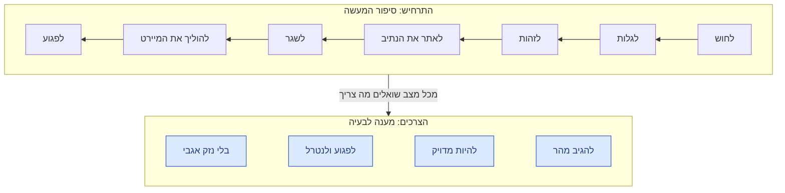
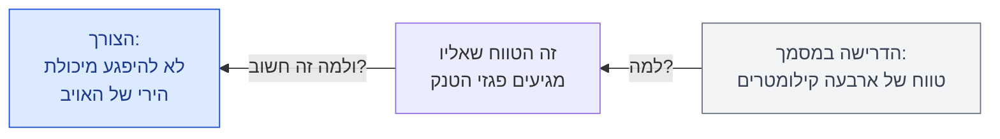
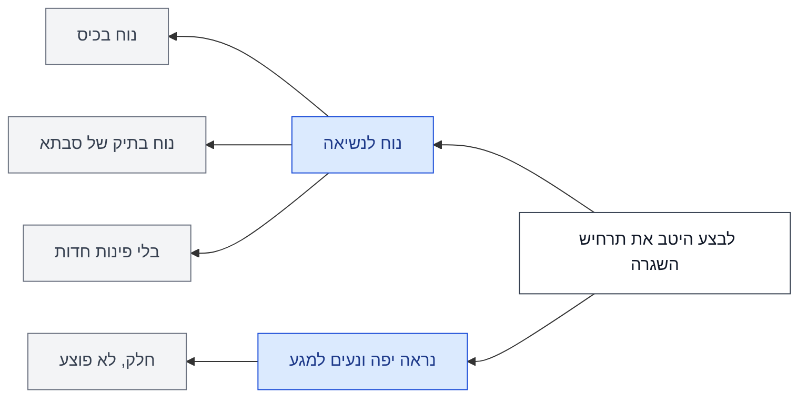

<!--
Deck source format (SystemEngineeringBKM course book).
`python -m sebkm render course` turns this file into slides.html, the deck on the guide's site.
A PowerPoint export comes later.

- The text before the first slide is the deck header: an H1 title and one blockquote.
- Each slide starts with a level-2 heading: "## שקף N: <title>", numbered from 1.
- The first line of a slide is "**המסר:** ...", the single takeaway of the slide.
- Then the slide content: a few short lines, a list, a table, or one Mermaid diagram.
  A "> **הערת עורך:** ..." line inside the content is an editor's addition and renders as a callout.
- Then the speaker notes, one blockquote line: "> **הערת דובר:** ...".
- Each slide ends with an HTML comment that names its source, for example "מקור: INTRO S6".
  Needs is the lecturer's deck for this meeting, S is the slide number, and ההקלטה is the meeting recording.
- Slides are separated by a line of three dashes. The text after the last separator is the footer.
- Writing rules are the same as in the chapter: every block starts with a Hebrew letter,
  no en or em dashes, Mermaid labels in Hebrew only, and no slide images are copied.
-->

# מצגת מפגש 2: איסוף וניתוח צורכי הלקוח (חלק ב)

> מפגש 2, יום ג', 10 בנובמבר 2026. שבעה-עשר שקפים בעיצוב חדש ובמילים שלנו, על בסיס שקפי המפגש וההקלטה.
>
> הפרק המלא, עם כל ההסברים והמקורות: [פרק 2](README.md)
>
> כל הזכויות על תוכן הקורס שמורות לד"ר עמיהוד הרי. התוכן מתפרסם כאן באישורו, ואינו חלק מרישיון MIT של המאגר.

---

## שקף 1: איסוף וניתוח צורכי הלקוח, חלק ב

**המסר:** מהתרחיש אל הצרכים, ומהצרכים אל עץ גזום ומתועדף, שמושווה למה שכבר יש בשוק.

- תרחיש אחד עד הסוף, מצב אחרי מצב.
- מה עושים עם מסמך דרישות שמגיע במעטפה.
- עץ הצרכים וקו הגיזום.
- תיעדוף בשיטת NGT והשוואת שוק.

> **הערת דובר:** בפעם הקודמת הגענו עד סוגי התרחישים, האדומים והשחורים. היום בונים תרחיש אחד עד הסוף, ורואים איך יוצאים ממנו הצרכים. אחר כך מסדרים את כל הצרכים בעץ, גוזמים, מתעדפים ומשווים למה שכבר יש בשוק.

<!-- מקור: Needs S16; פתיחת ההקלטה -->

---

## שקף 2: כותרת התרחיש

**המסר:** תרחיש הוא סרט: יש לו שם, שחקנים וזירה, ולפעמים גם צד שכנגד.

| שדה | בדוגמה של הפנס |
|---|---|
| שם התרחיש, עד עשר מילים | מציאת מתג התאורה בחדר מדרגות לא מוכר, בחושך |
| השחקנים | קשיש או קשישה, שלא רואים טוב, והידיים קצת רועדות |
| הזירה | חדר מדרגות חשוך ולא מוכר |
| צד שכנגד, רשות | אין |

> **הערת דובר:** הצד שכנגד הוא לא עוד שחקן; הוא מנסה לקלקל את התרחיש. כמו בשח: חשבתי חמישה צעדים קדימה, והוא הכריח אותי לשנות את הסדר. כל הסייבר הוא כזה, וגם לוחמה אלקטרונית. לפעמים יש צד שכנגד, ולרוב אין.

<!-- מקור: Needs S16; ההקלטה 00:00 -->

---

## שקף 3: המצבים, מהשגרה ועד הסוף

**המסר:** ממלאים את המצבים מלמעלה למטה, כמו סרט, ומתחילים בשגרה.

| מצב | מה קורה | צורך משתמע |
|---|---|---|
| 1.1 | שגרה: הפנס בכיס או בתיק | נוח לנשיאה |
| 1.2 | מחפש את הפנס ומאתר אותו | קל לאיתור, נוח לתפיסה |
| 1.3 | שולף את הפנס | נוח לשליפה |
| 1.4 | מדליק את הפנס | קל להפעלה |
| 1.5 | מאיר סביבו ומחפש את המתג | תאורה שמתאימה למשימה |
| 1.6 | מאיר את הדרך אל המתג ולוחץ עליו | הארה ממוקדת |
| 1.7 | מכבה את הפנס | קל לכבות |
| 1.8 | מחזיר את הפנס למקומו | קל להכניס |
| 1.9 | חזרה לשגרה | אין |

> **הערת דובר:** מצב השגרה מלא בדרישות, ובדרך כלל בדרישות שהתרחיש התפעולי שוכח לבקש. בטבלה המלאה יש עוד שתי עמודות, מאפיינים משתמעים ופונקציות משתמעות. היום לא ממלאים אותן; רק צריך להבין שנחזור אליהן.

<!-- מקור: Needs S16; ההקלטה 02:50 -->

---

## שקף 4: אירוע המעבר והמצב הבא

**המסר:** לכל מצב צריך לדעת מתי הוא נגמר, ולאן הולכים ממנו.

- אירוע המעבר: איך יודעים שהמצב נגמר? מדליקים את הפנס, והאור דולק.
- המצב הבא: בפנס הכול בטור, וגם כמה הסתעפויות זה בסדר.
- תרחיש שכולו "אם": מצרפים תרשים זרימה, שמתלווה לטבלה ולא מחליף אותה.
- בסוף התכן שואלים מול כל מצב: איזה מרכיב אחראי לו, והאם הבאתי לו פתרון?

> **הערת דובר:** תחשבו שמכונה עושה את המצבים בשבילכם. היא צריכה לדעת לא רק מתי להתחיל, אלא גם מתי להפסיק. והטבלה נוחה: רוצים להוסיף שורה בין 1.5 ל-1.6? זה קל. בתרשימי זרימה החיים מסובכים יותר.

<!-- מקור: ההקלטה 14:02-16:54; 25:30 -->

---

## שקף 5: כמה לפרט

**המסר:** שבעה מצבים, פלוס מינוס שניים. מצב שלא דמיינתם הוא צורך שלא תגלו.

| מספר המצבים | מה זה אומר |
|---|---|
| ארבעה | כנראה לא תרחיש, אלא תמונה או קטע מתרחיש |
| שבעה, פלוס מינוס שניים | תשובה טובה, כשאדם עושה את זה |
| שנים-עשר | בסדר, כשה-AI עוזר |
| מאות | נסחפתם לפרטי פרטים |

> **הערת דובר:** בימי ה-AI השאלה הזו פחות היסטרית; כשעשינו את זה ביד, היא הייתה קריטית. אם גמרתם תרחיש בארבע שורות, תחשבו עוד פעם. תתייעצו עם ה-AI, עם החברים, תחלמו קצת.

<!-- מקור: ההקלטה 11:18 -->

---

## שקף 6: תרחיש ראשון ביד, ואז AI

**המסר:** כל אחד עושה תרחיש אחד ביד, מההתחלה ועד הסוף, ורק אחר כך נותנים ל-AI.

- ה-AI יודע לעשות את זה, אבל צריך ללמד אותו ולהשגיח עליו.
- אל תתנו לו להתחיל: אם הוא לא הבין את המהות, הוא ייקח אתכם למקום אחר.
- שבעה, שמונה תרחישים ביד בצוות, ואת השאר ל-AI.
- בוחרים מערכת עם אקטואציה: היא חשה, מבינה, מנתחת, וגם עושה משהו.

> **הערת דובר:** עד שלא עשית תרחיש כזה בעצמך, לא הבנת, וגם לא תדע לבדוק מה ה-AI עושה. ובגלל זה ביקשתי נושאים עם אקטואציה: מחליפה את הגלגל, נותנת את התרופה. מערכת שרק נותנת אינפורמציה לא מתאימה לקורס.

<!-- מקור: ההקלטה 02:50-05:42; 25:30 -->

---

## שקף 7: תרחיש מול צורך

**המסר:** התרחיש הוא סיפור המעשה, והצורך הוא מענה לבעיה. התרחיש מוביל אל הצרכים.

רשימת הצרכים עצמאית: יש צרכים של התרחיש כולו, ויש מצב שמעלה כמה צרכים.

> **הערת דובר:** הצורך הוא לא היירוט, והתרחיש הוא לא איך מיירטים. התרחיש הוא שירו עליכם טיל בצפון, בדרכו למרכז, ואתם רוצים ליירט אותו בשלום, מהר. מכל מצב שואלים מה צריך. והצורך נטול מספרים; המספרים יבואו עם המאפיינים.

<!-- מקור: ההקלטה 16:54-22:39 -->

---

## שקף 8: הכשל מחכה

**המסר:** עכשיו מחפשים איך זה בכלל יעבוד; את הכשל בודקים כשיש פתרון.

- כדי לשאול איך משהו ייכשל, צריך קודם פתרון.
- ניתוח הכשלים מחכה כמעט לסוף הסמסטר, ואז עוברים מצב אחרי מצב.
- נפל, נרטב: אלה תרחישי תקלה נפרדים, מהרשימה השחורה.
- מתרחיש סינתטי כזה יוצא צורך: עמיד להתזת מים.

> **הערת דובר:** תהיו אופטימיים. הפנס נפל על הרצפה? זה תרחיש אחר. אני רוצה ששום דבר לא יישבר, ושכשאנסה להפעיל אותו, הוא יעבוד. הוא נרטב בגשם, או שמישהו התיז עליו מים? הצורך הוא עמידות להתזת מים.

<!-- מקור: ההקלטה 19:47; 25:30-28:16 -->

---

## שקף 9: ניתוח מסמך דרישות

**המסר:** כשמגיע מפרט מוכן במעטפה, קודם עולים מדרכי העפר אל האוטוסטרדה.

במעטפה הכול מעורבב: צרכים, מאפיינים, תרחישים, וגם פתרונות. מזמינים את מי שכתב את המסמך, ועל כל דרישה שואלים:

- מי ביקש אותה?
- האם מנוסח כאן תרחיש או צורך? האם מנוסחת כאן פונקציה?
- האם זה עקרון תכן, תשובה לשאלה "איך"?
- האם זה מתייחס לכל המערכת, או לחלק ממנה?
- האם בכלל מדובר כאן בשיטת בדיקה?

> **הערת דובר:** משרד הביטחון לא היה בקורס, והוא שולח מעטפה עבה. מי שכתב אותה הוא כנראה קצין פרויקט, איש טכני, שמעולם לא נלחם עם המוצר; הוא אסף דרישות מהרבה אנשים. אני קורא לזה אוטוסטרדה ודרכי עפר, והטופס הזה עוזר לעלות על האוטוסטרדה.

<!-- מקור: Needs S17; ההקלטה 28:16-31:06 -->

---

## שקף 10: למה ארבעה קילומטרים?

**המסר:** שואלים למה, עד שהמספר נעלם ונשאר הצורך.

> **הערת דובר:** למה ארבעה קילומטרים? מה, חמישה לא טוב? כי זה הטווח של פגזי הטנק. אז הצורך הוא לא ארבעה; הצורך הוא לא להיפגע מיכולת הירי של האויב. לפעמים צריך ארבעה או חמישה למה. בהמשך החליפה את זה פריסת פונקציית האיכות: יושבים ביחד, והלקוח מתאר.

<!-- מקור: ההקלטה 31:06-33:57 -->

---

## שקף 11: עץ הצרכים

**המסר:** מסדרים את בלגן הצרכים בעץ, ומחפשים בו את המקומות הריקים.

על העץ רואים בנים בלי אבא, ואבות בלי בנים.

> **הערת דובר:** אספתי צרכים מכל התרחישים, ויש ביניהם יחסים: בנים, נכדים, ואולי גם סבתא. כשהכול על העץ, רואים את החורים. ויותר גרוע מזה: אולי יש צרכים שלא נגזרים מתרחישים. זה משפט מאוד חשוב.

<!-- מקור: Needs S18; ההקלטה 33:57-36:47 -->

---

## שקף 12: צרכים שלא באו מתרחיש

**המסר:** עלות היא לא צורך, אבל היא מובילה לצורך שלא הופיע באף תרחיש: בהישג יד.

| הבן | מה הוא אומר |
|---|---|
| בתקציב | המחיר מתאים לתקציב של הלקוח |
| במקום | אפשר להשיג אותו במקום שבו צריך אותו |
| בזמן | הוא שם בזמן הנכון |

> **הערת דובר:** העלות גוררת אותנו למקום הנכון: ללקוח יש צורך שהמוצר יתאים לתקציב שלו, ואולי זה הצורך הכי חשוב. ואם אי אפשר להשיג את המוצר במקום שבו צריך אותו, הוא לא בהישג יד.

<!-- מקור: ההקלטה 36:47-39:36 -->

---

## שקף 13: גיזום העץ

**המסר:** גוזמים ל-20 עד 30 צרכים, לפי בחירה, ומה שנגזם לא נמחק.

- עשרים עד שלושים צרכים בתוך הקו זה אנושי. ל-AI אין בעיה עם מאה, לבן האדם שבודק יש.
- מסתכלים שלושה צעדים קדימה: באילו צרכים נטפל אחד אחד, ואילו מאפיינים נבדוק מוקדם.
- גזע, ענפים עבים ועלים: גוזמים עלים וענפים דקים, ולא באופן גורף.
- מה שנגזם נשאר בעץ, ומזכיר למה התכוונו.

> **הערת דובר:** בשלב הקונספטואלי אין הרבה זמן, ויש הרבה ניחושים, ולכן 20 עד 30 צרכים זה סביר. אני נותן עדיפות למה שבתוך הקו, אבל תמיד מסתכל גם על מה שנגזם. כך לא אעשה טעות איומה, ואהיה מעשי.

<!-- מקור: Needs S18; ההקלטה 39:36-42:24 -->

---

## שקף 14: שלמות קו הגיזום

**המסר:** הקו לא עובר באמצע ענף: או האבא, או כל הבנים.

| איפה עובר הקו בענף 2.1 | מותר? |
|---|---|
| על 2.1 בלבד | מותר |
| על כל ארבעת הבנים של 2.1 | מותר |
| על 2.1, וגם על 2.1.3 ו-2.1.4 | אסור: אותו צורך נספר פעמיים |
| על 2.1.3 ו-2.1.4 בלבד | אסור: שני בנים נשארים בחוץ |

> **הערת דובר:** אני לא יכול להשאיר את 2.1, וגם את 2.1.3 ואת 2.1.4. או שלקחת הכול, או שגזמת הכול. אחרת אותו צורך מופיע פעמיים, וכשתתעדף, מה תתעדף?

<!-- מקור: Needs S18; ההקלטה 45:13 -->

---

## שקף 15: תיעדוף בשיטת NGT

**המסר:** כל משתתף מחלק 100 נקודות לבד, מדרגים לפי ממוצע משוקלל, ועושים לפחות שני סבבים.

> **הערת עורך:** התוכן כאן מהשקפים ומקובץ הדוגמה; ההקלטה של החלק הזה עוד לא בידינו.

| דירוג | הצורך | ממוצע משוקלל | סטיית תקן |
|---|---|---|---|
| 1 | 1.1 נוח לנשיאה | 23.8 | 3.5 |
| 2 | 4 עובד באמינות כשצריך | 20.1 | 3.9 |
| 3 | 5 בהישג יד | 13.1 | 1.9 |
| 4 | 2.2 הפסקת חשמל | 9.3 | 1.7 |
| 5 | 1.2 נראה יפה ונעים למגע | 8.0 | 1.8 |

> **הערת דובר:** בדוגמה של הפנס יש שמונה משתתפים, וסכום המשקלים 14; שלושה מהם הם קול הלקוח. את סטיית התקן מחשבים בלי משקלים, והיא מראה איפה אין הסכמה. בין הסבבים דנים בצרכים שסטיית התקן שלהם גבוהה. המטרה היא לא אחידות מלאכותית, אלא הסכמה שאפשר לקבל.

<!-- מקור: Needs S19 -->

---

## שקף 16: השוואת שוק

**המסר:** טבלת BM1 משווה מול הצרכים, טבלת BM2 מול המאפיינים, ולכל ערך יש מקור.

> **הערת עורך:** גם כאן התוכן מהשקפים ומקובץ הדוגמה.

- **טבלת BM1:** לכל צורך, מי עונה עליו הכי טוב. בפנס, על צרכים 3 ו-6 אף מוצר לא עונה טוב, וזו הזדמנות.
- **טבלת BM2:** הערכים של כל מוצר בכל מאפיין, והטוב ביותר מסומן. אף מוצר לא מנצח בכול.
- **מקור ורמת אמינות:** מגבוהה, מפרט רשמי של היצרן, ועד לא פורסם, שרושמים כפער ולא ממציאים לו ערך.

> **הערת דובר:** השוואה תחרותית היא לימוד ומדידה של מוצרי ייחוס. הטבלה הראשונה מובילה לשנייה: מהצרכים שבהם מוצר מוביל, אל המאפיינים שבזכותם הוא מוביל.

<!-- מקור: Needs S20 -->

---

## שקף 17: תרגיל 2א

**המסר:** חלק א של תרגיל 2: שבעה סעיפים, מהצורך ועד השוואת השוק.

- הצורך, בעלי העניין ואיסוף הצרכים.
- ניתוח תרחישים אישי: לפחות תרחיש אחד לכל חבר צוות.
- עץ צרכים עם קו גיזום, ולפחות שני סבבי NGT.
- השוואת שוק, עם מקור ורמת אמינות לכל ערך חיצוני משמעותי.
- צוות אחד מציג את חלק א ב-17 בנובמבר, והתרגיל המלא מוגש ב-22 בדצמבר 2026.

> **הערת דובר:** המשימה של תרגיל 2 היא מפרט ביצועים שמתרגם את צורכי הלקוחות לשפת המהנדס, בלי לעוות אותם. זה תקציר; הקובע הוא קובץ ההנחיות של הקורס.

<!-- מקור: Needs S21; הנחיות תרגיל 2 -->

---

כל הזכויות על תוכן הקורס שמורות לד"ר עמיהוד הרי. התוכן מתפרסם כאן באישורו, ואינו חלק מרישיון MIT של המאגר. זו מצגת חדשה, בעיצוב חדש ובמילים שלנו; השקפים המקוריים אינם מועתקים לכאן.
