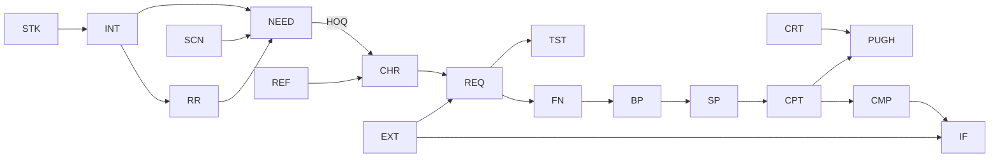

# SystemEngineeringBKM: method spec

Draft 2, November 2026 (Avi's answers in). Owner: Avi Salmon. This is the design record for whoever maintains the
guide. Users never need to read it; their chat does.

## 1. What it is

A clone-and-chat guide for systems engineering. You clone the repo, open it in an editor with an AI chat (Claude
Code, GitHub Copilot in VS Code, or Cursor) and ask **"מה אני עושה פה?"**. From then on the chat is a systems
engineering mentor that also does the work. It takes a new system from the first need to the selected concept,
following Dr. Amihud Hari's **ICDM** (Integrated, Customer Driven, Conceptual Design Method) and its **QRD**
(Quality Requirements Definition) process, and it names and shapes everything the way the standards do.

Two products live in one repo:

1. **The mentor (the main product).** Production first: the AI drafts needs, requirements, tests, tables, diagrams
   and documents; humans interview, vote, decide and approve. All project data is local JSON. Formal documents
   (Word, Excel, PDF), presentations and an HTML dashboard are generated from it.
2. **The course book.** A Hebrew book of the course "תכן הנדסי מערכתי מתקדם 1" (AEDM1, Technion 038808), one
   chapter per meeting, in Amihud's voice, with the theory, tables and his slides recreated in a new design. Every
   chapter points to the phase and skill that put it into practice, and the mentor points back to the chapter when
   it teaches.

The promise on the README (Hebrew):

> משכפלים, פותחים בעורך עם צ'אט AI ושואלים "מה אני עושה פה?". מכאן הצ'אט מלווה אתכם בבניית מערכת חדשה, מהצורך
> ועד הקונספט הנבחר: מראיין ומתמלל, כותב צרכים, דרישות ובדיקות, שומר על עקיבות, בודק שהכול מחובר ומנוסח נכון,
> ומפיק מסמכים פורמליים, מצגות ולוח בקרה ב-HTML. הכול לפי שיטת ICDM של ד"ר עמיהוד הרי ותקני הנדסת המערכות.
> ובנוסף: ספר הקורס, פרק לכל שיעור.

## 2. Who it is for

- Systems engineers and multidisciplinary teams who start a new system, in defense and in civil industry.
- AEDM1 students who work the course exercises with an AI partner (the course allows it, with an AI declaration).
- Anyone who wants to learn ICDM by doing it on a real project.

They know engineering. They may not know git, Python or the editor; the chat handles those.

## 3. Decisions

| # | Decision | Why |
|---|---|---|
| D1 | The method is ICDM and QRD. The standards are the naming, review and document layer on top of it. | It is the course's method, proven in Israeli industry; the standards give the names and document shapes that customers and defense programs expect. |
| D2 | Standards: ISO/IEC/IEEE 15288:2023 (processes); 24748-7 (15288 on defense programs, formerly IEEE 15288.1); 24748-8:2019 (technical reviews SRR, SFR, PDR..., formerly IEEE 15288.2); 29148:2018 (requirements) with the INCOSE Guide to Writing Requirements; 42010 (architecture views); MIL-STD-498 DIDs (OCD, SSS, IRS, SSDD); MIL-STD-961 (specification layout). | The combination defense engineers in Israel actually meet. MIL-STD-498 was cancelled in 1998, yet its DIDs are still the common document shapes. |
| D3 | Project data is JSON: one item per file, validated by JSON Schema. SQLite only as a disposable index, if ever. | Readable diffs, clean merges in team repos, the AI reads only what it needs, no binary database. |
| D4 | A user's project lives in `my_projects/<name>/`, which is its own private git repo. The guide repo ignores `my_projects/*`. | Pulling guide updates never touches the user's work; baselines are git tags; a team shares one private remote. |
| D5 | Production first. The AI drafts, humans approve. Learning mode (explain, let the user try, then critique) is offered, never forced. | Avi's call: an automated escort of the systems engineer. The course rules keep the human in the loop and require an AI log. |
| D6 | Interview transcription is local by default (faster-whisper with `ivrit-ai/whisper-large-v3-turbo-ct2`), or through the user's own OpenAI key by choice. | Interviews stay on the machine unless the user decides otherwise. |
| D7 | Hebrew for everything a user sees: chat, README, start page, journey, course book, generated documents. English for code, schemas, skill bodies and this spec; skills carry Hebrew and English triggers. Standard terms (SRR, PBS, QFD, HOQ) stay as they are. | The audience is Israeli; the AI works best with English instructions. |
| D8 | The example project is window cleaning, in `examples/window_cleaning/`, grown lesson by lesson. Avi plays the customer. CI runs `check` and `render` on it. | A real, relatable system that shows every phase, and a living integration test. |
| D9 | Users never contribute. Every session starts with `scripts/check_updates.py` (pull `main`). Projects carry `schema_version`; `sebkm migrate` upgrades them. Anyone may keep a personal fork, but a fork of a public repository is always public, so project data stays in `my_projects/`. | The bkm-bkm rules. |
| D10 | `course/` is © Dr. Amihud Hari, published with his permission, and is not covered by the MIT license. Third-party material is cited or linked, never copied. | His content, his terms. |
| D11 | One engine, `sebkm`, in Python 3.12 inside `env/`. | python-docx, openpyxl, python-pptx and the faster-whisper wheels all exist for 3.12. |
| D12 | Skills are written once in `.claude/skills/`; `scripts/sync_skills.py` generates the Copilot copies, `.github/copilot-instructions.md` and `AGENTS.md`. | Claude Code, Copilot and Cursor read the same instructions. |
| D13 | 3D starts as design briefs: one per mechanical element, ready for design3d or Fusion360BKM. Generating CAD models inside this repo waits (section 20). | The briefs serve both tools today. Parametric CAD is a big build that can wait until the method is proven. |
| D14 | Amihud's slides are never copied. Each meeting's deck is recreated: the same messages in our own words, a new design and our own diagrams. One source per meeting renders to an HTML deck and a PowerPoint file. | Avi's call. The originals carry a strict copyright line; a fresh design keeps the message and matches the guide. |

## 4. The journey

Each phase ends with something the user can see. ICDM iterates, so a phase can be reopened; baselines record the
state at each gate.

| # | Phase | ICDM stage | Course | 15288 process | What you have at the end |
|---|---|---|---|---|---|
| 0 | A working chat | | | | The chat answers in Hebrew and shows the journey. |
| 1 | Computer ready | | | | `doctor` all green; a test Word file opens. Optional: the local transcription model. |
| 2 | Project, team and need | Preparation | L1, Ex1 | Business or mission analysis | Project repo, the need phrased as a benefit or a problem (no solution), team, Ex1 table, first dashboard. |
| 3 | Customers and needs | 1 | L2-L3, Ex2 items 1-7 | Stakeholder needs and requirements definition | Stakeholder map, interviews, reference scenarios, needs tree with a pruning line, priorities (NGT), reference products, Benchmark 1. |
| 4 | From needs to a specification | 2 | L3-L5, Ex2 items 8-13 | System requirements definition; SRR | Characteristics, external interfaces, House of Quality, Benchmark 2, decision table (TVDT), PBS, CSR curves, SRR package, git tag `SRR`. |
| 5 | Abstraction and solution principles | 3-5 | L6-L8, Ex3 items 1-6 | Architecture definition (functional view) | Functional analysis, models, FAST, basic problems, solution principles with an AI Red Team, criteria A and B, morphological table. |
| 6 | Concepts and main concepts | 6-7 | L9-L10, Ex3 items 7-10 | Decision management | Concept cards, Pugh matrix, at least three substantially different main concepts. |
| 7 | Architecture of the main concepts | 8 | L11-L12, Ex3 items 11-17 | Architecture and design definition, interface management, system analysis (toward SFR) | Visual, logical and block diagrams, interfaces and ICD, AI "critical systems engineer" review, sizing and sensitivity, operations, integration and maintenance concepts, compliance table, 3D briefs. |
| 8 | Final selection and the pitch | 9-10 | L13, final work and presentation | Decision management; project planning | Selected concept (criteria B), final report, investor pitch, git tag `final`. |

**Phase gate.** `sebkm check --phase N` has no errors; every warning is fixed or waived with a reason (a DEC item);
the phase checklist is done; documents are rendered; `PROGRESS.md` is updated. Phase 4 ends with the SRR. As the
QRD paper puts it, the SRR does not solve problems; it documents the consensus that a product meeting the PBS
will meet the voice of the customer, and it confirms the resources are there.

The course plan does not say which Ex2 items belong to parts 2א, 2ב and 2ג. Likely by lesson topic: 1-5, 6-8 and
9-13. To be confirmed with Amihud.

## 5. The project and its data

```text
my_projects/<name>/              its own private git repo
  project.json                   name, Hebrew title, the need, phase, settings, schema_version
  PROGRESS.md                    Done / Next / Waiting on you
  model/<type>/<ID>.json         one item per file, one folder per type
  text/                          long prose in Markdown (summaries, concept descriptions, report sections)
  assets/                        images, sketches, renders, imported files
  raw/audio/                     recordings (never committed; the project's .gitignore)
  raw/transcripts/               transcripts, after consent
  deliverables/<date>_<name>/    what was actually submitted or sent, frozen
  out/                           generated documents, HTML and images (ignored, rebuilt any time)
```

`settings` holds the transcription route, course mode on or off, the team list and the document language.

**Principles**

1. **One item, one file.** The file name is the ID. Small diffs, easy merges, and the AI reads only what it needs.
2. **Stable IDs.** `PREFIX-NNN`, assigned by the engine, never reused. A withdrawn item keeps its file with status
   `withdrawn` and a reason. Display numbers (needs tree 1.2.3, PBS paragraphs) are computed from parent links and
   order; they are never identity.
3. **Store judgments, compute numbers.** Stored: HOQ cell values, NGT votes, Pugh marks, targets, thresholds,
   difficulty levels. Computed: HOQ totals, relative weights and ranks, NGT averages, Pugh sums, coverage,
   display numbers, check results.
4. **Each link is stored once,** on the item that knows it: a need lists its sources and scenario states, a
   requirement lists its sources and characteristic, a test lists the requirements it verifies. Reverse links are
   computed.
5. **Prose next to structure.** Long text lives in `text/` and is referenced from the owning item. A structured fact
   (a number, a link, a status) never lives only in prose.
6. **Clean JSON.** UTF-8 with readable Hebrew (`ensure_ascii=False`), two-space indent, field order fixed by the
   schema, ISO 8601 dates, every number with an explicit unit.

**Fields every item has**

| Field | Meaning |
|---|---|
| `id`, `title`, `text` | Identity, short name, the statement itself. |
| `status` | `draft`, `approved`, `baselined` or `withdrawn`. Editing a baselined item returns it to `draft`. |
| `origin` | Where the content came from: `quote` (a stakeholder's words, needs an INT or SRC), `team` (the team's interpretation or decision), `ai` (an AI draft), `doc` (a document, standard or regulation, needs an SRC). Never changes. |
| `ai_outcome` | For `origin: ai`: `accepted`, `changed` or `rejected`, and why. This feeds the AI appendix. |
| `sources` | IDs this item came from. |
| `author` | The team member (MEM), for the course's personal parts. |
| `approved` | `{by, at}`. Only a human approves. |
| `notes`, `tags` | Free. |

**Item types**

| Prefix | Item | Comes from |
|---|---|---|
| MEM | Team member: name, discipline, experience, contact. Never a national ID number. | QRD 01, Ex1 |
| STK | Customer or stakeholder: place in the customer chain, what we know, what is missing | QRD 03, Ex2.2 |
| INT | Interview, observation or session: who, when, method, consent, recording, transcript | Ex2.3, Needs slides 9-10 |
| SRC | Source: kind, citation, link, date, reliability and why. AI is never a source. | Ex2.7 |
| ASM | Assumption: statement, why, how to check it | Ex2.1 |
| SCN | Reference scenario: type, actors, states (description, trigger, next state, needs, sizing factors, functions) | QRD 04-05, Ex2.4 |
| NEED | Customer need: customer language, positive, solution-free, usually no numbers; parent, Kano class, pruning | QRD 06, Ex1, Ex2.5 |
| NGT | Prioritization round: participants, votes | QRD 07, Ex2.6 |
| RR | Requirement request as received: who asked, its real type (need, characteristic, function, design principle, test method, constraint), the decision (accept, accept with changes, reject) and the items it became | QRD 08-09, QRD paper |
| REF | Reference product: Benchmark 1 (which needs and scenarios it answers), Benchmark 2 (values per characteristic), a source for every value | QRD 17-18, Ex2.7 |
| EXT | External entity: neighbor system, platform, environment, regulation | QRD 11 |
| CHR | Characteristic: family, definition, unit or ordinal scale, range of debate, HOQ yes or no, mandatory; and its decision-table row: trade-offs, reference values, target, threshold, difficulty (technical, cost, TTM), conceptual implication | QRD 12-13, 15; Ex2.8, 2.10 |
| HOQ | House of Quality: needs (by scenario) against characteristics, cells 9, 3 or 1, roof correlations | QRD 14, Ex2.9 |
| REQ | Performance requirement, a PBS row: statement, type, characteristic, target, threshold, rationale, sources, verification method (inspection, analysis, demonstration, test), CSR points, allocation | QRD 16, Ex2.11-12 |
| TST | Verification activity: the requirements it verifies, method, success criteria | QRD 16, 29148 |
| FN | Function: verb and noun, FAST how/why links, scenario states | Ex3.2 |
| BP | Basic problem, abstracted from the specification | Ex3.2 |
| SP | Solution principle for a basic problem: description, sketch, method that produced it, evaluation, Red Team critique, conditions for success | Ex3.3-4 |
| CRT | Evaluation criterion: Go/No-Go or weighted, group A (first evaluation) or B (final selection), target, threshold, method | QRD 10, Ex3.5 |
| MORPH | Morphological table: basic problems, their principles, the combinations | Ex3.6 |
| CPT | Concept: its combination, card, author, state (initial, main, selected, dropped) | Ex3.7, 3.9-10 |
| PUGH | Pugh evaluation: datum, criteria A, each member's marks | Ex3.8 |
| CMP | System element: parent, concept, allocated functions and requirements | Ex3.11 |
| IF | Interface: two ends (CMP or EXT), category (the 14 of QRD 11), what flows | QRD 11, Ex3.11 |
| SIZ | Sizing: the 5-6 key requirements, calculation, results, sensitivity | Ex3.12 |
| RSK | Risk: cause, consequence, likelihood, impact, mitigation | Ex3.11 |
| DEC | Decision record: question, options, decision, rationale, the items it traces back to | Ex2.6, Ex2.10 |
| ACT | Action item: what, who, by when (the "AI" column of the decision table means action items) | QRD 15 |
| CHK | Checklist instance: each line open, done or not applicable, with evidence | QRD 05, 11, 13, 19 |
| AIL | AI use: task, tool, what the AI produced, what the team did with it and why | Every exercise's AI appendix |

Hours per exercise item (the course reports them, AI hours included) go in `log/hours.json`.

**The trace chain**



Matrices computed from the links: needs by characteristics (HOQ), requirements by sources (RTM), requirements by
verification (VCRM), functions by elements (allocation), elements by elements (N²), concepts by criteria (Pugh),
requirements by concepts (compliance).

## 6. Checks

`python -m sebkm check [--phase N]` and `python -m sebkm lint`.

**Errors, always:** schema violations, duplicate IDs, a file name that is not its ID, broken links, links to the
wrong type, cycles in parent links.

**Warnings, by phase** (a gate needs each one fixed or waived with a DEC):

| Phase | Warns when |
|---|---|
| 3 | A need has no source or origin; a quoted need has no interview; a scenario state lists no needs and does not say "none"; no pruning line; a need above the line has no priority; course mode: fewer than two NGT rounds; a benchmark value has no source. |
| 4 | A need above the pruning line has no HOQ relation of 9 or 3; a characteristic relates to no need and has no reason; a mandatory characteristic is missing (unit production cost, MTBF, MTTR at user level, TTM, development cost or knowledge gap, human operation); a decision-table row has no target, threshold or difficulty; a requirement lacks a source, rationale, threshold or verification method; an operational scenario has no demonstration requirement; an external-interface category is neither covered nor marked not applicable; course mode: fewer than three significant decisions traced back; a main requirement has no CSR curve. |
| 5 | A basic problem has no function or requirement behind it; a principle has no evaluation; a Red Team critique has no team decision; criteria A or B are missing; a basic problem is missing from the morphological table. |
| 6 | Course mode: a member has no combination or card; a card fails the card checklist; a Pugh evaluation has no datum or a member did not vote; fewer than three main concepts, or two that differ in too few principles. |
| 7 | A main concept lacks a visual, logical or block view; an interface has one end; an element has no function; a key requirement is not allocated; fewer than two critic insights applied; sizing uses different requirements across concepts; the operations concept lacks a nominal, a logistic or an accident scenario; no integration chart; no compliance table. |
| All | An `ai` item is baselined without human approval; course mode: an exercise has fewer than three AI log entries or none rejected or changed. |

**Writing lint** (deterministic, Hebrew aware; adapted from the INCOSE GtWR):

- Needs: no numbers or units, no negation, no solution words (the project keeps its own list), a proposer.
- Requirements: one requirement per statement, the future-tense form ("המשקל הכולל לא יעלה על 60 גרם"), no
  "ו/או", no vague words ("קל", "מהיר", "ידידותי", "מינימלי", "אופטימלי"...), no escape clauses ("ככל הניתן",
  "במידת האפשר"), no open ends ("וכו'"), a number with a unit or a link to a characteristic's threshold, no TBD
  after SRR.

On top of the lint, the AI critic reviews meaning (solution-free needs, ambiguity, missing or conflicting
requirements) and always returns a review table. The human decides.

## 7. The engine

Package `sebkm/`, run as `python -m sebkm <command>` from `env/`. Skills call it; users just talk to the chat.

| Command | Does |
|---|---|
| `new <name>` | Creates the project folder, its git repo, `.gitignore`, `project.json` and `PROGRESS.md`. |
| `add <type>` | Creates an item with the next free ID. |
| `check`, `lint` | Section 6. |
| `trace <ID>` | Everything upstream and downstream of an item. |
| `status` | Phase, counts, coverage, open warnings and actions; feeds `PROGRESS.md` and the dashboard. |
| `render <target>` | Documents, presentations and HTML (section 8). |
| `forms`, `import` | Excel forms (NGT votes, Pugh marks, benchmark values) for members who do not use the chat, and reading them back. |
| `transcribe <audio>` | Local Whisper or the user's OpenAI key. |
| `baseline <name>` | Runs the gate, marks items `baselined`, tags the project repo. |
| `renumber` | Fixes ID collisions after a team merge and rewrites the links. |
| `migrate` | Upgrades a project to the current `schema_version`. |

Schemas live in `schemas/<type>.schema.json` (JSON Schema 2020-12).

## 8. What it produces

**Course formats** (course mode):

| Output | Format | Notes |
|---|---|---|
| Ex1 table | xlsx | The course's columns. The national ID column is left empty for the student to fill by hand. |
| Ex2 and Ex3 reports | docx | Cover, one-page executive summary, contents, the exercise's numbering, summary with hours, bibliography, appendices, AI appendix. |
| QRD workbook | xlsx | The QRD Formats sheets, filled from the model. |
| Weekly presentation | pptx | 25 minutes, fonts of 18 or more, derived from the report. |
| Final presentation | pptx | Pitched to customers and investors. |

The course asks for Office files, not PDF, with Word fonts of at least 10; 5% of each exercise grade is
organization and aesthetics. The templates follow that.

**Standard documents** (professional mode):

| Document | Shape | Built from |
|---|---|---|
| OCD, operational concept | MIL-STD-498 DID | STK, SCN, operations concept |
| StRS, stakeholder requirements | 29148 | STK, NEED, SCN, priorities |
| SyRS or SSS, system specification | 29148 or MIL-STD-498; sections per MIL-STD-961 (scope, applicable documents, requirements, verification, packaging, notes) | REQ, CHR, IF, TST |
| RTM and VCRM | | the links |
| SRR package | 24748-8 | SRR checklist, documents, open items |
| IRS or ICD | MIL-STD-498 | IF, EXT, CMP |
| Architecture description (SSDD-lite) | MIL-STD-498 with 42010 views | CPT, CMP, FN, IF, diagrams |
| Trade study | | CRT, PUGH, DEC |
| Compliance matrix | | REQ by CPT |

**HTML** in `out/html/`, static and offline, Hebrew and right to left. The data is embedded as a script, so the
pages open straight from disk with no server. Dashboard (phase, progress, check status, coverage, actions, risks,
recent decisions), trace explorer, needs tree, scenarios, HOQ heat map, decision table, PBS, CSR charts, FAST,
morphological table, Pugh, concept cards, block diagrams, N² matrix, checklist status.

**How:**

- Diagrams: Mermaid, vendored in the repo, for trees, flows, FAST, block, state and sequence diagrams. The same
  diagrams become PNG for Word and PowerPoint through Playwright with Edge. Charts (CSR, NGT, HOQ) in matplotlib.
- PDF: Word itself when it is installed, otherwise the HTML printed by headless Edge.
- Hebrew in Office files: RTL templates in `templates/office/`; docx paragraphs get `w:bidi`, runs `w:rtl`,
  tables `w:bidiVisual`; xlsx sheets `rightToLeft`; pptx paragraphs `rtl="1"`. IDs, units and formulas stay in
  left-to-right runs.

## 9. How the mentor works

Every step of every phase runs the same loop, the course's human, AI, human cycle:

1. **Orient.** Where the project stands, what this step is for, the theory in two lines with a link to the chapter.
2. **Human input.** What only people can do: interviews, observations, votes, decisions. The mentor prepares the
   material (interview guide, consent text, voting forms).
3. **AI draft.** Items created with `origin: ai` and their sources.
4. **Check.** `check`, `lint`, then the AI critic or Red Team.
5. **Review.** A table in the chat (ID, text, origin, issues, suggestion). The human approves, edits or rejects;
   changes and rejections land in the AI log.
6. **Render.** Documents, dashboard and `PROGRESS.md` are updated.

Two modes in one data model: **course mode** (exercise numbering, the course minimums and formats, deadlines from
the course plan, personal parts marked) and **professional mode** (standard documents and reviews). And two
styles: **production** (default) and **learning** (explain, let the user try first, then critique).

The QRD workshop agenda (QRD 02: five days from voice of the customer to the decision table) is available as a
facilitation plan for teams that run phases 3 and 4 as a workshop.

## 10. Interviews

1. Stakeholder map and an interview plan.
2. An interview guide per stakeholder (the Needs slides' questions and the scenarios), or an observation guide for
   a field visit.
3. Consent read at the start of the recording, recorded in the INT item.
4. The recording goes to `raw/audio/` and is never committed.
5. Transcription: local faster-whisper with the ivrit-ai Hebrew model by default; speaker separation optional
   (`ivrit-ai/pyannote-speaker-diarization-3.1`); or the user's own OpenAI key. The result,
   `raw/transcripts/INT-NNN.md`, has timestamps and speakers.
6. Extraction: the AI proposes quotes, needs, scenario steps, likes and dislikes, key buying factors and
   requirement requests, each with a timestamp in the transcript.
7. The human approves. Verbatim items enter as `quote`, interpretations as `team`.

## 11. Research

The `se-research` skill researches the market, reference products, standards, regulations and technologies. Every
fact that enters the model gets an SRC with a link, a date and a reliability rating; the AI is never cited as a
source; primary sources (standards bodies, datasheets, papers) come first. The course demands a source and a
reliability rating for every significant benchmark value (Ex2.7).

## 12. Diagrams and 3D

- Block, context, N², FAST, state and sequence (UML) diagrams are generated from the model, never drawn by hand.
- 3D: `se-3d` writes a design brief per mechanical element (envelope, interfaces, mass, materials, constraints, a
  numbered spec in millimetres) from REQ, IF and CMP. The brief is ready for design3d (Avi's chat that turns words,
  a sketch or a photo into a printable part) or for Fusion360BKM (https://github.com/avisalmon/Fusion360BKM), which
  builds it in Fusion from a chat. Generating CAD models inside this repo is in the backlog (D13).

## 13. Teams

- A team project is one private remote; each member clones it into `my_projects/<name>/`. The mentor sets it up.
- Pull before creating items, push soon after. `check` catches duplicate IDs after a merge; `renumber` fixes them.
- Members who do not use the chat fill the Excel forms; `import` reads them.
- `author` marks personal work (Ex2.4 personal scenarios, Ex3.7 personal cards).

## 14. The course book

- `course/README.md`: contents, course details, credits, the content notice.
- `course/NN_<slug>/README.md`, one per meeting, in Hebrew and in Amihud's
  voice: what the meeting was about; the theory with tables and Mermaid diagrams; a worked example from the window
  cleaning project; common mistakes from the team presentations, without names; "in your project" (the phase,
  the skill, what to ask the chat); further reading; the meeting's deck.
- The book is read on the site: `sebkm render course` turns `course/README.md` into `course/index.html` and each
  chapter into `index.html` in its folder: static pages, right to left, with a table of contents that follows the
  reader, zoomable diagrams and a dark mode. They share `assets/` (the CSS, the scripts and a vendored Mermaid, so
  they work offline), are committed, and `render course --check` fails when one is out of date.
- The deck (D14): `course/NN_<slug>/slides.md` is the source, one section per slide with its message, the content
  (a few lines, a table or a Mermaid diagram) and a speaker note. `sebkm render course` turns it into `slides.html`
  (right to left, offline, viewable on GitHub Pages) and `slides.pptx` in the guide's template; both are committed
  so they open without the engine. No image, photo or layout is taken from the originals; figures are redrawn as
  diagrams, and third-party pictures are described or linked.
- 13 meetings, 3.11.26 to 3.2.27; no meeting in Hanukkah week.
- Recordings and raw transcripts are never committed (they hold students' voices), and chapters never name
  students. Amihud may review a chapter and its deck before they go out.
- Pipeline: the lesson recording is transcribed, the original slides are rendered to images and read (their Hebrew
  text layer is in visual order, so text extraction is unreliable), then the chapter and the new deck are written
  and checked. The originals stay in the git-ignored `course_raw/`. The maintainer's steps live in the git-ignored
  `CLAUDE.local.md`.

## 15. Safety, privacy and rights

- **No classified or confidential data.** The AI is a cloud service. The mentor says so when a project is created
  and stops if content looks classified. Defense users follow their organization's rules and use an approved
  environment for anything sensitive.
- **Minimal personal data.** No national ID numbers. Stakeholders may be recorded by role instead of by name.
- **Recordings** need consent; audio is never committed; transcripts stay in the private project repo.
- **Publishing.** Project repos are private. A fork of a public repository is always public, which is why projects
  live in `my_projects/`.
- **Rights.** MIT covers the code, schemas, templates, skills and docs. `course/` is © Dr. Amihud Hari, with
  permission. Templates that follow the course forms are used with his permission. The QFD paper (Wiley) and other
  third-party material are cited or linked. Course results belong to the Technion, the lecturer and the team, per
  the course rules.

## 16. Standing rules for the chat (seed for CLAUDE.md)

1. Check for guide updates at the start of every session.
2. Speak Hebrew to the user; keep standard terms (SRR, PBS, HOQ) as they are.
3. Never store a national ID number; never accept classified content.
4. AI drafts carry `origin: ai` until a human approves them; log every substantive AI use.
5. The AI is never a source; every fact gets an SRC with a link and a reliability rating.
6. After any change to the model, run `check`; fix errors before anything else.
7. Store judgments, compute numbers; never hand-edit a computed value.
8. Never commit audio; ask for consent before recording.
9. Suggest the course chapter when theory helps; never block work on it.

## 17. Skills

| Skill | Does |
|---|---|
| `se-guide` | Entry point: "מה אני עושה פה?", where am I, the journey, the course book. |
| `setup-my-computer` | Python 3.12 `env/`, packages, `doctor`, the optional transcription model, Office and Edge checks. |
| `mentor` | Explains any concept and why it matters, with the chapter; runs learning mode. |
| `improve-this-guide` | Collects the user's ideas in `my_projects/SUGGESTIONS.md`. |
| `se-project` | New project, team, the need, settings, Ex1, phase gates, baselines, team repo. |
| `se-interview` | Stakeholder map, interview guides, consent, transcription, extraction. |
| `se-needs` | Scenarios, needs tree, Kano, NGT, pruning, requirement requests. |
| `se-research` | Market, reference products, Benchmarks 1 and 2, standards, technology. |
| `se-qfd` | Characteristics, external interfaces, HOQ, decision table, CSR. |
| `se-requirements` | PBS writing and lint, verification methods, tests, RTM and VCRM. |
| `se-review` | Checklists, the AI critic and Red Team, SRR and other reviews. |
| `se-abstraction` | Functional analysis, models, FAST, basic problems. |
| `se-concepts` | Solution principles, creativity methods, criteria, morphological table, cards, Pugh, selection. |
| `se-architecture` | Views, interfaces and ICD, N², allocation, sizing, operations, integration and maintenance concepts, compliance, risks. |
| `se-3d` | 3D design briefs and concept visuals. |
| `se-documents` | Course and standard documents, presentations, PDF. |
| `se-dashboard` | HTML dashboard, trace explorer, checklist status. |
| `course-book` | Maintainer only: writes a chapter from a recording and slides. |

## 18. Repo layout

```text
README.md                    Hebrew promise and three steps
CLAUDE.md                    standing rules (English, under 200 lines)
AGENTS.md, .github/          generated by scripts/sync_skills.py
.claude/skills/              the source of every skill
index.html, .nojekyll        Hebrew RTL start page (GitHub Pages)
assets/                      the CSS and scripts of the book pages, and the vendored Mermaid
docs/                        README, get_started and journey (Hebrew), gotchas, lessons_log, spec, backlog
course/                      the book: a chapter and a recreated deck per meeting, as HTML pages (its own notice)
examples/window_cleaning/    the reference project, same layout as a user project
templates/                   office (RTL), course forms, documents, checklists, interview guides, html
schemas/                     JSON Schemas
sebkm/                       the engine
scripts/                     check_updates, sync_skills, doctor
tests/                       skills, repo hygiene, maintainer mode, schemas, engine, course
my_projects/README.md        everything else in my_projects/ is ignored
LICENSE                      MIT (course/ excluded)
.gitignore                   env/ .env my_projects/* !my_projects/README.md CLAUDE.local.md course_raw/ out/
.worktreeinclude             CLAUDE.local.md
```

## 19. Not in scope

- Detailed design (CDR), production and running tests.
- Replacing DOORS, Jama, Cameo or Capella.
- Doing a student's course work for them: the team stays responsible and declares its AI use.
- Classified projects.

## 20. Backlog

- Parametric CAD (for example CadQuery) generated from the 3D briefs (D13).
- SysML v2 textual export; ReqIF export for DOORS.
- ICDM stage 10, project kick-off: SEMP, WBS, schedule.
- A live demo of the example's dashboard on the start page.
- Documents in English on request.

## 21. Open questions

For Avi: none open. Settled in draft 2: the phases and ID prefixes as written; 3D briefs now and CAD later (D13);
slides recreated, never copied (D14); this spec stays in English (D7); the entry skill is `se-guide`.

For Amihud:

- Which Ex2 items belong to parts 2א, 2ב and 2ג.
- The card checklist (slide 12) referenced in Ex3 items 7 and 10.
- Where the lesson recordings will come from.
- Whether he wants to review each chapter and deck before it is published.
